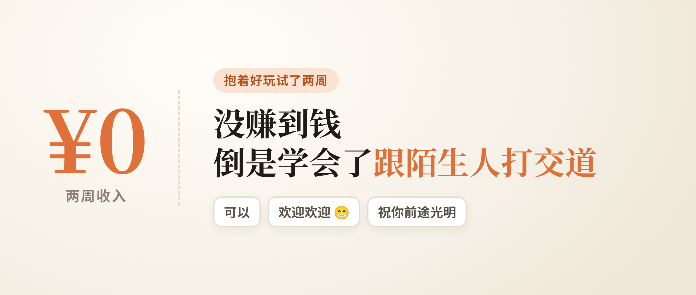
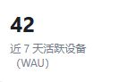
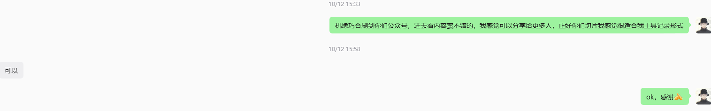
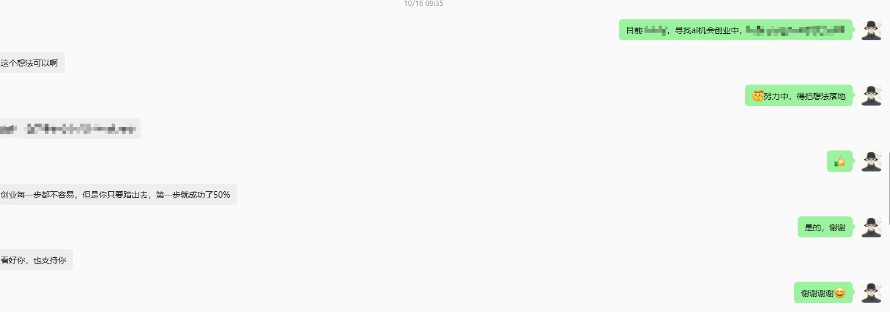
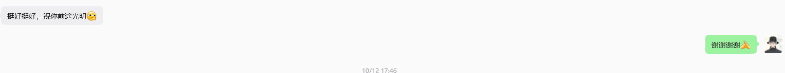
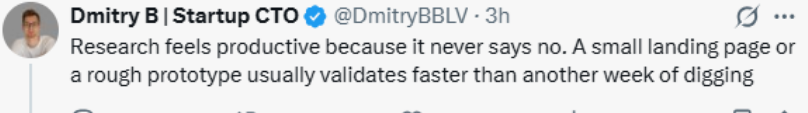

2026-10-24 发布 · 作者 chokebit3xp

10 月中旬我抱着好玩做了个小实验：把自己做的柔术笔记工具 BJJ Sequence 分享给更多人，顺手给自己定了个小目标：10 月 24 日前，有一个陌生人愿意付费。今天到期，写个复盘。

## 一分钟看完

- **结果**：一分钱没赚到。但近 7 天有 42 台设备在用（已排除我自己和测试设备）。
- **学到最多的**：怎么跟陌生人开口。自我介绍、说明目的、礼貌询问，发完就去忙别的，成不成都不亏。
- **做得不好的**：群建晚了、评论区运营起步晚、转化排得太靠后、中间有过滑档。
- **接下来**：换个打法，先找到有需求的人，再做产品。

---

## 为什么做这件事

1. AI 确实变聪明了，据我了解，最近在一些数学难题上都有突破。但它能不能帮我这个新手麻瓜变现，我想试试。（变现其实是其次，最主要是想看看 AI 能不能帮我去触达用户。）
2. 我自认为行动力不错，但旧的思维很难打破，得逼自己去做正确但难为情的事。说白了，就是没直面过市场。思维驱动行动，行动塑造新思维。
3. 向 levelsio 学习。他是国外很有名的独立开发者，一个人做了好几款赚钱的产品，还公开分享自己的收入。
4. 手头这个产品正好做完了，想看看怎么分享给更多人用。

## 先说赚钱：两种打法

**第一种：做自己喜欢的、自己需要的东西**，最好这个需求很多陌生人也有，这样才有可能赚钱。

**第二种：直接找到有痛点的人群**，确认需求能不能系统化、自动化，快速做出一个最小可用的产品，直接卖给用户验证。

> 找需求用户 → 理解背后的需求 → 做产品满足需求
>
> 再结合流量：通过 SEO、SEM、GEO 获取流量 → 网站承接流量 → 流量变现

我这次走的是第一种。它有点像旧式打法，从尽快变现的角度看，也是我的短板：这种真的是用爱发电，市场得你自己去找。在没有收入的情况下，我应该尽快做能变现的事。

**先做产品、再找用户，这也是大部分技术人的通病吧。** 我稍微好一点的是，一开始就给自己限定了时间。看到不少人闷头造产品很久，一发出去直接没下文了。

第二种才是主流，有长期复利的能力。除了销售能力，还要有洞察需求、对市场敏感的能力，这在 AI 时代绝对是不可替代的。说到底，还是要和人建立联系。

## 结果：数据一般，但有正反馈

一分钱没赚到。不过还是有不错的正反馈，可以看看周活跃：

近 7 天有 42 台设备在用（已排除我自己和测试设备），说明产品真的有人在用。这是国内站点的数字，国内站点难就难在大家不付费，哈哈哈。问了一些用户，都说功能确实不错，这点我还挺有自信的：我自己一直在用，功能都是从实际问题出发做的。

至少在我这次实验里，AI 没能直接帮我变现。下面说两件比数据值钱的事：学到了什么，哪里做得不好。

## 一、学到了什么

### 1. 怎么跟陌生人开口：自我介绍，说明目的，礼貌询问

一开始觉得跟不认识的人谈合作很尴尬。后来想通了：先行动，再看结果。

我做的东西都是用心做的，对方跟我合作零成本：不用出钱，也不用干活，东西做出来，流量来了就是白赚的。我发完消息就继续忙别的事，避免内耗。成了就成，不成也不亏。

第一次收到回复，收获还是不少，很感激陌生人的正反馈。尤其是自己做生意的人，可能也看我比较真诚，反馈都挺好。

### 2. 东西要演示给人看，目的要直说

给别人看实际演示，让人看得见，而不是光靠文字。

直接说目的，不浪费大家时间；涉及利益，也直接说。

### 3. 找高质量的合作，被拒绝就停，别浪费自己的时间

教育成本很贵。有些人观念比较旧，或者很抗拒新事物，你花再多时间跟他讲，付出一点成本能提高效率、带来价值，他也不愿意试。这种不用再花时间聊了。

### 4. 真人反馈比后台数据值钱

东西做得再好，只要没人付费，没和用户建立起反馈，你基本没法改进，也赚不到钱。

## 二、哪里做得不好

**1. 群建晚了。**

最开始分享产品时没建群，最早那波看到的人就这么流失了。

为什么是建群，而不是让大家直接加开发者？国内普通用户大多没有直接加开发者的习惯，总想着直接找开发者提问，是我的技术思维。不过开发者的联系方式也得留着，这里可能有 ToB 的机会。

**2. 评论区运营起步晚。**

有篇笔记 0 评论 0 转发。后来才发现，置顶一条引导留言、再逐条回复，互动明显多了。这个动作第一篇就该做。

**3. 转化排得太靠后。**

前面一直在做触达和内容，转化放到了最后，到今天还没等来第一笔陌生人付费，这也是原因之一。

**4. 内容有过滑档。**

发过一篇失败的，发布时段、标题、形式全踩错了，浏览只有个位数；也有一两天什么都没做。

## 三、最后

人这一辈子都离不开经济基础。行情好的时候，很多问题都不是问题；环境不好的时候，更要尽早建立不依赖平台、能长期复利的能力。

我目前的一点小见解，最值得练的是这几种能力：

- 找到需求用户（customer discovery）
- 洞察需求、对市场敏感
- 销售、运营、转化
- 技术托底

还有三个问题，我会一直问自己：流量沉淀在哪？怎么触达潜在的需求用户？需求有没有转化变现的可能？

“怎么和陌生人建立联系”这一课，已经值回这次尝试了。后面我会按第二种方式，继续在出海 SEO、GEO 和独立站上深耕。

喜欢练柔术的小伙伴欢迎来玩：[BJJ Sequence](https://bjjsequence.cn/)。

## 四、小彩蛋

分发的时候，有个老外评论挺有意思：他做 SaaS 凉了一年，问大家应该先营销还是先写代码。

另一个老外的回复，我觉得很适合分享给正在做研究、迟迟不动手的朋友：

> Research feels productive because it never says no. A small landing page or a rough prototype usually validates faster than another week of digging.
>
> 研究让人觉得很有成就感，因为它从来不会拒绝你。一个简单的落地页或者粗糙的原型，往往比再埋头研究一周验证得更快。

---

参考：

- BJJ Sequence（柔术笔记工具）：https://bjjsequence.cn/
