最近我花了一些时间研究 GPT Plus / Pro 代充、CDK、卡台、AI API 中转站，以及一些相关的开源项目。

一开始，我以为这只是一个很简单的生意：

> 用户付钱，商家帮用户开通会员，然后赚一点差价。

但越往下研究，越发现事情没有这么简单。

一个表面上只有"付款 → 输入卡密 → 提交账号信息 → 等几分钟 → Plus 到账"的页面，背后可能已经存在一条完整的数字服务供应链：

```
用户
↓
零售商
↓
商城 / CDK
↓
任务调度系统
↓
上游 API
↓
卡台 / 资源供应商
↓
支付资源
↓
OpenAI / Apple / 其他官方平台
```

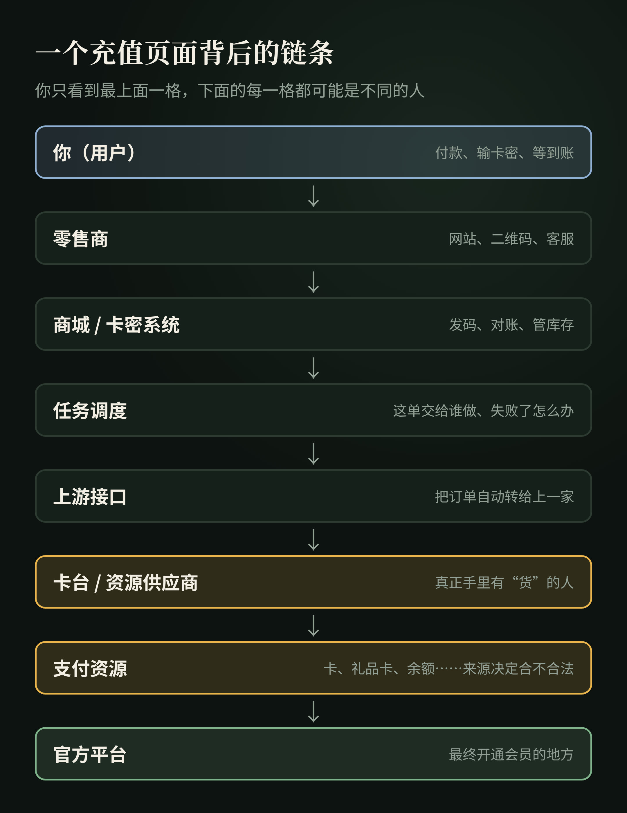

而如果把视野从 GPT 代充扩大到 AI API 中转站，会发现两者底层逻辑极其相似。

它们卖的表面上是 ChatGPT Plus、Claude 订阅、API Token、API Key、模型调用额度。

但从系统和商业角度看，它们真正交易的是同一种东西：

> **可以被标准化、调度、计费和再次分销的数字服务履约能力。**

这篇文章试着把这件事彻底拆开。

**本文只讨论产业结构、公开技术和商业逻辑，不涉及绕过安全控制、盗取账号、支付欺诈等操作方法，也不提供任何购买或充值渠道。**

---

## 一、我为什么会研究这个

**第一，我自己就在这个圈子里。**

我每天都要用 AI 干活，订阅、API 调用，每个月都是一笔固定开销。要是真有更便宜、又靠谱的渠道，我自己就能省一笔钱。

**第二，网上太多人在说：这行真真真太赚钱了。**

晒截图的、晒流水的、拉群招代理的，到处都是。

赚到大钱的那批人确实存在，但基本都是入场早、执行快的。现在从 0 开始，可能也能赚，但没那么夸张了。

所以我更想搞清楚一件事：

> **别人说的"赚钱"，到底是他真的在赚钱，还是在赚你的中介费？**

### 外行也能做的一道估算题

不需要任何内部数据，用公开能看到的信息就能粗算。

**第一步：先看他靠什么赚钱。**

- 如果他真的在卖货、交货，收入来自一单一单的差价；
- 如果他主要在卖课、招代理、收加盟费，那他赚的，很可能就是你的入场费。

> 还记得那句老话吗：如果教人赚钱的方法真能赚钱，他自己去用就好了，何必收费教你？

**第二步：估单量。**看店铺页面上的"已售""月销"，或者评价的数量。留评价的只是一部分买家，实际订单只会比评价多。

**第三步：算流水。**单量 × 客单价。

**第四步：算毛利。**每单售价 − 上游成本。不同卖家之间的报价差，基本就是上一层的利润空间。

**第五步：再打个折。**退款、售后、被封号、上游跑路，都会吃掉利润。

**第六步：拿结果对照他晒的收入。**

举个**假设**的例子（数字是我编的，只为演示算法）：

> 一家店月销 3000 单，客单价 140 元，月流水约 42 万；
>
> 每单毛利 20 元，毛利约 6 万；
>
> 扣掉退款、售后和损耗，按八折算，实际到手大概 5 万左右。

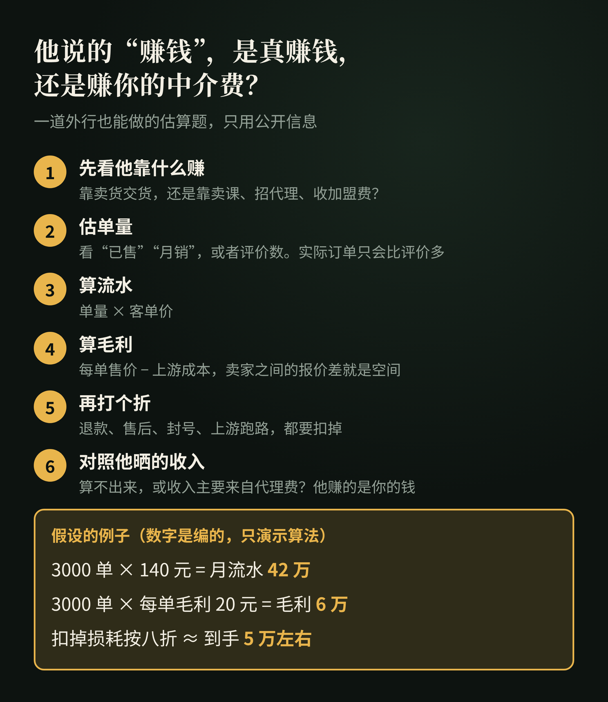

如果一个人号称"月入 30 万"，但你按这个方法怎么算都算不出来；或者他的收入主要来自"代理费""课程费"，那答案就很清楚了：**他赚的不是这门生意的钱，是你的钱。**

带着这个问题往下研究，我发现了一条比想象中长得多的链。

---

## 二、先不要研究"怎么充"，先问：到底卖的是什么？

GPT 相关第三方服务，至少可以分成三类。

### 1. 成品账号

商家提前准备好一个已经开通会员的 ChatGPT 账号，然后把账号整体卖给用户。

这种模式里：账号 + 会员 = 商品。

用户购买的实际上不是自己原账号的升级，而是另外一个账号。

### 2. 共享账号 / API 中转

商家拥有 API、订阅账号或其他模型资源，再搭一个自己的入口。

用户购买的是**调用额度**，而不是自己的 ChatGPT 账号真正变成 Plus。

典型形式包括：

- API 中转站
- Web 聊天站
- 多模型聚合平台
- Claude / GPT / Gemini 统一接口

### 3. 原号代充

用户已经拥有自己的 ChatGPT 账号。商家需要完成的是：让用户自己的账号获得 Plus / Pro 权益。

这里就出现了整个问题最关键的两个变量：

> **给谁？** 和 **谁付款？**

也就是 **Identity + Payment**，身份与支付。

理解这两个词，后面所有 CDK、Session、卡池、卡台、API 都会变得清楚。

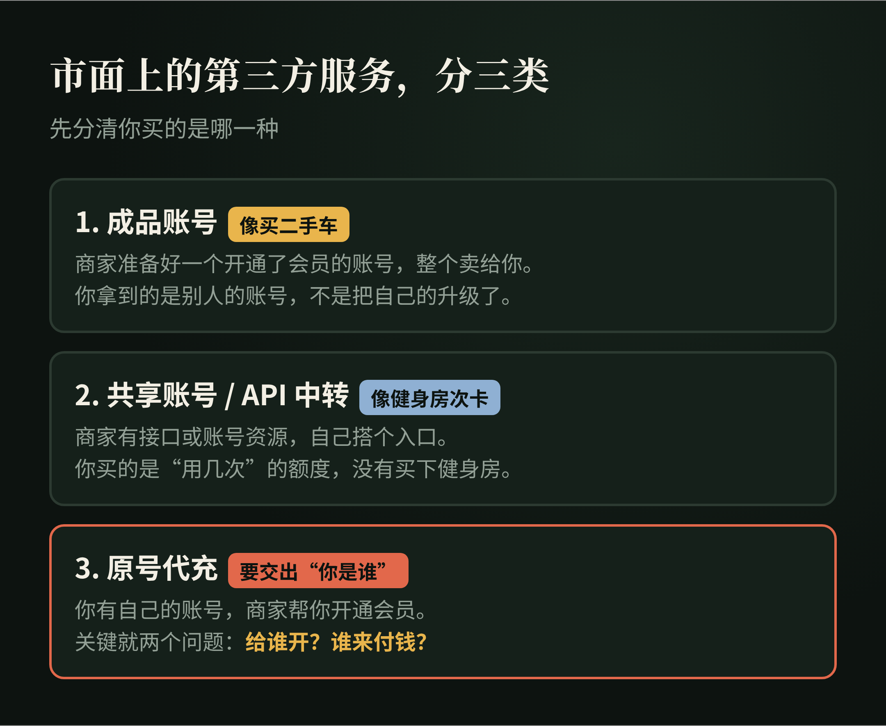

---

## 三、CDK 到底是什么？

CDK 是 CD-Key 的缩写，原指早年游戏光盘上的序列号，现在泛指卡密、激活码、兑换码、提货码。

例如：`PLUS-A8F2-K91X`

很多人第一次看到，会自然认为：这是 OpenAI 官方发行的一张 GPT Plus 礼品卡。

实际上，大量第三方代充系统里的 CDK 并不是官方兑换码。它只是商家自己的数据库认可的一串字符串：

```
CDK: PLUS-A8F2-K91X
SKU: ChatGPT Plus
Quantity: 1
Status: unused
```

用户提交以后，商家的系统检查：这张码是否存在？是否已经使用？对应哪个商品？是否允许开始履约？

所以 CDK 真正解决的是：

- 对账；
- 防止重复兑换；
- 商品库存；
- 代理分销；
- 把"付款"和"真正交付"拆开。

它甚至不是整个系统必需的。完全可以"用户付款 → 订单号 → 直接开始履约"，而不经过 CDK。

据我了解，这类 CDK 基本都是零售商自己发行的内部提货凭证，而不是 OpenAI、Apple 或 Stripe 认识的官方激活码。

### 一个最简单的比喻

假设我是小学生。我在纸上随便写 `83957291`，然后告诉班里的人：

> 谁拿这张纸来找我，我就帮他充 30 元 Q 币。

小明、小胖帮我把这张纸卖出去。

那么 `83957291` 本身有没有价值？没有。

它的价值来自：

> **我是否承诺认这串数字，并且有能力履约。**

如果哪天我转学了，`83957291` 就只剩一串数字。拿着它去找腾讯，腾讯不会知道它是什么。

这就是绝大多数第三方 CDK 最核心的属性：

> **它是信用凭证，不是底层资产。**

### 兑换失败了，谁来负责？

把"付钱"和"交货"拆开，对商家很方便，对你却多了一层风险。

假设你在一家店买了卡密，兑换时失败了。你找店家，店家说"上游出问题了，等等"；再过几天，店家说"上游跑路了"。

这时你手里只剩一串字符，而这串字符，只有那家店认。

> 就像你买了一张理发店的储值卡，结果店关门了。卡还在你手里，但没人认了。

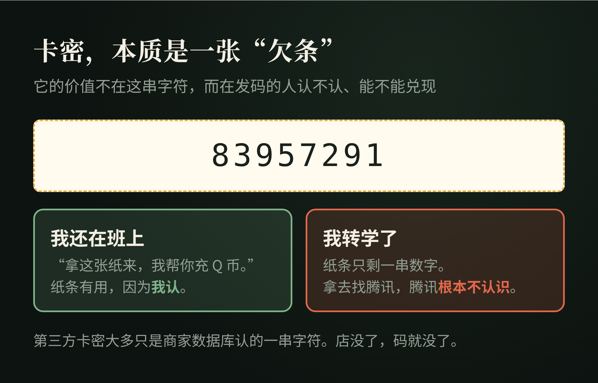

---

## 四、Session：不是钱，而是"你是谁"

原号代充里，比 CDK 更重要的是 Session。

Session 可以粗略理解成：

> **一个已经登录状态下的会话身份凭证。**

它解决的问题不是"钱从哪里来"，而是：

> **"这笔操作对应哪个 ChatGPT 用户？"**

因此可以把两个概念分开：

```
Session        → Who?   → 给谁？
Card / Apple   → Paid?  → 谁来付款？
```

据我了解，这类系统里，这两类信息是明确分开的：一类是 ChatGPT 身份，一类是支付身份。

这也是为什么原号代充的风险，比普通买一个兑换码高：**你交出去的可能不是一个普通订单号，而是具有账号身份意义的认证信息。**

截至 2026 年 10 月，OpenAI 个人使用条款写明，用户不得共享账号凭证，也不得把账号提供给其他人使用；OpenAI 的账户共享政策同样指出，账号供创建者本人使用。

所以这里需要区分两个问题：

> **技术上能不能实现**，和 **是否符合平台规则**。

这是完全不同的事情。

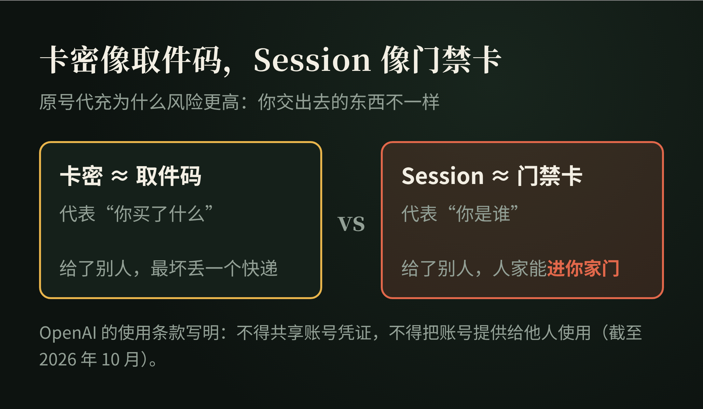

---

## 五、真正的"货"是什么？

研究到这里，会出现一个很有意思的问题。

如果 CDK 不是货，Session 不是货，网站也不是货，那么代充商真正卖的到底是什么？

答案是：

> **履约能力（Fulfillment）。**

也就是：收到订单以后，最终真正把商品或权益交付出去的能力。

例如一家上游对下游说：

```
你给我：
ChatGPT 用户身份 + Plus 套餐 + 一笔费用

我给你：
success / failed
```

那么下游真正采购的是：

> **"把某个账号变成某种套餐"的服务能力。**

而不是某个神秘字符串。

这一步理解以后，"卡台"这个词也就变得简单了。

---

## 六、什么是"卡台"？

"卡台"不是一个严格的软件工程术语，更像行业俗称。

在代充供应链中，可以把它理解为：

> **掌握某种真实支付资源或订阅履约能力的上游供应商。**

它可能拥有：

- 可正常完成支付的银行卡资源；
- Apple ID / App Store 支付资源；
- 合法礼品卡余额；
- 不同地区的支付能力；
- 上一级供应商账户；
- 自动化执行环境；
- 一套自己的订单 API。

因此，零售商向卡台采购的不是"一张银行卡"，而是：

> **一次成功履约的能力。**

据我了解，卡台就是真正持有订阅履约资源的那一层，零售商向它买的是把目标账号升级为某个套餐的能力。

---

## 七、卡池又是什么？

卡池，英文可以理解为 **Card Pool**。

它不是发卡平台，更不是"一个可以凭空生成 Visa 卡的网站"。

它只是：

> **一组已经存在的支付卡资源，由系统记录状态、分配使用。**

公开项目 KC-PAY-GPT（github.com/KC-CatK/KC-PAY-GPT，2026-10 查看）就包含卡池管理、浏览器池、支付重试、Stripe Checkout 自动化等模块，其项目目录中可以直接看到 `stripe-payment.js`、`browser-pool.js`、`payment-retry.js`、`session-auth.js` 等文件。

但是：

> **拥有卡池管理程序，不等于拥有发卡能力。**

真正发行一张 Visa / Mastercard，需要合法的金融发行体系。所以：

```
Card Pool ≠ Issuer
```

这里的 **Issuer** 指发卡机构。

软件可以管理卡。软件不能凭空创造一张真正能够完成清算的银行卡。

这一点非常重要。卡从哪里来，决定了整条链是正常生意还是违法行为。

---

## 八、KC-PAY-GPT：一个很好的"调度层"样本

KC-PAY-GPT 是研究这套产业链时非常有代表性的公开项目。

它的意义并不是"GitHub 上有人开源了一个制造 GPT Plus 的程序"，而是：

> **它公开展示了数字服务履约系统的中间层是如何组织的。**

项目公开结构里同时存在：CDK、Session、任务调度、数据库、卡池、浏览器池、支付重试、第三方 API。

它的角色更接近：

```
            用户
              │
       CDK + Session
              │
              ▼
      ┌──────────────┐
      │  KC-PAY-GPT  │
      │  订单 / 身份  │
      │  任务 / 状态  │
      └──────┬───────┘
             │
   ┌─────────┴─────────┐
   ▼                   ▼
本地执行             上游 API
   │                   │
支付资源               │
   └─────────┬─────────┘
             ▼
          官方系统
```

这里出现了一个非常重要的商业现象：

> **零售商甚至不需要拥有真正的支付资源。**

它只需要：收用户的钱 → 收到订单 → 通过 API 提交给上游 → 等待 success / failed。

据我了解，这就是所谓的"调度层"：零售商可以完全不拥有真正的支付能力，只需要把订单交给卡台。

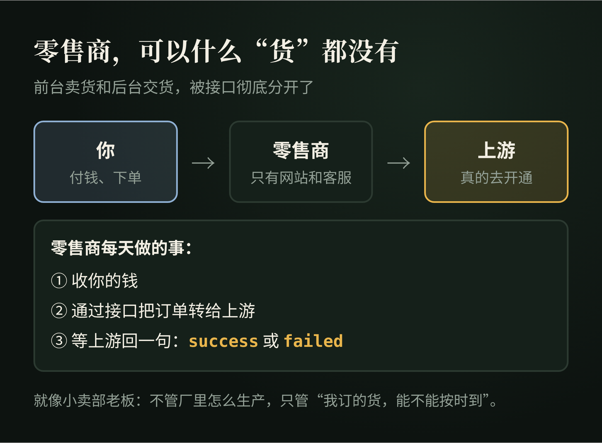

---

## 九、API 为什么是这条产业链最重要的放大器？

API 全称 **Application Programming Interface**，应用程序编程接口。

最重要的作用是：

> **让两个软件自动说话。**

上游只需要提供几个接口：获取商品、查询余额、创建订单、查询订单。

下游就可以自己建立网站、品牌、价格、支付、客户。

用户的钱进入下游，下游再自动从上游采购。于是，**前台销售**和**后台履约**彻底分开。

这就是现代数字商品分销非常核心的结构，也是上一节"零售商不需要拥有支付资源"能成立的原因。

---

## 十、然后我发现：AI API 中转站其实是同一门生意

研究完代充，再去看 AI API 中转站，会发现两者的结构几乎一模一样。

所谓中转站，可以粗略理解为：

> 用户不直接连接模型提供商，而是先连接一个中间 Gateway。

```
用户
↓
API Gateway
↓
OpenAI / Anthropic / Google / AWS / Azure ...
```

用户一般只获得两个东西：**Base URL + API Key**。

### Base URL 是什么？

API 请求发往哪里的基础地址，例如 `https://example.com/v1`。

客户端把请求发过去。至于 Gateway 后面真正连接的是 OpenAI、Claude、Gemini、Azure 还是 AWS，客户端可能根本不知道。

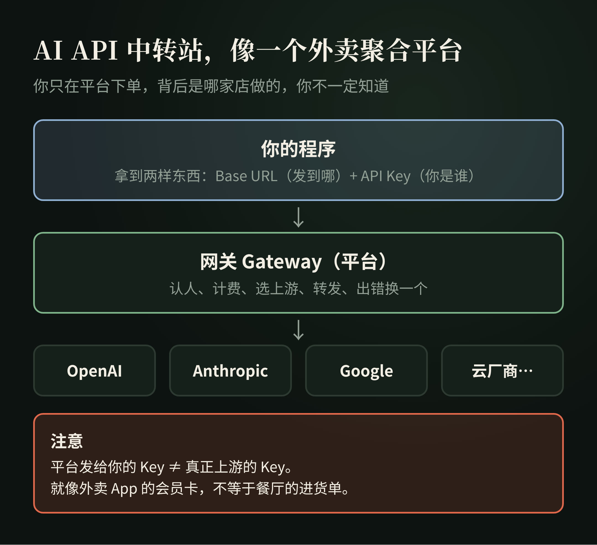

### API Key 是什么？

调用 API 的身份凭证。它告诉 Gateway：你是谁、剩多少余额、允许调用什么模型、该怎么计费。

注意：**用户拿到的 API Key，不一定等于真正模型供应商的 API Key。**

中转站完全可以自己生成一个 Key 给用户，内部再映射到自己的上游资源。

---

## 十一、API Gateway 才是"中转站"的技术核心

Gateway 的意思是**网关**。

一个成熟的 AI Gateway 通常负责：鉴权、计费、路由、限流、额度、日志、负载均衡、失败切换、模型映射。

例如经典开源项目 One API（github.com/songquanpeng/one-api），README 里直接写着"可用于 key 管理与二次分发"，支持多个渠道接入、负载均衡、Token 管理、渠道管理、额度管理和用户分组等能力。

New API（github.com/QuantumNous/new-api）则把自己的定位写成：

> A unified AI model hub for aggregation & distribution.（统一的 AI 模型枢纽，用于聚合和分发。）

支持把不同的大模型统一转换成 OpenAI、Claude 或 Gemini 兼容的格式。

所以"中转站"真正的技术本质并不神秘：

```
用户请求 → Gateway → 选择一个上游 → 转发 → 获取结果 → 返回用户
```

---

## 十二、什么是 Key Pool？

和 Card Pool 几乎完全一样。

**Key Pool = API Key Pool**，一组可以调用上游模型的 API Key。

Gateway 可以根据余额、速率限制、当前压力、模型、可用状态，决定这次请求使用哪个 Key。

因此可以发现一个很有意思的对称关系：

```
代充产业：订单 → Card Pool → 选择支付资源
API 中转：请求 → Key Pool  → 选择模型资源
```

底层其实是同一种计算机系统思想：

> **Resource Pooling，资源池化。**

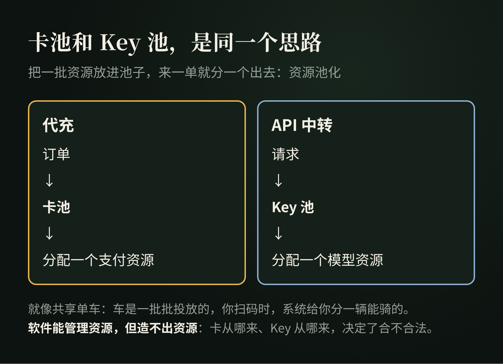

---

## 十三、Gateway 的几个基本功：负载均衡、限流、重试

### Load Balancing：负载均衡

假设系统有 Key A、Key B、Key C。如果所有流量都打到 A：A 爆掉，B 和 C 闲着，显然不合理。

所以 Gateway 会把请求分散：请求 1 → A，请求 2 → B，请求 3 → C。One API 就支持多个渠道之间的负载均衡。

### Rate Limit：速率限制

模型供应商通常不会允许无限高速调用。两个常见指标：

- **RPM**（Requests Per Minute）：每分钟最多多少个请求；
- **TPM**（Tokens Per Minute）：每分钟最多处理多少 Token。

当资源达到限制时，系统可能等待、换 Key、换上游，或者稍后重试。

于是又出现几个重要的词：

- **Retry**：重试；
- **Failover**：故障转移；
- **Queue**：任务排队；
- **Concurrency**：并发数。

---

## 十四、Sub2API 又多做了一层什么？

一些更激进的系统，不只是聚合正规 API。它们会尝试：

> 把某些订阅额度重新包装成 API 能力。

这通常被称为 **Subscription-to-API**，或者 **Sub-to-API / 2API**。

公开项目 Sub2API（github.com/Wei-Shaw/sub2api，2026-10 查看）当前把自己描述为：

> AI API Gateway Platform for Subscription Quota Distribution

它提供：多账号管理、API Key 分发、Token 级计费、Smart Scheduling、Sticky Session、Concurrency Control、Rate Limiting、Request Forwarding，还内置了支付系统。

项目 README 里自己也写了一条醒目的风险提示：

> 使用本项目可能违反 Anthropic 等上游服务商的服务条款，所有风险由使用者自行承担。

所以需要再次强调：

> **技术上存在某种实现，不代表平台允许这种商业用途。**

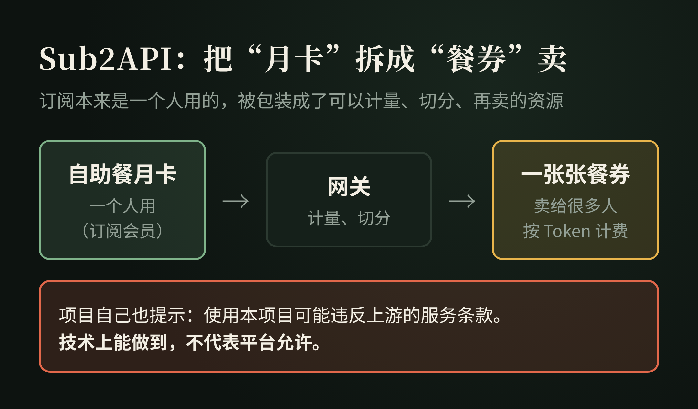

---

## 十五、Subscription-to-API 为什么这么有意思？

因为它实际上完成了一次商品形态转换。

原来的商品是 **$20 / month subscription**：一个用户，使用一个产品。

经过 Gateway 以后，商品被抽象成 **API Request、Token、Quota**：一个资源，可以计量、可以切片、可以分配、可以再卖。

这个过程非常重要。它就是：

> **把不可标准化的订阅，重新包装成可计量的数字资源。**

这和云计算的思维很像。一整台物理服务器，经过虚拟化，被拆成 CPU、RAM、Storage，再卖给不同用户。

AI 服务的中间层做的某些事情，本质上也类似：

```
上游能力 → 资源化 → 计量 → 路由 → 分销
```

---

## 十六、所以"中转站"不能只分成正规和山寨

从技术结构看，至少可以分三种。

### 第一种：正规 API Gateway

官方 API → Gateway → 客户。

Gateway 解决统一接口、计费、路由、监控、多模型管理。这完全可以是一门正常的 SaaS 生意。

### 第二种：资源池 Gateway

多个 Key / Account → Pool → Gateway → 客户。

核心竞争力变成资源数量、调度能力、可用性、成本。

### 第三种：非官方协议适配

订阅 / 客户端 → 协议适配 → 统一 API → 用户。

这一类的稳定性和平台规则风险通常都更高。

---

## 十七、为什么到处都是"二道贩子"？

不管是代充还是 API 中转，都会出现层层转手。

先看代充。假设真正上游的履约成本是 100 元：

```
一级供应商：100 → 110
二级代理：  110 → 120
博主：      120 → 139
```

最终消费者看到的，可能只是一个网站、一个二维码、一个客服。但后台实际上可能已经经过：

```
消费者 → 博主 → 零售商城 → API 服务商 → 上游卡台 → 支付资源 → 官方
```

API 中转也一样，因为 API 天然适合继续转 API：

```
OpenAI / Anthropic → A Gateway → B 中转站 → C 中转站 → 开发者 → 最终用户
```

只要 **成本 < 售价**，每一层都可以存在。

为什么每一层都能赚一点？因为每一层都可能提供不同的价值：流量、客服、中文支付、售后、界面、品牌、渠道、API、自动化、真正履约。

所以"二道贩子"并不只是某种道德描述。从商业上看，它本质上就是：

> **Reseller，分销商。**

很多传统产业链本来就是这样运行的。

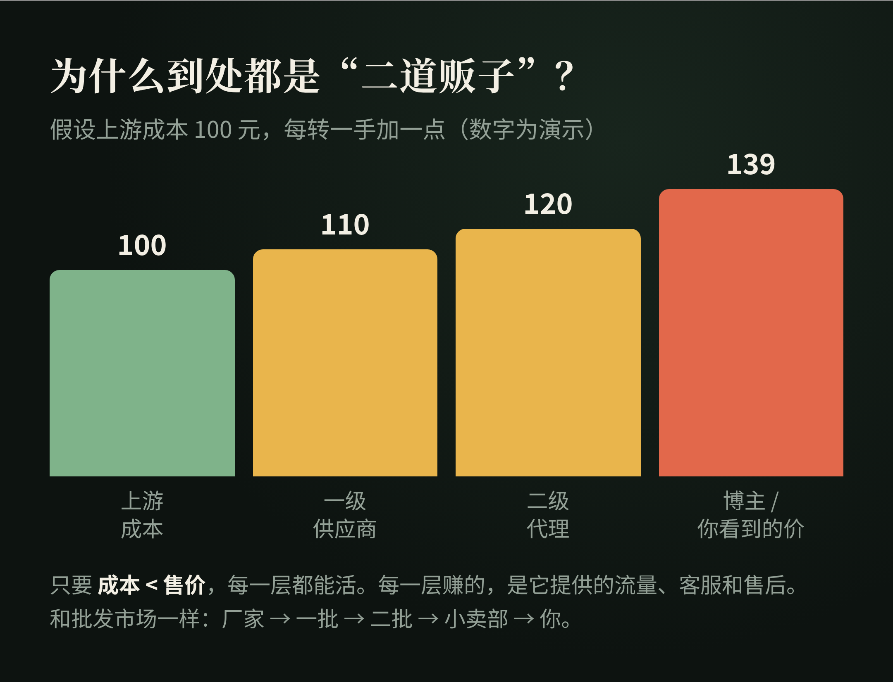

这也意味着：你看到不同的网站、不同的品牌、不同的充值页面，背后并不一定是不同的真实资源，它们可能最终汇聚到同一个上游。

---

## 十八、所谓"官转、满血、阉割、降智"到底是什么意思？

这些词大部分不是严格的技术术语，而是行业黑话。

### 官转

通常指上游仍然使用正规官方 API。

但"官转"不是经过官方认证的标准术语。商家说自己"纯官转"，不能自动证明资源来源。

### 满血

通常表示没有人为降低模型能力，比如没有换模型、砍上下文、限制工具、额外注入 Prompt。

同样，这是营销和社区语言，不是正式的技术等级。

### 阉割

通常表示用户获得的实际能力低于宣传的模型能力，可能表现为上下文缩水、功能缺失、参数限制。

### Model Swap

模型替换。例如用户以为请求的是 Model A，实际被路由到了 Model B。

这也是中转平台非常重要的信任问题。

### 用户一般是怎么察觉的？

模型被换了，商家一般不会告诉你。用户往往是从一些"不对劲"里感觉出来的：

- 同样的问题，回答风格突然变了，或者明显变笨了；
- 稍长一点的对话，前面说过的事它就"忘了"，说明上下文可能被砍了；
- 一些官方版本能用的功能，在这里用不了；
- 同样的用量，扣费对不上。

要注意：直接问模型"你是谁"，**并不可靠**，因为模型的自我介绍是可以被提示词改掉的。这些迹象只能让你起疑，没法帮你下结论。

---

## 十九、为什么"便宜"本身解释不了上游？

研究这些行业时，很容易出现一个错误判断：

> 价格特别低，一定是黑产。

这不能直接成立。低价格可能来自很多因素：补贴、企业合同、批量价格、地区差异、缓存、不同模型、免费额度、上游促销。

但反过来也一样：

> 价格便宜，不能证明资源合法。

所以研究一个供应链时，比价格更重要的问题是：

> **它的资源到底从哪里来？**

---

## 二十、钱和资源到底从哪里来？

这是研究到最后，我认为最重要的问题。

对于代充：卡从哪里来？Apple 余额从哪里来？礼品卡从哪里来？付款资金从哪里来？

对于 API 中转：API Key 从哪里来？账号从哪里来？额度从哪里来？为什么能以这个价格长期供应？

这里才真正决定了：**合法性、稳定性、长期性、风险、利润**。

而不是网站 UI 好不好看、代码是不是开源。

---

## 二十一、这条产业链一定包含黑灰产吗？

不一定。

分销本身完全可以是正常的商业模式：官方 → 授权渠道 → 经销商 → 用户。大量传统行业都是这种结构。

AI Gateway 本身也是正常的软件基础设施。企业内部完全可能合法使用 Gateway，来统一管理 OpenAI、Anthropic、Bedrock、Vertex、Azure。New API 的 README 也写明：本项目仅用于合法、经授权的 AI API 网关、组织级认证、多模型管理、用量分析、成本核算和私有部署场景；用户必须合法获取上游的 Key、账号和服务，并遵守上游服务条款和法律法规。

真正决定性质的是：

> **身份、支付、额度和账号资源，是否来自合法授权。**

风险较高的情况通常包括：盗刷、盗号、窃取凭证、未经授权共享账户、支付欺诈、恶意退款、绕过访问控制。

所以不能简单写成"GPT 代充 = 黑产"。更准确的是：

> **这是一条第三方数字服务供应链，其中既可能存在正常的代理和技术服务，也可能混入未经授权甚至违法的支付、账号和身份资源。**

---

## 二十二、用户视角：怎么判断靠不靠谱？

这一节不告诉你去哪买，只告诉你遇到时，可以先问自己几个问题。

**1. 这个卡密是谁发的？**

是官方礼品卡，还是商家自己数据库里的码？如果是后者，它的价值就完全取决于这家店能撑多久。

**2. 要不要交出登录凭证？**

只要要求你提供账号密码、登录状态或者类似的凭证，就要格外小心。你交出去的是"门禁卡"。

**3. 出了问题找谁？**

有没有明确的售后规则？失败了能不能退？退款要等多久？如果对方只有一个微信号，跑了就真的找不到人。

**4. 价格是不是低得离谱？**

便宜不一定有问题，但低得离谱时，就要多问一句：它的资源，凭什么能长期这么便宜？

**5. 宣传的"官转""满血"，你能验证吗？**

大多数时候不能。这些词只是宣传语，不是保证。

**6. 你一次充了多少？**

预付越多、时间越长，风险越大。按月、少量，比一次性充一年稳得多。

这六个问题，回答越多"不知道"，风险就越高。

---

## 二十三、普通人最该知道的风险：钱

如果你是买家，或者想做其中的一环，最大的风险永远是资金。

只要不是一个人、或者自己的团队把所有环节都解决，在卡台这个资金环节，就一定存在风险。

无论你做几手中介，还是直接对接卡台，都要先把钱垫给别人。对方随时可能跑路。

这里特别强调：这是**危险**，而且是极其危险的。

---

## 二十四、把整个系统抽象成七层

研究到这里，可以把代充、中转、卡密、API 全部放进同一个模型。为了好记，每一层都拿"点一杯外卖奶茶"来对照。

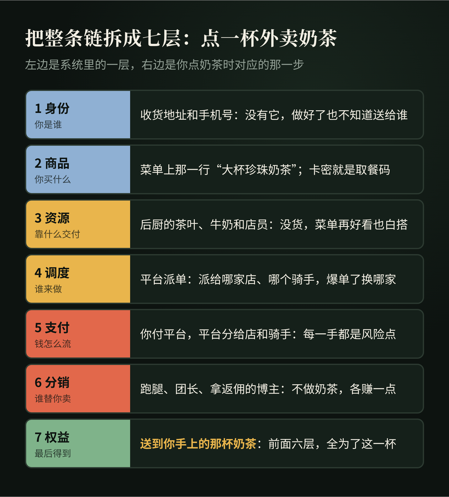

### 第一层：Identity，身份层

解决"你是谁"。包括 Session、OAuth、API Key、Account。

> 比喻：收货地址和手机号：没有它，奶茶做好了也不知道送给谁。

### 第二层：Product，商品层

解决"你购买什么"。例如 CDK、Plus、Pro、API Quota、SKU。

SKU 是 **Stock Keeping Unit**，库存单位。数字商品同样可以有 SKU。

> 比喻：菜单上那一行"大杯珍珠奶茶，少冰"；卡密就像取餐码，代表你买了这一行，但它本身不是奶茶。

### 第三层：Resource，资源层

真正能够完成任务的东西。例如银行卡、Apple 支付资源、API Key、账号、模型额度。

> 比喻：后厨的茶叶、牛奶和店员：没货，菜单写得再好看也做不出来。

### 第四层：Orchestration，调度层

负责：哪个订单使用哪个资源、什么时候执行、失败怎么办。

典型概念：Pool、Queue、Routing、Load Balancing、Retry、Failover、Concurrency。

> 比喻：平台的派单系统：这单派给哪家店、哪个骑手，爆单了换哪家，超时了怎么办。

### 第五层：Payment，支付层

解决"钱如何流动"。包括银行卡、Stripe、Apple、支付宝、微信、USDT、钱包余额。

> 比喻：你付给平台，平台再分给店家和骑手：钱经过的每一手，都是一个风险点。

### 第六层：Distribution，分销层

解决"谁替你卖"。包括 Reseller、Affiliate、API、Distributor。

> 比喻：帮你下单的跑腿、拼单的团长、发券拿返佣的博主：他们不做奶茶，但每人都赚一点。

### 第七层：Entitlement，权益层

这是最后真正重要的结果。**Entitlement = 权益**，例如 ChatGPT 账号上的 Plus 权益，或者 API 账号里的 $100 额度。

最终用户真正购买的是：

> **系统认可的使用权。**

> 比喻：最后送到你手上的那杯奶茶：前面六层，全是为了这一杯。

这七层合起来，就是 **Digital Service Supply Chain，数字服务供应链**。

外面看到的一张卡密、一个网站、一个 API Key，只是接口。里面真正运行的是：身份、资源、资金、软件、渠道、信用。

---

## 二十五、这也解释了为什么真正稀缺的通常不是代码

研究这些开源项目后，一个非常明显的事实是：商城、CDK、订单、API Gateway、用户系统、计费、卡池、Key Pool、队列、负载均衡、任务调度、支付回调，都可以找到成熟实现。

- One API 已经公开提供渠道聚合、Token、额度、负载均衡等完整能力；
- Sub2API 进一步公开了多账号、计费、调度、Sticky Session、并发、Rate Limit、支付；
- KC-PAY-GPT 又展示了 CDK、Session、浏览器池、支付重试、第三方上游 API。

所以真正长期稀缺的，通常不是"我会不会写 API"，而是：

**可靠供应、合法资源、低成本、稳定交付、风险控制、用户信任、获客渠道。**

用一句话概括：

> 真正稀缺的并不是自动付款代码，而是支付资源。

---

## 二十六、这门生意，现在还值得进吗？

回到开头那个问题：这行到底赚不赚钱？

**早进场的人，确实赚到了。**他们吃到的是信息差：知道的人少，会做的人更少，需求又大，利润自然高。

**但从"想到"到"做到"，中间的距离很长。**

同样一个机会，有人看到了，第二天就开始找上游、搭网站、拉第一批客户，赚到了一波钱；而同时看到它的其他人，可能到今天还在想"这个能不能做""要不要试试"。

机会是同一个，结果完全不同，差的就是执行力。

**现在再从 0 进场，情况已经变了：**

- **价格战**：做的人多了，差价被一层层压薄；
- **平台风控**：上游平台对账号共享、异常支付的打击越来越严，封号就是直接亏损；
- **资金风险**：越往下游，越要先垫钱给上游，跑路的风险全在你身上；
- **规则风险**：有些做法本身就踩在平台条款，甚至法律的边上。

所以我的结论是：**现在从 0 进，可能还能赚，但远没有网上说的那么夸张；而且你承担的风险，比你看到的收益大得多。**

研究到这里，我选择了只研究、不下场。

但这趟研究并没有白做，因为它让我看清了另一件事。

---

## 二十七、作为独立开发者，我真正学到的是什么？

研究到这里以后，我反而对"自己去做 GPT 代充"这件事兴趣下降了。

但对它背后的基础设施，兴趣增加了。

因为这套结构完全可以脱离代充，用在正常的独立软件业务里：

```
用户 → 购买软件 → 支付 → 生成 License → 自动交付 → Webhook → 激活
```

然后再增加 Affiliate：别人帮你推广，系统自动计算佣金。

再进一步，开放 API：其他产品调用你的能力。

于是一个普通软件，就从"我做一个产品，我自己卖"，变成：

**产品 + 支付 + 自动交付 + License + API + 分销 + 计费。**

也就是：

> **一套能够自己运行的商业系统。**

### 商业上 1：每一层都自己做，成本比你想的高得多

很多人的第一反应是：中间商都在赚差价，那我全部自己做，不就把差价都赚了？

我粗略算了一下，每一层要付出的代价大概是这样：

| 环节 | 主要成本 | 难在哪 |
|---|---|---|
| 商城、卡密、收款 | 技术：有开源方案，搭起来几天 | 不难，最容易被高估的一环 |
| 对接上游、调度 | 技术：对接、测试、处理各种失败，一两周起 | 上游一改规则就得跟着改 |
| 资源本身（卡台那一层） | 资金 + 合规 | 不是技术问题，是钱和合法性的问题 |
| 客服、售后、退款 | 时间：每天都要有人回消息 | 最耗人，而且停不下来 |
| 风控 | 时间 + 损失：封号、拒付、坏账 | 出一次事，可能几个月白干 |
| 获客 | 时间 + 钱：内容、投放、渠道 | 没人买，前面全白搭 |

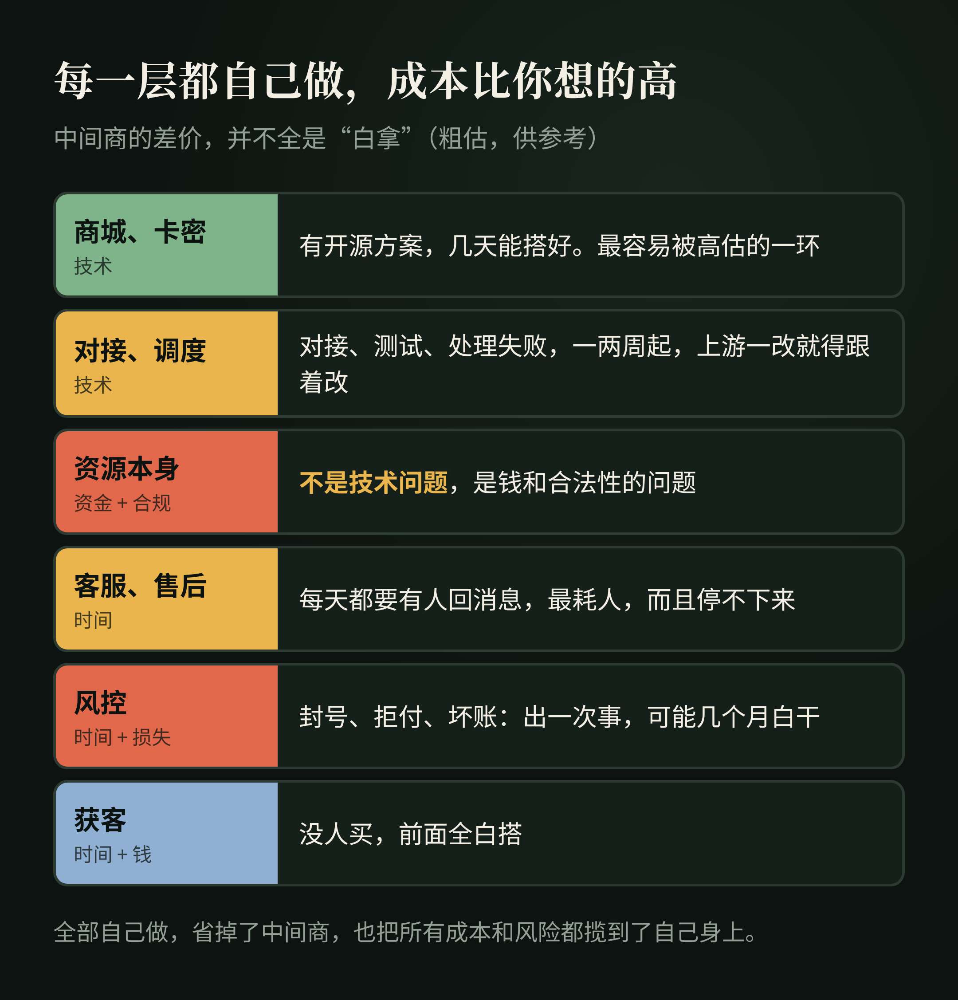

所以中间商赚的差价，并不全是"白拿"。每一层都在替别人承担一部分时间、技术、资金或风险。

**全部自己做，你确实省掉了中间商，但也把所有的成本和风险，都揽到了自己身上。**

### 商业上 2：真正稀缺的，是分工里你占哪一环

研究到最后我发现，这条链上活得最好的，不一定是技术最强的，而是在某一环有不可替代优势的：有资源的做上游，有技术的做调度，有流量的做分销。

想清楚自己最强的是哪一环，比"什么都自己干"重要得多。

### 商业上 3：研究完，我给自己留的四条底线

我也在想：如果哪天我真要自己做点小生意，我会先跟自己约法四章：

- **先有订单，再去拿货**：能按单结算就不提前垫钱，垫出去的钱就是风险；
- **要我先交钱才能"拿货"的，一律先打个问号**：按开头那道估算题算一遍，他赚的到底是货的钱，还是我的入场费；
- **只做合法、能长期做的东西**：踩在规则边上的生意，赚得再快，一次封号、一次跑路就全没了；
- **力气主要花在推广上**：货源越来越透明，最后拼的其实是能不能把东西卖出去。

这不是什么成功学，只是我研究完这一条链之后给自己留的底线。真要试，也小成本试；就算试错了，至少能看清自己缺的是货源、技术，还是获客能力。

---

## 二十八、独角数卡、One API、KC-PAY-GPT，本质上在解决同一种问题

表面看，它们完全不同：

- 独角数卡：卖数字商品；
- One API：卖 API 额度；
- KC-PAY-GPT：管理订阅履约任务。

但抽象一层以后，都是：

```
资源 → 标准化 → 生成商品 → 计费 → 分销 → 自动交付
```

它们全部属于：

> **数字资源商业化基础设施。**

这才是研究这些项目真正值得带走的东西。

---

## 二十九、术语速查

| 术语 | 全称 | 一句话理解 |
|---|---|---|
| CDK | CD-Key | 原指游戏光盘序列号，现泛指商家自己的兑换凭证 |
| Session | Session Credential | 当前登录身份凭证 |
| API | Application Programming Interface | 软件与软件之间的接口 |
| API Key | API Key | API 身份和权限凭证 |
| Base URL | Base URL | API 请求发送到哪里的基础地址 |
| Gateway | API Gateway | 统一管理 API 请求的网关 |
| Card Pool | Card Pool | 可调度的支付卡资源池 |
| Key Pool | API Key Pool | 可调度的 API Key 资源池 |
| Account Pool | Account Pool | 可调度的账号资源池 |
| Routing | Request Routing | 决定请求走哪个上游 |
| Load Balancing | Load Balancing | 将流量分配给多个资源 |
| Queue | Queue | 任务排队 |
| Retry | Retry | 失败后重试 |
| Failover | Failover | 上游失败后切换备用资源 |
| Concurrency | Concurrency | 同时处理多少任务 |
| Rate Limit | Rate Limit | 调用速率限制 |
| RPM | Requests Per Minute | 每分钟请求次数 |
| TPM | Tokens Per Minute | 每分钟 Token 数量 |
| Token | Token | 模型处理和计费的基本文本单位 |
| Context Window | Context Window | 模型一次可处理的上下文范围 |
| Streaming | Streaming | 流式返回结果 |
| SSE | Server-Sent Events | 常见的服务器流式推送机制 |
| OAuth | Open Authorization | 第三方授权协议 |
| SKU | Stock Keeping Unit | 商品库存 / 销售单位 |
| Reseller | Reseller | 从上游采购后再次销售 |
| Affiliate | Affiliate | 通过推广获得佣金 |
| Supplier | Supplier | 上游供应商 |
| Fulfillment | Fulfillment | 从订单到真正交付的过程 |
| Entitlement | Entitlement | 用户最终拥有的服务权益 |
| IAP | In-App Purchase | App 内购买 |
| StoreKit | StoreKit | Apple 的 App 内购框架 |
| Transaction | Transaction | 一次正式的交易记录 |
| Webhook | Webhook | 一个系统主动通知另一个系统某事发生 |
| MoR | Merchant of Record | 代表开发者处理销售、支付和部分税务事务的记录商户 |

---

## 最后

最开始研究 GPT 代充时，我的问题是："他们到底怎么把 Plus 充进去？"

后来问题慢慢变成："为什么一个简单的充值页面后面，会出现这么多代理？"

再后来，我真正感兴趣的问题已经变成：

> **数字服务究竟如何被商品化？**

答案大概就是：

```
把能力变成资源
↓
把资源变成标准商品
↓
把商品变成 API
↓
让系统自动计费和交付
↓
允许其他人继续分销
```

所以不论是 GPT Plus、API Token、License、软件、数据、模型还是云计算，很多数字生意最终都会走向同一件事：

> **把原本复杂、不可直接交易的技术能力，包装成标准化、可计量、可自动交付的商品。**

网站只是入口。CDK 只是凭证。API 只是连接器。Gateway 只是调度系统。

真正决定一门数字生意能不能长期成立的，仍然是：

> **资源从哪里来、有没有真实需求、能否稳定履约、用户是否信任，以及整个供应链是否经得起长期验证。**

这才是研究 GPT 代充和 AI API 中转以后，我觉得最值得带走的东西。

---

想聊聊 AI、独立开发，或者对这类产业链也有研究，欢迎通过 [X / @chokebit3xp](https://x.com/chokebit3xp) 交流。
