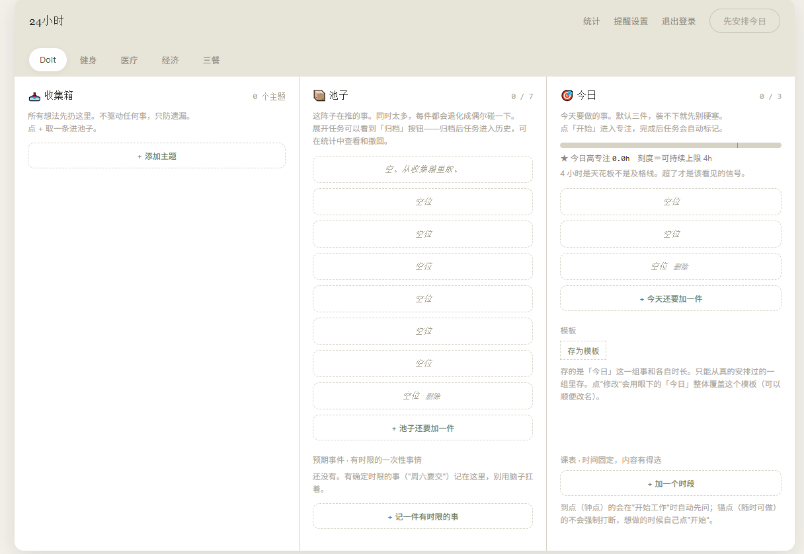
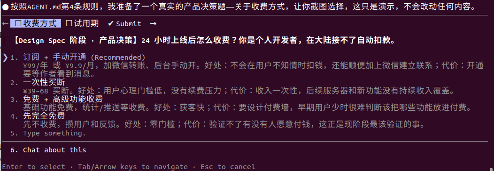
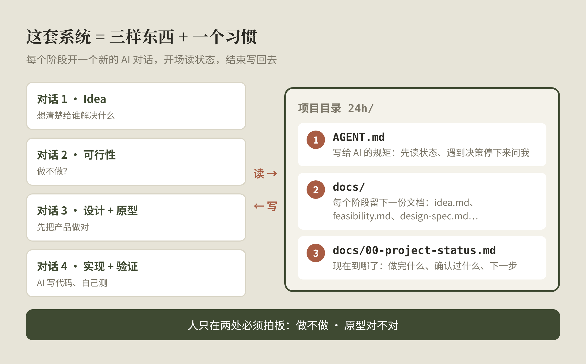
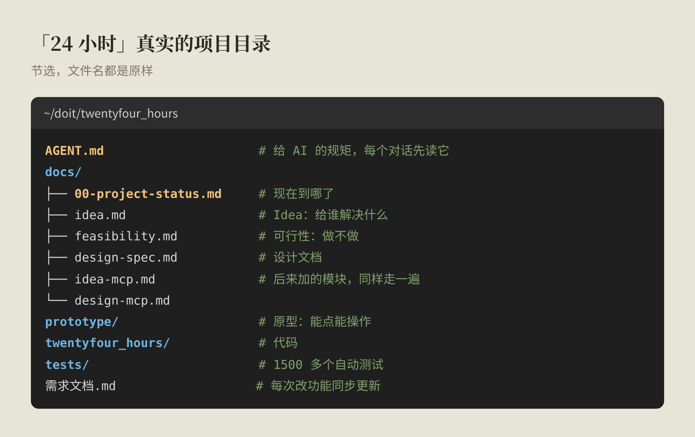
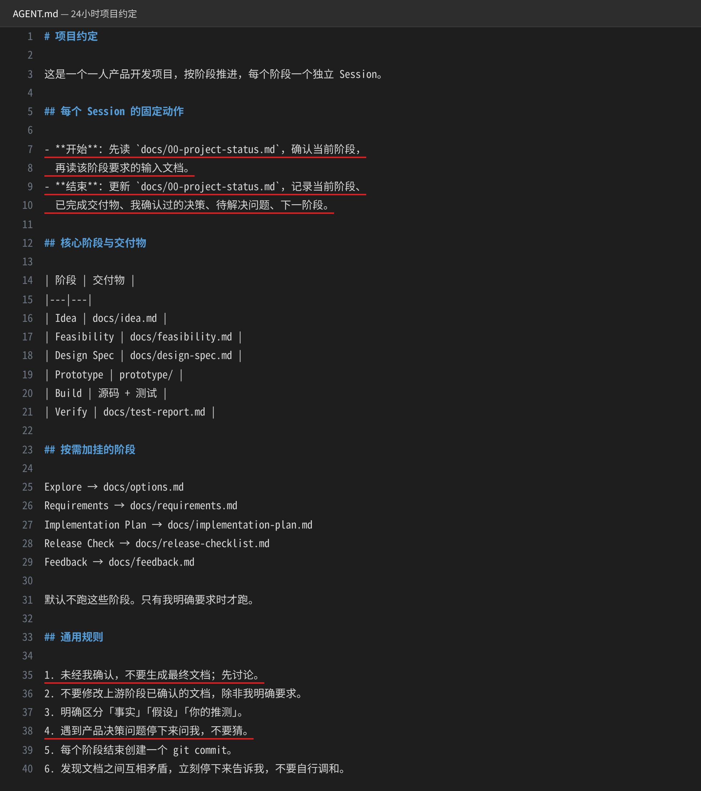
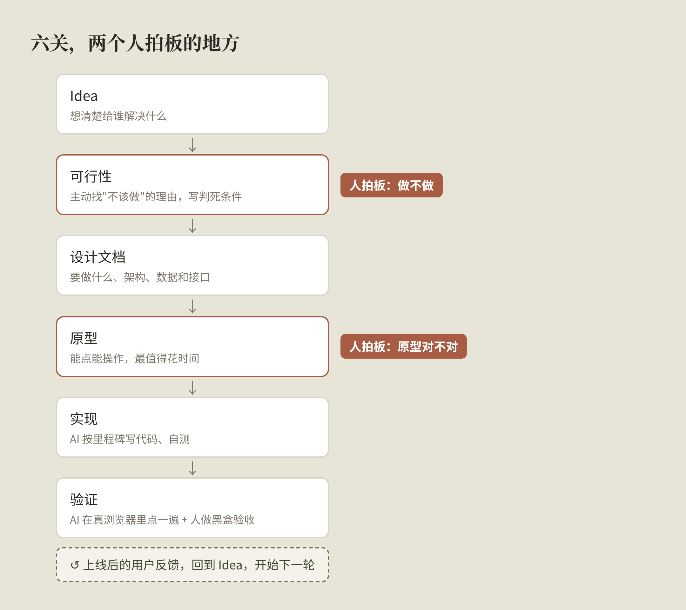
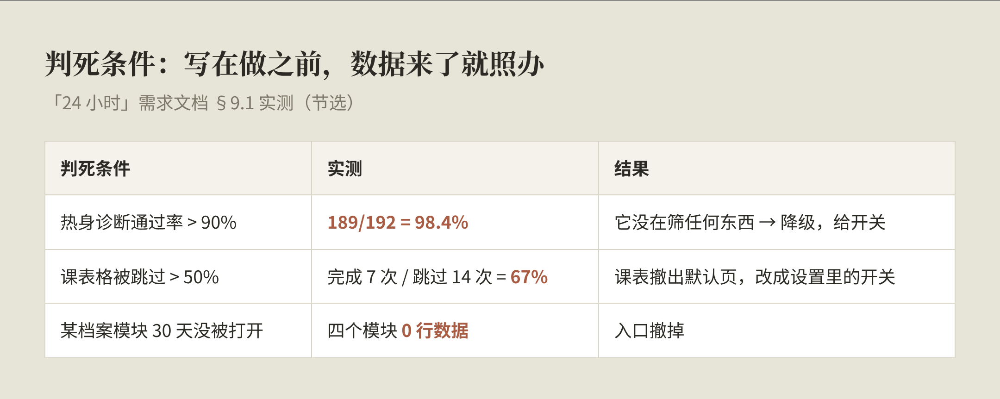
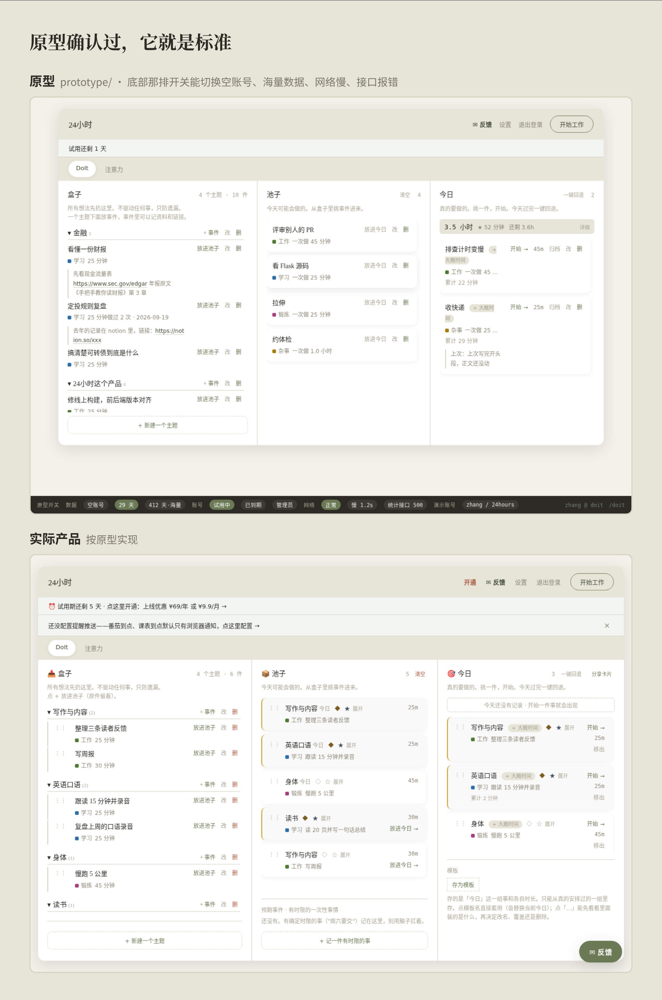
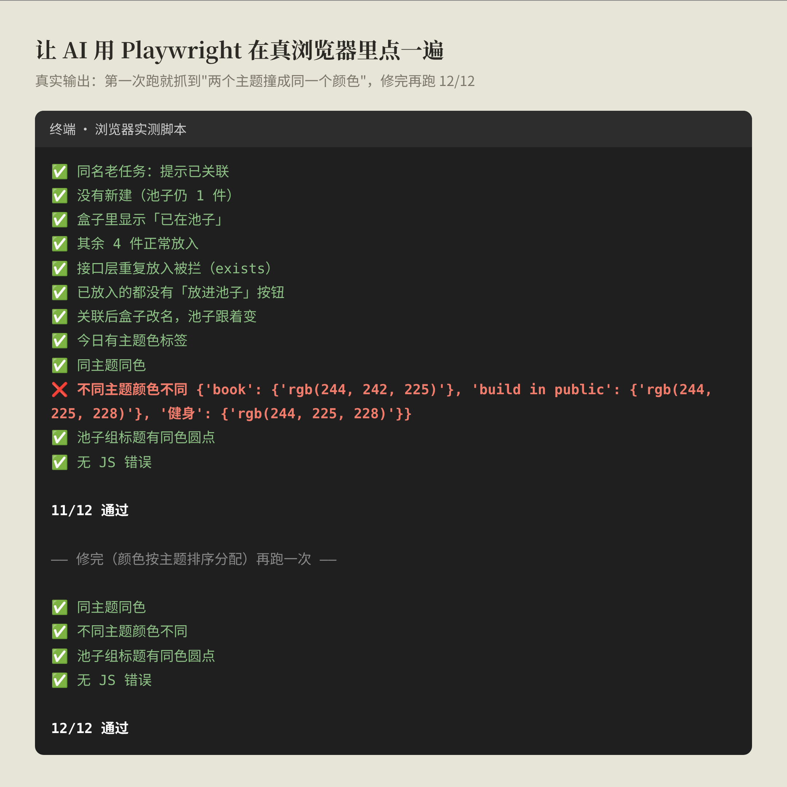
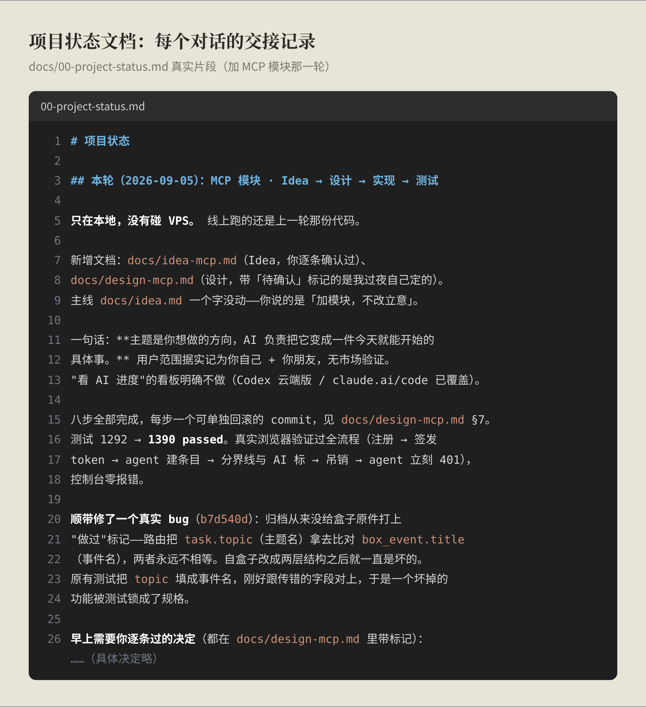

> 做「24 小时」这个产品，我中途推倒重来过一次。这篇讲为什么推倒，推倒之后换成了什么，以及每个阶段具体怎么做。用的例子全部来自「24 小时」。
>
> 这篇由我先后发在公众号的三篇合并而成：《AI 原生开发 vs Vibe Coding，到底差在哪》《一个人做产品的 AI 原生开发流程》《一张图看懂我的 AI 原生开发系统》。重复的部分已经合并。

## 一分钟看完

我做第一款产品「24 小时」时，一开始用的是 Vibe Coding：想到一个功能，告诉 AI，它就做出来了。功能越做越多，项目却越来越难管，因为**项目的状态只存在于我的脑子和聊天记录里**。

后来看到宝玉分享的 AI 原生开发流程，我直接推倒重来，边做边改，慢慢形成了自己的用法。

两者的区别，一句话：**Vibe Coding 优化的是写代码；AI 原生优化的是整个做产品的过程。**

我现在的做法：

1. **让 AI 出选项，我来拍板**：AI 是一本百科全书，别让它直接给答案。
2. **一个人做产品，走六关**：Idea → 可行性 → 设计文档 → 原型 → 实现 → 验证，上线后的反馈再回到第一关。每关一个新对话，对话之间靠文档交接；人只在两处必须拍板：**做不做**，和**原型对不对**。
3. **用文档管 agent**：一个 AGENT.md 立规矩，一份项目状态文档做所有对话的共同入口。
4. **上下文是有限的**：人的注意力有限，AI 的上下文也有限，拆分加文档交接，是绕不开的解法。

几条我自己踩出来的做法：可行性阶段就写好"判死条件"；原型上改一句话的事，别拖到代码里改几天；测试通过不等于做对了，让 AI 在真浏览器里点一遍，人再自己当一回普通用户。

---

## 1. Vibe Coding：想到哪，让 AI 写到哪

Vibe Coding 这个词，是 AI 研究员 Andrej Karpathy 在 2025 年初提出的：用自然语言告诉 AI 你想要什么，让它去写代码，你只看结果，"顺其自然"。

我做「24 小时」的第一版就是这样。想到一个功能，描述给 AI，它就做出来了，每个功能单独看都能跑。

这是那时候的界面。顶上除了 DoIt，还有健身、医疗、经济、三餐一排标签，想到什么就加什么。

问题是，那时候我有用户手册和功能说明书，写的是产品"能做什么"；但**没有一份给 agent 看的记录**：项目现在在哪个阶段、定过哪些决定、为什么这么定、下一步做什么，都没写下来。项目小的时候，全凭脑子记；功能一多，改一处要想半天会不会影响别处，新开一个对话，AI 也不知道前面定过什么。

项目的状态只存在于我的脑子和聊天记录里。功能一多，两边都装不下了。

## 2. AI 原生开发：推倒重来，换一种做法

AI 原生开发（AI Native Development），不是"用 AI 写代码"，而是从一开始就按"AI 参与每个环节"来设计做产品的整套流程：从想清楚做什么、设计、原型，到实现、测试，每一步都有 AI 参与；项目的状态和决定写成文档，人读得懂，AI 也查得到。

正好在那段时间，我看到宝玉分享的 [AI 原生开发流程](https://baoyu.io/blog/2026-08-24/ai-native-dev-workflow)。看完觉得逻辑没问题，就直接把项目推倒，按这个思路重来验证。

传统写代码，推倒重构是件很痛苦的事。但在 AI 编程的时代，难的已经不是执行，而是心理上要克服那一下阵痛。

宝玉的文章里，很多地方没有讲得很细，但思想我觉得是对的。于是**做中学，学中思**，边用边改，慢慢形成了自己的风格。

举一个例子：原型阶段要用 Claude Design 做界面，它有网页版，也能在命令行里用 `/design`。两个到底怎么选，文章里没说，是我自己试出来的。

**真正的区别在于：在哪里用、要不要来回切换、离代码有多近。**

- 网页版是浏览器里的可视化画布，自然语言描述就能生成可交互的原型。做完要导出设计包，再拿回本地的开发环境里实现。
- 命令行里的 `/design`，就在开发的对话里用，会读现有的代码、贴合现在的界面风格，挑好方案可以直接接着实现。

我的开发都在命令行里做，所以现在**先用命令行的 `/design`**；效果不好，再回到网页版，或者两者结合着用。网页版做完还要下载文件、放回项目目录，来回切换比较麻烦。

这类细节，只有自己用过才知道。

## 3. 差在哪：流程没变，变的是谁来做

很多人第一次用 AI 编程，会形成这样的习惯：

> 有个想法 → 告诉 AI → AI 写代码 → 跑起来 → 哪里不对继续改

这就是 Vibe Coding。它大大降低了写代码的门槛，但没有改变做产品的方式。

AI 原生开发里，传统的流程一个环节都没少：想清楚给谁做 → 判断值不值得做 → 设计 → 原型 → 实现 → 测试。变的是**每个环节由谁来做**：人负责判断方向、做决定、最后验收；AI 负责探索方案、生成、实现、检查。

**Vibe Coding 优化的是写代码；AI 原生优化的是整个做产品的过程。**

### 让 AI 出选项，我来拍板

我对 AI 原生的理解是：**AI 是一本知识极其丰富的百科全书。**

所以不该把它当成一问一答的做题机器，问一个问题、要一个标准答案。每遇到一个决策点，我都让它先给建议和几个选项，把每个选项的好处和代价写清楚，再由我来选。

这是一个真实的例子：给「24 小时」定收费方式时，AI 列出了四个方案，每个都写了好处和代价，最后由我决定。

AI 负责把分析面铺开，人负责做最后的判断。

AI 能做的判断也在变多。像 [TypeSafe](https://typesafe.ai/) 的 Jev 这类模型，已经开始把一部分判断做成程序里可以直接调用的能力。但产品的方向、做不做、选哪个，最终还是要人来拍板。

## 4. 这套系统是什么：三样东西，加一个习惯

说是"系统"，其实就是三样东西，加一个习惯：

1. **一份 AGENT.md**：放在项目根目录，写给 AI 的规矩，比如"开始先读项目状态""遇到产品决策停下来问我"。
2. **一个 docs/ 文件夹**：每个阶段结束留下一份文档，idea.md、feasibility.md、design-spec.md……人读得懂，AI 也查得到。
3. **一份项目状态文档** `docs/00-project-status.md`：现在在哪个阶段、做完了什么、我确认过什么、下一步做什么。

一个习惯：**每个阶段，在项目目录里开一个新的 AI 对话**（我用的是 Claude Code）。开场先读状态文档，结束前更新它。对话之间不靠记忆，靠文档接力。

「24 小时」的项目目录长这样，文件名都是原样。没有什么特别的工具，就是几个 Markdown 文件，和代码一起放在 Git 里：

实际用起来是这样的：我在项目目录里开一个新对话，说"读一下项目状态，我们继续做设计文档"。AI 读完就知道前面定过什么，先跟我讨论，我拍板后它生成文档、更新状态。到下一个阶段，再开一个新对话。

### AGENT.md：写给所有 AI 的同一份规章

我的项目根目录下有一个 AGENT.md：

红线标出的几条，是我觉得关键的：

- **每个对话开始，先读项目状态文档**，知道现在在哪个阶段；**结束时更新它**，记下做了什么、我确认过什么、下一步是什么。
- **未经我确认，不要生成最终文档，先讨论。**
- **遇到产品决策问题，停下来问我，不要猜。** 上一节那道选择题，就是这条规则的结果。

每开一个新对话，其实就是一个新的 agent。它不记得前面的对话，但读得到文档。**文档，就是这些 agent 之间交接的方式。**

所以 AGENT.md 本质上就是一份"多 agent 管理说明"：一个阶段开一个对话，前后接力，靠文档交接。宝玉在[另一篇文章](https://baoyu.io/blog/2026-08-31/ai-native-thinking)里说得很直接：每次变更都要同步更新文档，过时的文档比没有文档更有害。这一点我深有体会：文档一旦过时，AI 会非常自信地照着错的往下做。

### 为什么要拆成多个对话：上下文装不下

agent 刚出来那会儿，我自己动手做过多 agent 开发：每个 agent 负责一块功能。起因是一个 agent 塞的上下文太多，记忆不够用了，于是拆成多个，各管一块。

现在回头看，两次是同一个道理：

|            | 问题           | 解法                  |
| ---------- | ------------ | ------------------- |
| 当年做多 agent | 一个 agent 装不下 | 按功能拆，几个 agent 各管一块  |
| 现在做「24 小时」 | 一个对话装不下整个项目  | 按阶段拆，一个阶段一个对话，靠文档接力 |

为什么上下文会装不下？这是当前大模型在技术上的一个硬限制。

一是**窗口有上限**。模型一次能读的内容是有限的，对话越长，越早的内容越可能被挤掉或压缩；而且就算都还在窗口里，内容一多，模型对前面某条约束的注意力也会被稀释。它不会告诉你它忘了，只会很自信地按不完整的理解接着做。

二是**越长越贵**。每一轮对话，模型都要把前面的内容重新读一遍。上下文越长，每一轮消耗的 token 越多、算力越多，回复也越慢。一个对话从想法一路聊到上线，不只是容易出错，也是在反复为同一段历史付费。

所以按阶段拆开，每个新对话只读它需要的那几份文档，既更准，也更省。

**上下文是有限的。** 拆分加文档交接，是 AI 原生开发绕不开的解法。这和我在「24 小时」那篇里写的"注意力是存量，不是产量"，其实是一回事：人的注意力有限，AI 的上下文也有限。

## 5. 全景：六关，两个拍板点

从想法到上线走六关：**Idea → 可行性 → 设计文档 → 原型 → 实现 → 验证**。每关一个新对话。AI 负责探索、生成、实现、检查；人只在两个地方必须亲自拍板：**做不做**，和**原型对不对**。

这六关，只有第一关是"从零做产品"才需要的。给已有产品加功能时，想法和用户早就清楚，Idea 可以在脑子里过一遍，直接从可行性开始。

每一关用什么提示词，我整理在了[[ai-native/ai-native-prompt-templates.cn|《AI Native 开发 Prompt：能直接照抄的 6+5 个》]]里，这篇只讲每关的要点和我是怎么做的。

## 6. Idea：先把"事实"和"我以为"分开

这一关要回答的只有四件事：用户是谁、遇到什么问题、为什么值得解决、产品给什么价值。

关键做法是**让 AI 先提问，别让它先写**。你丢一句想法过去，它一定能写出一份看起来很完整的文档，但里面大半是它替你补的假设。这些假设会被后面每一关继承，越往后越难发现。

所以我的 idea.md 里，内容都按证据等级标注：〔事实〕、〔假设〕、〔推测〕。

这个标注救过「24 小时」一次。它最初的立意是"克服 burnout"：盒子接住想做的事，热身把"起不来"变得可测。自己用了 29 天、197 段专注、81 小时之后，数据显示当初设想的那套"起步"机制几乎没被用到。因为假设和事实一开始就分开写了，推翻起来很干脆：定位改成了"注意力是存量，不是产量"。

**Idea 不是一次写完的。数据一来，就该回头改。**

## 7. 可行性：给自己写"判死条件"

这是最容易被跳过的一关。有想法不等于应该做。

可行性要回答两件事：用户真的需要吗？我一个人做得出来吗？然后让 AI 列出两三个方案，把复杂度、成本、体验、风险摆在一起比，最后我来选。

提示词里有一句我觉得最重要：**主动寻找"不应该做"的理由。** AI 默认是顺着你说的，不加这句，可行性分析很容易变成"可行性论证"。

我在这一关多做了一件事：**写判死条件**，也就是"出现什么数据，就砍掉这个功能"。写在做之前，是为了防止做完以后舍不得砍。数据来了照办，不跟自己讨价还价。

「24 小时」里真的有功能因此被砍：

- **课表**：判死条件是"课表里的事被跳过超过一半"。实测完成 7 次、跳过 14 次，跳过率 67%，条件成立。课表从默认页面撤下来，改成设置里的一个开关。
- **档案模块**（上面截图里健身、医疗、经济、三餐那一排标签）：实测 28 天，数据库里一行数据都没有。入口直接撤掉。

要说清楚的是，**可行性分析不是保险**，它也会看走眼。它更像一个期望值上划算的赌注：大部分时候帮你避坑，偶尔判断错。判死条件就是给看走眼留的出口。

## 8. 设计文档和原型：先把产品做对

**设计文档**是产品设计和技术设计的混合：要做什么、架构怎么分、数据和接口怎么定义。它的作用有两个：让后面写代码的 AI 有明确参照，让我有一个检查方向的锚点。项目越复杂，越要逐条看，因为在文档上发现问题，比写完代码再推翻便宜得多。

**原型**是整个流程里最值得花时间的一关。

传统做法是需求文档、线框图、交互、UI 设计各走一遍，每次交接都丢信息。现在可以合成一步：直接做一个能点、能操作的高精度原型，把空状态、出错、数据特别多或特别少这些情况都做进去。

为什么值得花最多时间？因为改动的成本差太多了。"这个按钮放这里别扭""这一栏应该折叠"，在原型上是一句话的事；到了代码阶段，就是改代码、改测试、再验证一遍，是几天的事。

「24 小时」原型目录的说明第一句是："范围严格等于设计文档，一个功能没多加。"后来实现出来的界面和原型走偏了，我的处理也很直接：按原型重构，而不是反过来改原型迁就代码。**原型确认过，它就是标准。**

上面是原型，下面是实际产品。原型底部那排开关，能切换空账号、海量数据、网络慢、接口报错。原型我先在命令行里用 `/design` 做，效果不好再去网页版 Claude Design，原因见第 2 节。

## 9. 实现：人要做的是"盯住范围"

走到这一步，设计和原型都确认过了，写代码对现在的模型来说是很简单的事。人在这一关要做的很少，主要是两件：

1. **让 AI 先报里程碑，我确认了再开工。** 每完成一个里程碑提交一次，每一步都能单独回滚。
2. **盯住范围。** AI 写着写着容易"顺手"做点别的，比如重构一下、多加个功能。规则里写明：发现需求、设计、技术方案互相冲突，立刻停下来问我，不要自己猜。

给「24 小时」加 MCP 模块（让 AI 助手能直接往盒子里放事）那次，拆成了 8 步，每步一个可以单独回滚的提交，测试从 1292 个加到 1390 个。那一轮是过夜做的，有几个需要拍板的小决定，AI 先按自己的判断做了，在文档里标上「待确认」，第二天早上我逐条过了一遍。

**一个技巧：要求 AI 自己验证。** 写完代码自己跑测试，改完界面自己截图看一眼。你拿到的就不是粗糙的初稿，而是它已经查过一遍的结果，被叫回来返工的次数少很多。

## 10. 验证：测试通过，不等于做对了

AI 会写测试、跑测试，但我不会因为测试全过就认为产品没问题。两个真实的例子：

**测试也可能是错的。** 加 MCP 模块时顺手查出一个 bug：归档一件事，本该给盒子里的原件打上"做过"的标记，却从来没打上过。原因是比对时拿错了字段，而原有的测试恰好填了同样错的字段，于是一个坏掉的功能被测试"锁"成了规格。

**要证明测试能抓住 bug。** 修"编辑时切到别的页面，输入就丢了"这个问题时，同一套测试又拿到旧代码上跑了一遍：全部失败。这说明测试真的能抓住这个 bug，而不是碰巧通过。

### 让 AI 真的去点一遍

单元测试只能证明"函数返回的值对"，证明不了"用户点下去是对的"。所以我让 AI 用工具直接操作浏览器，像用户一样把产品真的用一遍：

- **Playwright**：一个能用代码控制真实浏览器（Chromium）的工具。AI 写一段脚本，就能打开页面、注册、点按钮、输入文字、拖动排序，最后检查页面上显示的内容，以及浏览器控制台有没有报错。
- **截图**：跑完让 AI 截图，然后它自己看截图。很多问题只有看了才知道，比如表格的表头被挤得换行、按钮在手机上小得点不中。
- **手机尺寸**：同一段脚本把窗口设成手机宽度、开启触屏模拟，就能在电脑上测手机端。

这样测出来的问题都很具体。做手机端时，脚本把页面关掉 20 秒再打开，确认计时没断，因为计时在服务器上；给主题分配颜色时，脚本发现两个不同的主题撞成了同一个颜色，修完再跑，12 项全过；做拖拽排序时，脚本发现指针停在两行之间的空隙里，列表就不会自动滚动了。这几个问题，单元测试都测不出来。

最后一层是我自己：打开产品，假装第一次见到它，凭直觉乱点、乱输入。开发者会下意识按预期的路径操作，普通用户不会。AI 的自测加上人的黑盒测试，两层缺一不可。

## 11. 上线以后：反馈也是一轮流程

上线不是终点，用户反馈会带出下一轮 Idea。

有一次我自己用的时候，一天之内给自己提了 7 条反馈：有的是 bug，比如专注进行中又点了另一件事，弹出一串英文报错；有的是体验问题，比如同主题的事情太多、看着乱。我把自己当成第一个用户，每一条都按同样的步骤处理：

1. **先查清原因，再说怎么改。** AI 先复现、看代码、查数据，给出方案和影响范围，我确认了才动代码。
2. **拿数据说话。** 有一条是"盒子里改了，池子没同步"。查了我自己的数据才发现：14 件事里有 5 件从来没和盒子关联上，所以永远不会同步。问题出在关联，不在同步本身。
3. **复现不了，就不改。** 更早还有一条"改了网址回来，任务就结束了"，本地怎么试都复现不了。没有确定的 bug，就不为它改代码。
4. **按想法的本意改，不照搬做法。** 我当时想的是"用颜色区分主题"，和 AI 讨论后做成了淡色主题标签，而不是另起一套颜色，免得和原有的分类颜色打架。

修完、本地验证、上线，两天之内全部闭环。

## 12. 文档怎么管

AI 原生开发里，文档不是写完代码再补的附属品，而是 AI 的记忆。

**一份"项目状态"文档，是所有对话的共同入口。** `docs/00-project-status.md` 记着：现在在哪个阶段、做完了什么、我确认过哪些决定、还有什么没解决、下一步是什么。每个新对话一开始先读它，结束前更新它。

它读起来像一份交接记录。比如 MCP 那一轮的状态开头写着：只在本地，没碰线上；新增了哪两份文档；八步全部完成；早上需要我逐条过的五个决定。换一个新对话，AI 读完这几段就知道从哪接着干，我不用把前因后果再讲一遍。

三条管文档的规矩：

1. **改需求先改文档，再改代码，永远不要反过来。** 「24 小时」的需求文档我要求每次改功能同一轮就同步更新，不攒着。过时的文档比没有文档更糟：AI 会非常自信地照着错的往下做。
2. **别预先建一堆空文件。** 一个只有标题的空文件摆在那里，AI 会为了"不能空着"把没确认的猜测填进去，下一个对话读到时会当成事实。文档应该是讨论完之后的产物，不是起点。
3. **文档和代码一起进 Git。** 每一次改动都能追溯到"当时为什么这么定"。

换个角度看，这套文档其实是一个状态机。AGENT.md 是状态机的定义：有哪些阶段、每个阶段读什么、产出什么、什么时候必须停下来找人，它也像一张路由表，告诉每个新来的 agent 该去读哪份文档。项目状态文档记录当前状态：现在在哪、做过什么、确认过什么。每个 agent 本身不记事，读完状态、干完活，把结果写回去就结束。

我现在的路由是自己做的：开哪个新对话、贴哪个模板，由我决定。

## 13. 第一次试，跑三个对话就够

不用一上来就跑满六关。先跑这三个，就能感受到和 Vibe Coding 的差别：

- **对话 A**：可行性分析
- **对话 B**：设计文档 + 原型
- **对话 C**：实现

开工前只需要准备三样东西：一个 Git 仓库，一份写规矩的 AGENT.md，一份只写着"当前阶段：Idea"的项目状态文档。其余文件由各个阶段自己生成。

先跑通一个薄的闭环，再按需要往里加阶段，比一开始就搭全套靠谱得多。

## 14. 还没验证的想法：路由能不能交给 AI

下面这些是我接下来想试的，还没实际跑过，写出来一起讨论。

我的第一反应是加一个专门的"路由 agent"，但想了想觉得没必要。下一步做什么，状态文档里基本已经写着了，不需要一个模型专门去判断；多一个 agent，就多一次读上下文、多一份 token，也多一个可能出错的环节。

更可能的做法是让每个 agent 自己路由：

- **开场自己判断阶段**：AGENT.md 加一条"开场先读状态文档，判断当前阶段，加载对应的模板；进入下一阶段前先问我"。开新对话只说一句"继续"。
- **模板做成 Skill**：按阶段名字加载，不用一直占着上下文。
- **重活交给子 agent**：像 Playwright 验证这种输出很多的活，在独立的上下文里做完，只带回结论。
- **关口还是人来守**：AI 负责"下一步该干什么"，"要不要进入下一步"还是我拍板。

真正值得交给 AI 判断的，可能是上线后的反馈分流：一条反馈进来，是 bug、设计问题，还是新需求，这需要理解内容。等用户多了再试。

另外有两个隐患要提前想：状态文档会越写越长，反过来吃掉上下文，所以它只该放"现在"，历史交给 Git；这套设计也默认 agent 是一个接一个跑的，同时开几个对话改同一份状态文档，会互相覆盖。

## 15. 一人产品，不是一人公司；第一个产品，是在建生产系统

最近常听到"一人公司"（One Person Company）。我觉得对大多数人来说不太现实：一个人时间有限，财务、运营、开发、客服都要管，哪怕累死也很难出好活。

但"一人产品"（One Person Product）是可行的。一个人专心做好一个产品，AI 补上执行的带宽；而且一个人做，想法从头到尾是一致的，省掉了多人之间反复对齐的时间。

**AI 没有让一个人变成一家公司，但让一个人第一次有可能把一个产品做好。**

做完「24 小时」，我手上留下的不只是一个产品：还有一套开发流程、一份项目约定、一套提示词模板、一套测试方法，以及几千行记录着"当时为什么这么定"的文档。

下一个产品，这些都能直接复用。**第一个产品，是在建生产系统；从第二个产品开始，是在复用它。**

---

## 最后

「24 小时」就是用这套方式做出来的，也是我自己每天在用的执行力工具。产品介绍见 [[products/24-hours-execution.cn|AI 越来越聪明，我却开始害怕失去执行力]]，也可以直接打开 [doitbox.cn](https://doitbox.cn/?ref=blog)。

相关：[[ai-native/ai-native-prompt-templates.cn|AI Native 开发 Prompt：能直接照抄的 6+5 个]]，把上面每一关用的提示词整理成了能直接复制的版本。

遇到问题或者有想法，可以通过 [X / @chokebit3xp](https://x.com/chokebit3xp) 联系我。

## 参考

- 宝玉，《我的 AI 原生开发流程：一个真实案例的完整复盘》，https://baoyu.io/blog/2026-08-24/ai-native-dev-workflow
- 宝玉，《AI 原生思维——像训练大模型一样训练自己》，https://baoyu.io/blog/2026-08-31/ai-native-thinking
- Claude Design 官方教程，https://academy.claude.com/tutorials/using-claude-design-for-prototypes-and-ux
- TypeSafe，https://typesafe.ai/
