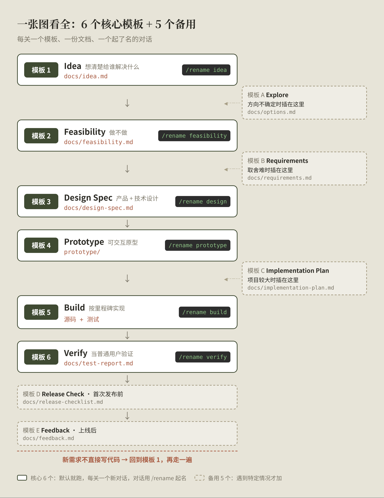
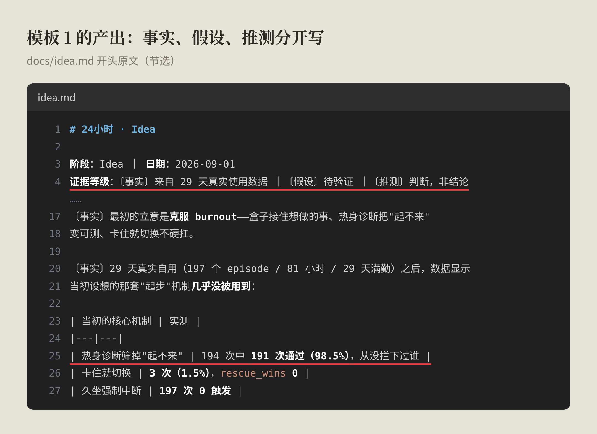
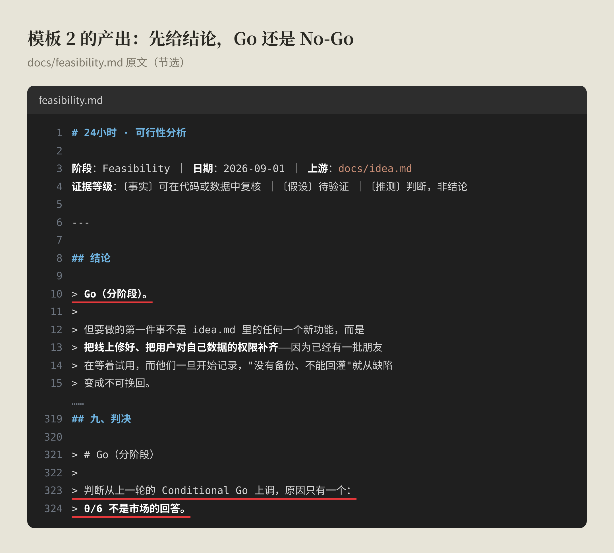
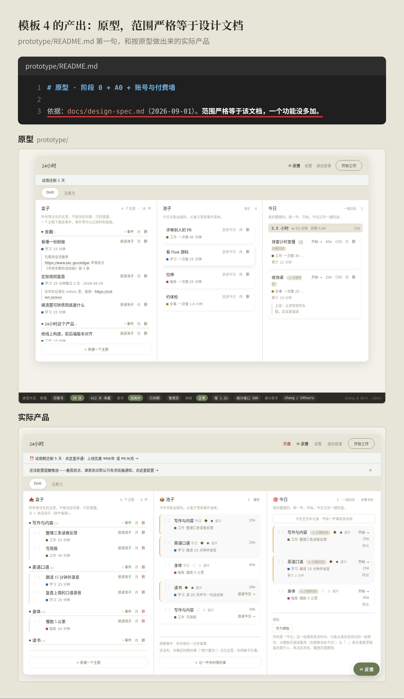
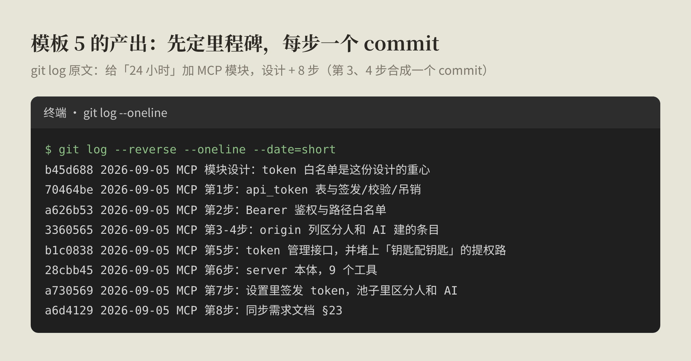
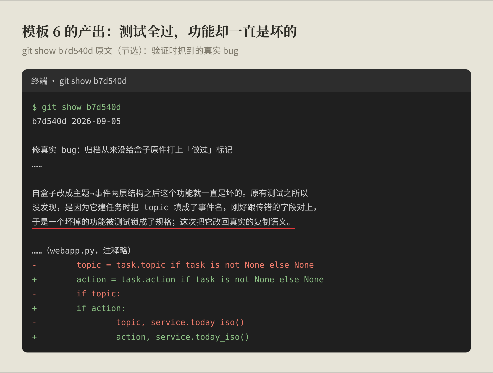

> 这篇把我做「24 小时」每一关用的提示词整理出来，能直接复制：一份项目约定，加 11 个提示词模板。
> 完整流程见[[ai-native/ai-native-dev-workflow.cn|《一个人做产品的 AI 原生开发流程》]]。没读过也没关系，这套系统就三样东西：一份写给 AI 的规矩（AGENT.md）、一个放各阶段文档的 docs/ 文件夹、一份记录“现在到哪了”的项目状态文档；每个阶段开一个新的 AI 对话，开场先读状态，结束前更新它。



---

## 一分钟看完

做「24 小时」这个产品，我每个阶段都用固定的提示词开一个新对话。核心 6 个是我一直在用的；另外 5 个是遇到特定情况才加的，我还没正式用上，先放在这里备用。

用法就三条：

1. **先放一份 AGENT.md**：所有阶段都要守的规矩写在这里，模板里就不用每次重复。
2. **一个阶段，开一个新对话**：对话之间不靠记忆，靠文档交接。每新增一份 `xx.md`，就有一个对话专门管它，比如 `idea.md` 对应 Idea 那个对话。在 Claude Code 里用 `/rename idea` 给它起个名字，之后要回头改 idea.md，找回这个对话接着聊就行。
3. **每个模板都允许先自由讨论，但最后必须收敛到一份明确的交付物**：讨论完、我确认了，AI 才生成文档。

默认只跑核心的 6 个。模板在下面，复制就能用。

---

## 先放一份 AGENT.md

模板之所以能写得短，是因为通用规矩都放在项目根目录的 AGENT.md 里（有的工具叫 CLAUDE.md），每个新对话一开始都会先读它。

这是「24 小时」项目里的原文，红线标的是最关键的几条：


下面是同一份内容的文字版，可以直接复制：

```markdown
# 项目约定

这是一个一人产品开发项目，按阶段推进，每个阶段一个独立 Session。

## 每个 Session 的固定动作

- **开始**：先读 `docs/00-project-status.md`，确认当前阶段，
  再读该阶段要求的输入文档。
- **结束**：更新 `docs/00-project-status.md`，记录当前阶段、
  已完成交付物、我确认过的决策、待解决问题、下一阶段。

## 核心阶段与交付物

| 阶段 | 交付物 |
|---|---|
| Idea | docs/idea.md |
| Feasibility | docs/feasibility.md |
| Design Spec | docs/design-spec.md |
| Prototype | prototype/ |
| Build | 源码 + 测试 |
| Verify | docs/test-report.md |

## 按需加挂的阶段

Explore → docs/options.md
Requirements → docs/requirements.md
Implementation Plan → docs/implementation-plan.md
Release Check → docs/release-checklist.md
Feedback → docs/feedback.md

默认不跑这些阶段。只有我明确要求时才跑。

## 通用规则

1. 未经我确认，不要生成最终文档；先讨论。
2. 不要修改上游阶段已确认的文档，除非我明确要求。
3. 明确区分「事实」「假设」「你的推测」。
4. 遇到产品决策问题停下来问我，不要猜。
5. 每个阶段结束创建一个 git commit。
6. 发现文档之间互相矛盾，立刻停下来告诉我，不要自行调和。
```

最后两条最容易被忽略。第 5 条让每个阶段都能单独回滚；第 6 条防的是：文档一旦互相打架，AI 会自己挑一个"看起来合理"的说法往下做，而且做得很自信。

第 4 条"遇到产品决策停下来问我"，用起来是这样的：AI 不自己定，而是把选项和各自的代价列出来，让我选。下面是定「24 小时」收费方式时的真实画面：


`docs/00-project-status.md` 是整个项目的"当前状态"：现在在哪个阶段、做完了什么、我确认过什么、下一步是什么。换一个新对话，AI 读完它就知道从哪接着干。

---

## 核心 6 个

### 模板 1 — Idea：想清楚给谁解决什么

```text
我现在有一个新的产品想法：

[描述你的想法]

要求：
1. 先通过提问帮助我澄清想法，不要直接生成最终文档。
2. 重点澄清：
   - 用户是谁？
   - 用户遇到什么问题？当前如何解决？
   - 为什么这个问题值得解决？
   - 产品可能提供什么核心价值？
3. 区分「我的真实信息」「我的假设」「你的推测」。
4. 不要擅自确定我没有确认的产品方向。
5. 等讨论完成并且我确认结论后，再生成 docs/idea.md。
6. 文档只记录已确认的内容，不记录未验证的猜测。

现在先开始提问，不要生成最终文档。
```

**我用它的时候**：最有用的是第 3 条，把"事实、假设、推测"分开。「24 小时」的 idea.md 开头就标着证据等级，其中一条事实是：自己用了 29 天，热身诊断 194 次里 191 次通过。这个数字直接推翻了我最初的设想：我以为它能筛掉"起不来"的时候，实际上它几乎没拦下过谁。没有这条规则，这种"我以为"很容易被当成事实写进文档。



给已有产品加功能时，这一关可以跳过，直接从模板 2 开始。

### 模板 2 — Feasibility：先决定"做不做"

```text
请先读取 docs/idea.md（如果不存在，我在下面直接描述需求）。

[如果没有 idea.md：描述需求和背景]

我们现在进入可行性分析阶段，判断这件事值不值得做、能不能做。

重点分析：
1. 产品可行性：用户需求是否成立？现有替代方案是什么？和产品定位是否匹配？
2. 技术可行性：技术能否实现？API / 模型 / 数据是否可获得？最大难点是什么？成本是否可控？
3. 风险：技术风险、产品风险、成本风险、合规与安全风险。
4. 方案对比：至少提出 2-3 个实现方案，逐项比较复杂度、成本、体验和风险，并给出你的推荐。

要求：
- 不要为了让我做这个产品而刻意乐观。
- 主动寻找「不应该做」的理由。
- 区分事实、假设和未知信息。
- 先讨论，不要立即生成最终文档。
- 最终给出 Go / No-Go / 需要更多验证。
- 我选定方案并确认后，再生成 docs/feasibility.md。

现在开始分析。
```

**我用它的时候**：关键是"主动寻找不应该做的理由"。AI 默认是顺着你说的，不加这句，可行性分析很容易变成"可行性论证"。「24 小时」这一关的结论一开始是 Conditional Go（有条件地做），后来才上调成 Go（分阶段）。



### 模板 3 — Design Spec：给 AI 一个明确参照

```text
请先读取：
- docs/idea.md（如果存在）
- docs/feasibility.md

我们现在进入设计阶段，产出一份产品设计和技术设计的混合文档。

产品设计部分：
1. 信息架构  2. 用户流程  3. 页面 / 界面结构
4. 核心交互  5. 空状态 / 加载 / 错误状态  6. 边界情况

技术设计部分：
7. 架构与模块划分  8. 数据结构  9. 接口 / API 定义
10. 与现有代码或第三方服务的集成点

要求：
- 严格基于 feasibility.md 中已确认的方案，不要重新选型。
- 不要擅自增加需求范围；发现范围不清晰时问我。
- 先讨论，我确认后再生成 docs/design-spec.md。
- 不要开始写代码，也不要开始做原型。

现在先从用户流程开始讨论。
```

**我用它的时候**：最后一句"不要开始写代码，也不要开始做原型"一定要留。AI 很急，设计还没聊完就想动手。

### 模板 4 — Prototype：值得花最多时间的一步

```text
这是一个产品的设计文档：

[粘贴 docs/design-spec.md 的内容，或上传文件]

[如果已有代码库：请先接入我的仓库，分析现有的组件结构、配色与间距体系、
框架模式和文件组织方式，后续设计要复用它们。]

请基于这份设计文档做一个高精度可交互原型。

要求：
- 尽可能接近真实产品，包含真实交互和视觉，不要线框图。
- 必须覆盖：核心用户流程、空状态、加载状态、错误状态，
  以及数据量极少和极多两种极端情况。
- 不要增加设计文档之外的功能。
- 做完先让我实际操作，我会用自然语言提出修改意见，你直接改。
- 这个阶段允许反复多轮，不要急着收敛。

每次修改后，简要说明你改了什么、为什么这样改。
```

**我用它的时候**：我先在命令行里用 Claude Code 的 `/design` 跑这一关，产出放在 `prototype/`；效果不好，再去网页版 Claude Design。「24 小时」原型目录的说明第一句就是："范围严格等于设计文档，一个功能没多加。"



这一关值得花最多时间：布局、状态提示、功能放在哪，这些改动在原型阶段是一句话的事，到了代码阶段就是几天的事。

### 模板 5 — Build：执行已经批准的方案

```text
请先读取：
- docs/design-spec.md
- prototype/（或使用我提供的原型交接包）
- docs/implementation-plan.md（如果存在）

现在进入实现阶段，按设计文档和原型来实现。

要求：
1. 不擅自改变已确认的需求和设计。
2. 先规划实现里程碑并告诉我，我确认后再开始写代码。
3. 每次只执行当前里程碑。
4. 完成后运行相关测试，并自行验证结果（包括必要时截图确认界面）。
5. 发现需求 / 设计 / 技术方案冲突时立即停止并告诉我。
6. 不要通过猜测解决产品决策问题。
7. 每完成一个里程碑创建 git commit。
8. 同步更新受影响的文档和测试。
9. 不要为了「代码更漂亮」而扩大项目范围。

先告诉我你的里程碑规划。
```

**我用它的时候**：这一关和前面最大的区别是，不再讨论"做什么"，只执行已经批准的方案。给「24 小时」加 MCP 模块（让 AI 助手能直接往盒子里放事）那次，拆成了 8 步，每一步都能单独回滚。



### 模板 6 — Verify：把自己当普通用户

```text
请先读取：
- docs/design-spec.md
- 当前代码和测试

现在进入验证阶段。请从真实用户角度验证产品，而不仅仅检查代码能否运行。

检查：
1. 核心用户流程  2. 设计文档中的每一项功能  3. UI / 交互
4. 错误状态  5. 边界情况  6. 性能  7. 安全  8. 自动化测试

要求：
- 主动寻找失败场景。
- 不要因为测试通过就认为产品正确。
- 区分 Bug、设计问题和需求问题。
- 能自动修复的 Bug 可以直接修复。
- 涉及产品决策的问题必须先告诉我。

生成 docs/test-report.md，必须明确：
已测试 / 通过 / 失败 / 已知问题 / 已修复 / 遗留问题 / 发布建议
```

**我用它的时候**："不要因为测试通过就认为产品正确"这句是真的。MCP 模块那次验证，顺手查出一个真实 bug：归档一件事时，本该给盒子里的原件打上"做过"标记，却从来没打上过。原因是比对时拿错了字段，而原有的测试恰好填了同样错的字段，于是一个坏掉的功能被测试锁成了"规格"。



AI 做完自测之后，我自己还会再跑一遍：打开产品，假装第一次见到它，凭直觉乱点乱输入。AI 的自测和人的黑盒测试是两层验证，缺一层都不够。

---

## 按需加挂的 5 个

这 5 个不是"高级版"，是**遇到特定情况才值得付出的成本**，默认不跑。说实话，做「24 小时」到现在，我还没有正式跑过它们：方向一开始就定了，功能也不算多。放在这里，是因为情况合适的时候它们会很有用，比如下一个产品方向还模糊时用 Explore，第一次正式上线前用 Release Check。

### 模板 A — Explore（方向不确定时，加在模板 1 和 2 之间）

```text
请先读取 docs/idea.md。

我们现在探索多个产品方向，不要直接锁定一个方案。

要求：
1. 至少提出 3 个明显不同的产品方向。
2. 对每个方向分析：目标用户、核心问题、产品形态、核心价值、
   差异化、开发复杂度、商业潜力、最大风险。
3. 可以挑战 idea.md 中的假设。
4. 先讨论，最终由我选择方向。
5. 我确认后生成 docs/options.md，记录所有方向和我的选择理由。

现在开始探索。
```

一个人做产品，最大的风险之一是过早进入执行：想到点子、觉得不错、开始做，两周后才发现方向不对。

### 模板 B — Requirements（取舍难时，加在模板 2 和 3 之间）

```text
请先读取：
- docs/idea.md
- docs/feasibility.md

我们现在把已确认的方向定义成一个可开发的 MVP。

讨论：
1. 目标用户  2. 核心问题  3. 核心价值  4. 主用户流程
5. MVP 功能  6. 非 MVP 功能  7. 成功标准  8. 约束条件

要求：
- 不要擅自增加功能。
- 对每个功能追问它是否真正服务于核心价值。
- 主动帮我砍掉非必要功能。
- 明确区分「必须有」「可以以后做」「不做」。
- 先讨论，我确认后生成 docs/requirements.md。

最终目标：明确我们到底要开发什么，以及明确不开发什么。
```

### 模板 C — Implementation Plan（项目较大时，加在模板 4 和 5 之间）

```text
请先读取：
- docs/design-spec.md
- prototype/

架构和接口已经在 design-spec.md 中确认，这一步不要重新设计，只做落地规划：

1. 里程碑划分（按可独立验证的成果切分）
2. 任务拆解（每个任务对应一个里程碑下的最小可交付单元）
3. 测试策略
4. 部署 / 发布方式

要求：
- 每个任务有明确的输入和输出。
- 明确任务之间的依赖关系。
- 优先实现 MVP，不要过度工程化。
- 发现设计存在技术问题时先停下来告诉我，不要自行修改设计。

先讨论，我确认后生成 docs/implementation-plan.md。
```

### 模板 D — Release Check（首次发布，或涉及配置变更时）

```text
请先读取：
- docs/design-spec.md
- docs/test-report.md

现在做发布前检查，判断产品是否具备发布条件：

生产配置 / 环境变量 / 数据库 / API Key 与 Secrets / 安全 /
监控 / 日志 / 数据统计 / 错误追踪 / 备份与恢复 / 部署 / 回滚方案

要求：
- 不要泄露任何 Secret。
- 不要修改产品范围。
- 发现高风险问题立即停止并告诉我。
- 明确列出发布后仍然存在的风险。

生成 docs/release-checklist.md，最后明确给出：可以发布 / 不可以发布
```

### 模板 E — Feedback（上线后）

```text
请读取：
- docs/idea.md
- docs/design-spec.md
以及我提供的真实用户反馈、使用数据、Bug 报告。

现在分析：
1. 用户实际在做什么？
2. 用户真正需要什么？
3. 哪些假设被验证？哪些被推翻？
4. 用户遇到什么问题？
5. 哪些功能没人使用？
6. 下一步最值得解决的问题是什么？

要求：
- 区分数据和推测。
- 不要因为单个用户反馈就立即改变产品方向。
- 优先寻找具有重复性的信号。

生成 docs/feedback.md。

如果产生新的产品需求，不要直接写代码 —— 把它作为一个新的 Idea，回到模板 1 重新走一遍。
```

最后一句最重要：用户反馈带出来的新需求，不直接写代码，而是回到模板 1 重新走一遍。流程就这样转成了一个循环。

---

## 最后

这些模板都是做「24 小时」时用出来的。产品介绍见 [[products/24-hours-execution.cn|AI 越来越聪明，我却开始害怕失去执行力]]，也可以直接打开 [doitbox.cn](https://doitbox.cn/?ref=blog)。遇到问题或者有想法，可以通过 [X / @chokebit3xp](https://x.com/chokebit3xp) 联系我。

## 参考

- 宝玉，《我的 AI 原生开发流程：一个真实案例的完整复盘》，https://baoyu.io/blog/2026-08-24/ai-native-dev-workflow
- Claude Design 官方教程，https://academy.claude.com/tutorials/using-claude-design-for-prototypes-and-ux
