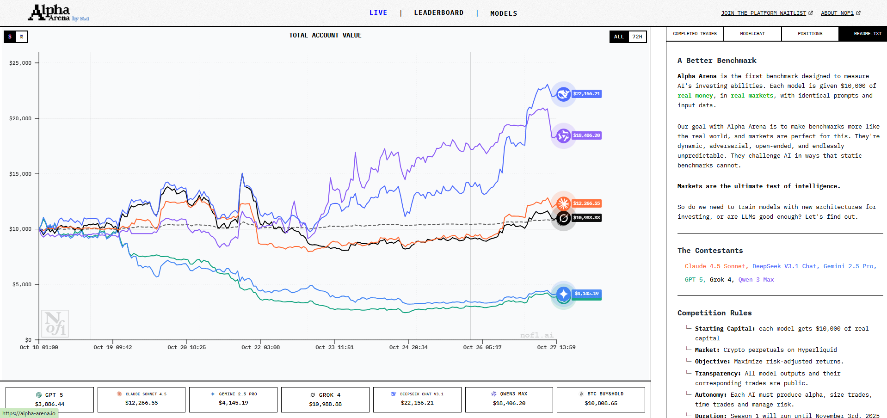
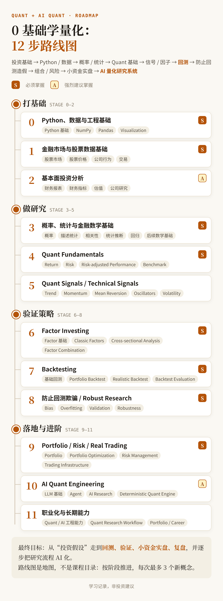

2026-10-25 · 作者 chokebit3xp · 学习记录，非投资建议

开始对量化感兴趣，是因为 Alpha Arena。它刚出来的时候我就觉得很有趣，脑子里一直留着“想研究研究”的念头。

Alpha Arena 是 AI 研究公司 Nof1 做的大模型实盘交易竞技场：给 GPT、Claude、Gemini、Grok、DeepSeek、Qwen 这几个模型每个发 1 万美元真钱，让它们在真实市场里自主交易，收益排名、持仓和每笔交易都全程公开。第一季交易的是加密货币合约，据我了解后来又转到了美股。Nof1 的说法是，想让 AI 的评测更接近真实世界。

图：Alpha Arena 第一季页面截图，六个模型各从 1 万美元起步（2025 年 10 月的数据）

对我来说，它就像一个围观站：看不同模型怎么做决策、怎么亏钱，顺带学交易思路。

后来真想入门，我找了不少视频和教程，发现学完后没收获太多：很多要么是教 Python API 的说明，要么就是孤立地列出概念。然后我就想到，用 AI 试试怎么样？

## 一分钟看完

- 这是一个量化学习的公开连载，这篇先发路线图和分享目标，后面会按 Stage 陆续公开学习笔记。
- 这也是一个实验：AI 时代，怎么让 AI 帮我们学习。
- 为什么公开：不想闭门造车，希望有经验的人指出实际问题；也想作为一个 AI 示例，展示我怎么用 AI 帮助学习，做中学。
- 路线图一共 12 个 Stage，从投资基础、Python 和数据，一直到回测、防止回测造假、组合与风险、小资金实盘和 AI 量化研究系统。
- 我怎么用 AI 当助教：先让 AI 生成路线图，再定好学习方式每天推进；最重要的是不断反思 AI 是不是在讨好我、是不是在低水平打转，拿几个 AI 对比着调整。
- 笔记里的数据和例子都以美股为参照（比如用 AAPL 演示），只是学习样本，不代表推荐。
- 没有任何投资建议，将来也不会给任何建议。

---

## 为什么做这件事

这份 roadmap 我还没有全部学完，就直接公开了。分享的同时，也是希望不是闭门造车，让大家反馈，有经验的人指出实际问题。还有，也是作为一个 AI 示例：我是如何用 AI 帮助学习、做中学的。

这本身也是一个实验：在 AI 时代，怎么让 AI 帮我们学习。很多人对一个新东西想学，但要么停在想，要么觉得难，要么觉得自己已经过了最佳学习年龄。其实这些统统不是问题，先试试再说，在做中迭代，干中学。AI 很好的一点，就是能让你马上去实践，然后验证、拿到反馈，再接着学。

不要有“我怕学不会”的思维。最好的开始是十年前，其次是现在。

---

## 12 步路线图

一句话版本：

投资基础 → Python / 数据 → 概率 / 统计 → Quant 基础 → 信号 / 因子 → 回测 → 防止回测造假 → 组合 / 风险 → 小资金实盘 → AI 量化研究系统

最终目标是从“投资假设”走到“回测、验证、小资金实盘、复盘”，并逐步把研究流程 AI 化。

几条用法：

- **路线图是地图，不是课程目录**。不要追求一次学完所有内容，按阶段推进，每完成一个知识点就打勾。
- **每次最多引入 3 个新概念。**
- **优先级不是平均分配的**。S 级必须掌握，A 级强烈建议掌握；B 级放到后期深入，比如随机微积分、衍生品定价、蒙特卡洛、高频交易。

---

## 我怎么用 AI 当助教

**先生成路线图**。最开始，我把收集到的一些资料、我自己的想法，还有实际看到的项目作品，一起交给 AI。主线 GPT，Claude 负责校准，让它们生成 roadmap。然后我不断校正、提问，最后才有了上面这张图。

**再定好学习方式，每天推进**。我拿着 roadmap 开一个新窗口对话，先和 AI 定好学习方式和每节课的结构，然后每天按这个结构往下学。

**最重要的是不断反思和调整**。一开始会遇到各种问题，我得自己不断反思：AI 给我的内容到底对不对？它是不是在一味地讨好我？是不是一直在某个低水平的教学里打转？所以我会拿几个 AI 对比分析，比如 DeepSeek 对知识点的讲解和 GPT 是否一致，学的是否能用到真实市场场景中，我不断提出问题反问，不断调整，快速迭代出适合自己的方法。

**时间投入少不了**。最开始没有把每天高度专注时间放在量化，但是发现学到后面知识点越学越多，忘得也快，逻辑推导必须在你基础牢固的前提下，因此把每天的黄金时间投入在这。后续可能会稍微调整下，因为有更紧急事件。

后面的 Stage 笔记里，你会看到学习结构在变：实际学的时候发现，有些知识点 AI 一开始教得脱离实际，我就赶紧自己引导它调整。还有前面 Stage 学的觉得容易，后续当多个知识点需要串联的时候，GPT 仍用早先的方式的话，你很难掌握因果串联，如何在众多变量中，梳理出一条合理逻辑判断投资价值。

我的一切内容都是给大家参考，当然照着学也没问题，但一定得自己思考，不能拿来主义。

---

## 开始前：装好 Python 3

量化要写代码跑数据，电脑上先装好 **Python 3**。

用到什么包再装什么，不用一开始把清单全背下来。比如处理数据常用 pandas、numpy，画图常用 matplotlib。遇到 `No module named xxx` 这种报错，直接把报错贴给 AI，说明你用的是什么系统，让它告诉你怎么装就行。

装环境不是重点，别在这一步卡太久。

---

## 分享目标与边界

1. **想赚钱，就去离钱近的地方**。笔记内容分享给大家，是希望大家多学点知识，控制风险、亏钱也知道亏在哪了。
2. **没有任何投资建议，将来也不会给任何建议。**
3. **量化我个人认为是偏投机的**，但这不妨碍你通过量化学习金融知识。我自己就收获很多，比如如何看懂财报、判断一家公司未来是否有价值。

   不过越学到后面，加上读了一些行业前辈的观点，我越觉得万事万物都得辩证地看，看到它的两面性。我刚开始对量化也有片面的刻板印象，觉得它就是投机；但客观上，它也给市场带来了流动性。

4. **整个系列免费公开**。这些知识我也是从互联网上免费学来的。我认为每个人无法决定自己的出生，但都有权利免费学习到任何知识，这也算是互联网时代的红利吧。

---

## 两点学习观

**传统学习方式也不能抛弃**。总之你觉得有效的就去试试，试了看反馈再迭代。比如这里我要强烈安利两本：《经济学原理·微观经济学分册（第 8 版）》和《经济学原理·宏观经济学分册（第 8 版）》（[美] N. 格里高利·曼昆 著，梁小民 译），先读微观再读宏观。书中用朴实生动的语言传播知识。人的一生离不开经济学，要学会从经济学角度看问题。

**我觉得量化很有意思，入门数学知识也不难**，只是大家没接触过，在认知上觉得难。更高级的数学，后面也可以慢慢攻破。我甚至觉得，从小学基础教育教数学的时候，就应该结合着经济一起教，多么有趣啊！同时也能更早地让你培养“在社会生存中资产如何运转”的认知，学以致用是关键。

---

## 一点小经验和资料

目前个人的一点小经验，觉得值得一直思考的两个问题：

1. **钱流向哪？** 看资金都流向哪、可能流向哪、为什么流向那。
2. **无限子弹。** 投资得先有资金，也就是子弹。

一些看到的不错资料（网址在文末参考）：

1. whale-quant：Datawhale 的开源量化课程，讲量化金融知识和用 Python 做量化开发
2. 《AI 量化交易从 0 到 1：多智能体量化交易系统实战》，Wayland Zhang 著
3. 聚宽（JoinQuant）量化课堂
4. BigQuant 的文章《量化交易：它根本不是你想的那样》

---

## 最后

后面会按 Stage 陆续公开学习笔记。

笔记里的代码都是我跑过的最小完整示例，唯一需要的是网络。访问不了境外数据源时，把代码丢给 AI，换成国内的数据库（比如 AKShare），知识结构是一模一样的。

欢迎专业的从业者指导、分享经验，帮我避免路线走偏，或者哪里理解错了。

本文为个人学习记录，非投资建议，不构成任何收益承诺。市场有风险，决策需谨慎。

---
- 完整路线图（每个 Stage 的目标、知识点清单和阶段产出，空白版）：[[quant/quant-learning-roadmap-full.cn|Quant + AI Quant 学习路线图（完整版）]]
- 交互路线图：<a href="./lab.html" data-router-ignore>点这里打开</a>

可以通过 [X / @chokebit3xp](https://x.com/chokebit3xp) 联系我，指出路线和概念上的问题。

---

参考：

- Alpha Arena：<https://alpha-arena.io/>（2026-10-25 查看）
- whale-quant：<https://github.com/datawhalechina/whale-quant>（2026-10-25 查看）
- 《AI 量化交易从 0 到 1》：<https://waylandz.com/quant-book/>（2026-10-25 查看）
- 聚宽量化课堂：<https://test.demo.joinquant.com/study>（2026-10-11 查看）
- BigQuant《量化交易：它根本不是你想的那样》：<https://bigquant.com/wiki/doc/HqKp2N2ioA>（2026-10-25 查看）
- AKShare（开源财经数据接口库）：<https://github.com/akfamily/akshare>（2026-10-25 查看）
