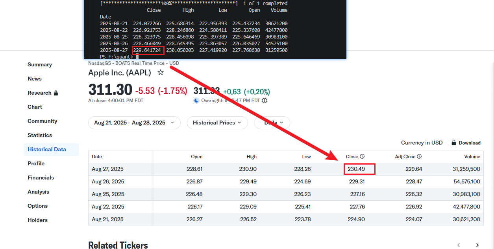
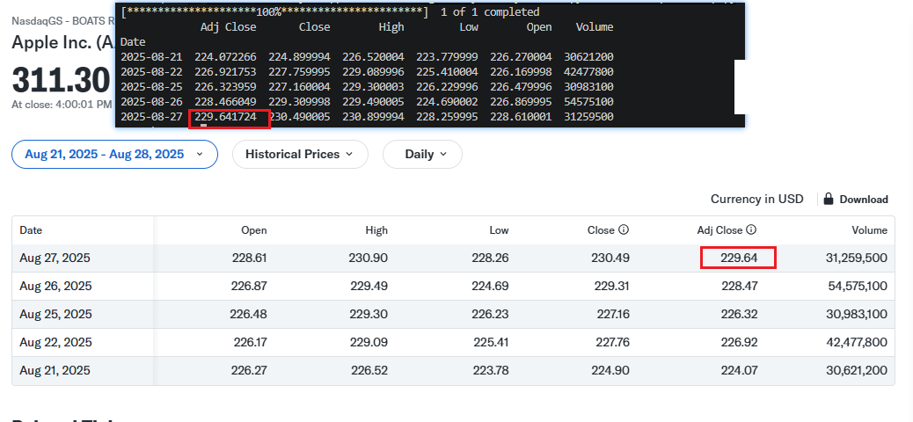
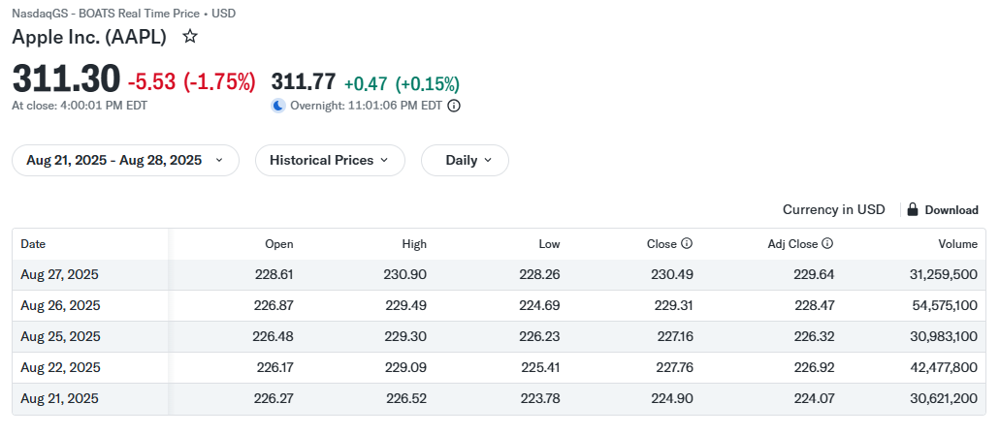
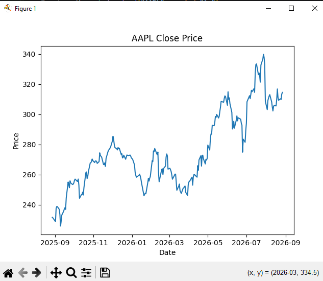
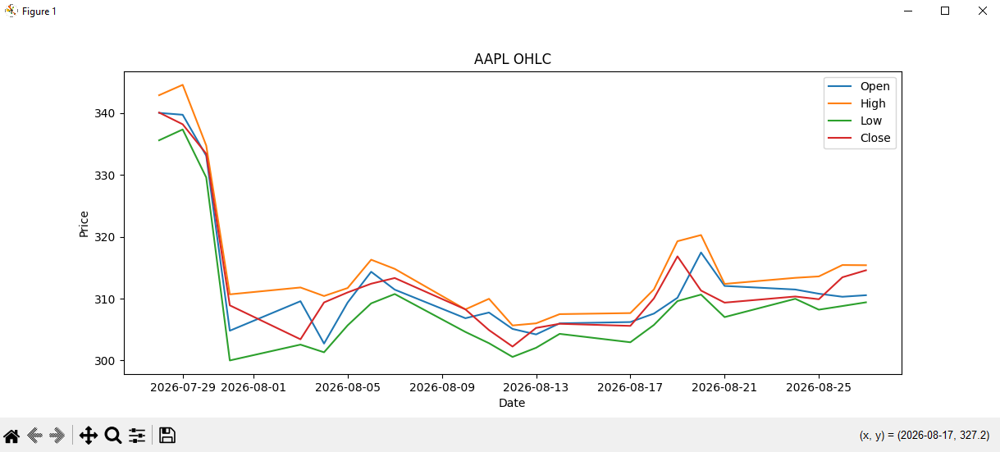
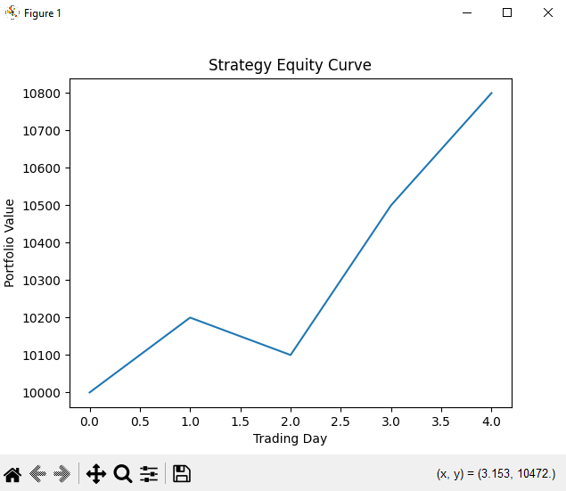
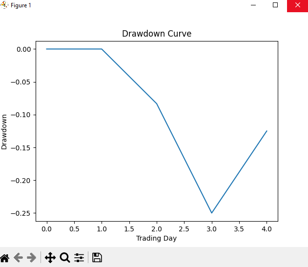

2026-10-26 发布 · 作者 chokebit3xp · 学习记录，非投资建议

## 一分钟看完

- **这是什么**：我自学量化前两个阶段（Stage 0 Python / 数据基础，Stage 1 金融市场与股票数据基础）的完整学习笔记，按学习当天的记录原样保留，包含概念、代码、练习和踩坑。
- **Stage 0** 学的是：用 Python + Pandas 读取一只股票的历史数据，算收益率（Return）、累计收益、移动平均，并把结果画成图。
- **Stage 1** 学的是：看懂股票价格和交易的基本规则，包括买价 / 卖价（Bid / Ask）、价差、流动性、市价单 / 限价单 / 止损单、滑点、做空、保证金与杠杆，以及复权价和除权除息对历史价格的影响。
- **怎么读**：篇幅很长，建议收藏。写这些笔记时我还没有路线图，所以 Stage 0 和 Stage 1 的内容是混在一起写的，**按 day 顺序读完全没问题**。
- **一句提醒**：文中的 AAPL、MSFT、NVDA 等代码只是演示数据处理用的例子，**不代表推荐**，也不构成任何投资建议。


这份是我的 **Stage 0-1 完整学习记录**，按学习当天的笔记原样保留：概念、代码、练习、踩坑、参考链接都在。篇幅较长，建议收藏慢慢看。

两条贯穿始终的原则：**一天学不了多少，但学一点就要好好掌握；忘记不可避免，忘了就回来复习。**

## 使用说明（读前先看）

- **顺序**：Stage 0/1 是最早写的，当时 roadmap 还没成型，中途微调过部分安排。你完全按 day 顺序学，或对照 roadmap 的顺序学，都没问题。

- **day 编号**：day 编号是我学习当天的编号。有了 roadmap 以后，我把同一主题的内容归到了一起，所以 day10 的公司行为（Ticker、反向拆股、股票增发）放在了 Stage 1 里，编号会跳；Stage 0 和 Stage 1 里还有两个 day4-6，一个属于 Stage 1，一个属于 Stage 0。**从后面的 Stage 开始，就都是按 roadmap 的顺序正常学了，不会再有这种情况。**

- **代码**：所有代码都是 100% 跑过的最小完整示例，你只需要能联网。境外数据源访问不了时，把代码丢给 AI 换成国内数据源库（比如 AKShare）即可，知识结构一模一样。

- **学习方式**：不是一成不变的。后面你会发现不同 stage 我用了不同的教学结构——这是我刻意引导 AI 按实战目的调整的，拒绝纯理论纸上谈兵。

- **忘记很正常**：学到基本面分析时我停下来反思过一次：按天流水账学下去，知识点串不起来。另外 Stage 0/1 当时觉得简单，没排在专注时段；后来调整为尽量早 9-10 点学，因为理解知识之间的关联非常耗注意力。

- **为什么用 AI 学**：AI 教学的好处是很多知识能快速独立掌握，还能让 AI 帮你提出好问题、串联知识点。对比传统自学：我之前想学会计知识和阅读财报，读了《会计学：企业决策的基础（原书第17版）》（Jan R. Williams, Susan F. Haka, Mark S. Bettner），书很经典、示例生动，但自学时"学后面忘前面"，很多点想不到它结合实际用在哪。这正是我转向 AI 辅助学习的重要原因。

## 学习地图

按 day 的原始顺序排列，点右侧目录可以直接跳到对应的一天。

| Day | 内容 |
|---|---|
| Day 1 | DataFrame、Return（收益率）、cumprod() |
| Day 2 | Daily Return、Moving Average（MA20 / MA50）、Raw Close 与 Adjusted Close、Corporate Actions |
| Day 3 | 股票市场与交易基础：Bid、Ask、Bid-Ask Spread、Liquidity（流动性） |
| Day 3-2 | 交易：Market Order（市价单）、Market Price、Slippage（滑点） |
| Day 3-3 | Limit Order（限价单） |
| Day 4-1 | Stop Order（止损 / 触发订单） |
| Day 4-2 | Short Selling（做空）、Borrow、Buy to Cover |
| Day 4-3 | Margin（保证金）、Leverage（杠杆）、Margin Call |
| Day 4-4 | Trade Date、Settlement Date、T+1 |
| Day 4-5 · Stage 1 | Stock、Share、Market Cap（市值） |
| Day 4-6 · Stage 1 | Outstanding Shares、Float（流通股）、Exchange（交易所） |
| Day 10-1 | Ticker（股票代码） |
| Day 10-2 | Reverse Split（反向拆股） |
| Day 10-3 | Stock Issuance（股票增发） |
| Day 4-6 · Stage 0 | Python 基础：变量、List、for 循环、函数 |
| Day 5-1 | Dictionary（字典） |
| Day 6-1 | if / elif / else |
| Day 6-2 | 异常处理：try / except |
| Day 6-3 | module / package |
| Day 6-4 | 文件读写（file I/O） |
| Day 6-5 | 虚拟环境（Virtual Environment） |
| Day 6-6 | Git 基础 |
| Day 7-1 | NumPy Array |
| Day 7-2 | 向量化运算（Vectorized Operation） |
| Day 7-3 | 布尔索引（Boolean Indexing） |
| Day 7-4 | 基础统计：Mean / Max / Min / Std |
| Day 8-1 | pandas：loc |
| Day 8-2 | iloc |
| Day 8-3 | Filtering（筛选） |
| Day 8-4 | Sorting（排序） |
| Day 8-5 | groupby（分组） |
| Day 8-6 | merge（合并数据表） |
| Day 8-7 | concat（拼接 DataFrame） |
| Day 9-1 | shift() |
| Day 9-2 | rolling（滚动窗口） |
| Day 9-3 | resample()（时间序列重采样） |
| Day 9-4 | Missing Data（缺失数据） |
| Day 9-5 | Datetime（日期时间） |
| Day 9-6 | Visualization：Matplotlib |
| Day 9-7 | Line Chart（折线图） |
| Day 9-8 | Candlestick（K 线图） |
| Day 9-9 | Equity Curve（资金曲线） |
| Day 9-10 | Drawdown Curve（回撤曲线） |
---

# Day 1

Python + Pandas + 一只股票的历史数据开始

## DataFrame

```python
import pandas as pd

df = pd.read_csv("data.csv")
#把 data.csv 里的表格数据读进内存，放到变量 df 里面。
#df = 一张可以用 Python 操作的 Excel 表
#示例
date          open    close    volume
2026-08-18    100     105      10000
2026-08-19    105     110      15000
2026-08-20    110     108      12000
```

```python
df["return"] = df["close"].pct_change()
#根据每天的收盘价，计算每天的收益率，并创建一个叫 return 的新列。
#结果大概：
date        close    return
8/18        100      NaN
8/19        110      0.10
8/20        105     -0.0455
8/21        120      0.1429
```

```python
df["close"]
df["return"]
df["close"].mean()
df["close"].rolling(20).mean()    #20日移动平均线（MA20）
df["close"].pct_change()    #计算相邻价格变化率
```

pct_change注意NaN处理：

参考https://pandas.pydata.org/docs/reference/api/pandas.DataFrame.pct_change.html

## Return（收益率）

## 第 1 课：Return —— 股票到底赚了多少？

假设：

Day 1    $100

Day 2    $110

Day 3    $105

第一天到第二天：

(110 - 100) / 100 = 10%

第二天到第三天：

(105 - 110) / 110 ≈ -4.55%

所以：

价格：100 → 110 → 105

收益率：

+10%

-4.55%

这里有一个非常重要的区别：

**价格变化 ≠ 投资收益。**

Q：为什么不能直接把 +10% 和 -4.55% 相加？

很多刚开始学的人会想：

10% - 4.55% = 5.45%

这是错的。

因为第二天你的本金已经变了。

假设你最开始有：

$10,000

第一天：

$10,000 × 1.10

= $11,000

第二天：

$11,000 × (1 - 0.04545)

≈ $10,500

最终：

**$10,500**

也就是：

**总收益 +5%**

Q：**总收益 +5%** 就是 Compound Return

也就是：

**复合收益 / 累计收益**

计算方式是：

(1 + r₁) × (1 + r₂) × ... × (1 + rₙ) - 1

刚才：

(1 + 10%) × (1 - 4.55%) - 1 ≈ 5%

这就是以后量化回测最核心的东西之一。

MVP示例：

```bash
import pandas as pd

data = {
    "date": ["Day1", "Day2", "Day3"],
    "close": [100, 110, 105]
}

df = pd.DataFrame(data)

df["return"] = df["close"].pct_change()

#1
print(df)
print("\n")

#2
df["wealth"] = (1 + df["return"]).cumprod()

print(df)
#输出
'''
   date  close    return    wealth
0  Day1    100       NaN       NaN
1  Day2    110      0.10      1.10
2  Day3    105     -0.0455    1.05
'''
```

## cumprod()

cumprod = **cumulative product**

即：

累乘。

所以：

```text
1.10 × 0.9545 ≈ 1.05    
#数值来源
# 1.10 = 1 + 0.10
# 0.9545 = 1 - 0.0455
```

意味着：

如果最开始投入 $1，最后变成 $1.05。

如果投入 $10,000：

10000 × 1.05 = $10,500

## 小练习

假设：

Day 1 = $100

Day 2 = $120

Day 3 = $108

如果你投入 $10,000：

**问题 1：**

Day 1 → Day 2 的收益率是多少？

**问题 2：**

Day 2 → Day 3 的收益率是多少？

**问题 3：**

最后你的 $10,000 变成多少钱？

**问题 4：**

总收益率是多少？

## 实践真实数据1

AAPL 真实数据 → 收盘价 → 日收益率 → MA20 → MA50

环境：

```bash
pip install yfinance pandas matplotlib
```

mvp：

```python
import yfinance as yf

df = yf.download("AAPL", period="1y")

print(df.head())
print("")
print(df.columns)

'''output 需要代理
f:/quant/less3.py
[*********************100%***********************]  1 of 1 completed
Price            Close        High         Low        Open    Volume
Ticker            AAPL        AAPL        AAPL        AAPL      AAPL
Date                                                                
2025-08-20  225.178192  229.621784  224.939085  229.133582  42263900
2025-08-21  224.072266  225.686314  222.956393  225.437234  30621200
2025-08-22  226.921753  228.246860  224.580411  225.337608  42477800
2025-08-25  226.323975  228.456098  225.397389  225.646469  30983100
2025-08-26  228.466049  228.645395  223.863057  226.035027  54575100

MultiIndex([( 'Close', 'AAPL'),
            (  'High', 'AAPL'),
            (   'Low', 'AAPL'),
            (  'Open', 'AAPL'),
            ('Volume', 'AAPL')],
           names=['Price', 'Ticker'])

'''
```

解释输出数据：

对应关系就是：

```text
Close        High         Low         Open      Volume
                  ↓           ↓            ↓           ↓          ↓
                  AAPL        AAPL         AAPL        AAPL       AAPL
                  ↓           ↓            ↓           ↓          ↓
Date            收盘价        最高价       最低价       开盘价      成交量
2025-08-20      225.18       229.62       224.94       229.13     42263900
```

你之所以觉得难看，是因为 **yfinance 返回了两层列名**。

可以把它变简单，因为你现在只研究 AAPL，所以可以把第二层 AAPL 去掉：

```text
import yfinance as yf

df = yf.download("AAPL", period="1y")

df.columns = df.columns.droplevel("Ticker")

print(df.head())

'''output
PS F:\quant> & python f:/quant/temp.py
[*********************100%***********************]  1 of 1 completed
Price            Close        High         Low        Open    Volume
Date                                                                
2025-08-20  225.178177  229.621769  224.939070  229.133567  42263900
2025-08-21  224.072281  225.686329  222.956408  225.437249  30621200
2025-08-22  226.921738  228.246845  224.580396  225.337593  42477800
2025-08-25  226.323959  228.456083  225.397374  225.646454  30983100
2025-08-26  228.466049  228.645395  223.863057  226.035027  54575100
'''
```

如果想把 Price 这个名字也去掉：

```text
import yfinance as yf

df = yf.download("AAPL", period="1y")

df.columns = df.columns.droplevel("Ticker")
df.columns.name = None    #columns.name 是“列索引的名字”，不是数据列。

print(df.head())

'''output
PS F:\quant> & python f:/quant/temp.py
[*********************100%***********************]  1 of 1 completed
                 Close        High         Low        Open    Volume
Date                                                                
2025-08-21  224.072266  225.686314  222.956393  225.437234  30621200
2025-08-22  226.921753  228.246860  224.580411  225.337608  42477800
2025-08-25  226.323975  228.456098  225.397389  225.646469  30983100
2025-08-26  228.466049  228.645395  223.863057  226.035027  54575100
2025-08-27  229.641724  230.050203  227.419920  227.768638  31259500
'''

```

理解这 3 个概念：

**DataFrame** = 一张表

**Column（列）** = Close、High、Volume 等

**Index（索引）** = 左边的 Date，用于标识每一行

数据来源对应站点：https://finance.yahoo.com/quote/AAPL/history/

发现数据不是100%一样：



代码里的数值 ≈ 网页的 Adj Close

## Yahoo Finance 网页给你两种价格

**Close**

当天实际收盘价。

**Adj Close（Adjusted Close）**

对分红、拆股等公司行为进行调整后的收盘价。

而你当前 yfinance 下载出来的 Close，实际上是**调整后的价格**。

因为 yfinance 默认可能返回**调整后的价格（Adjusted Price）**，会考虑拆股、分红等公司行为。day2解释。

如果你想拿网页上看到的**原始 OHLC（open|high|low|close）**，可以明确写：

```python
df = yf.download(
    "AAPL",
    period="1y",
    auto_adjust=False
)
```

运行代码：

```python
import yfinance as yf

df = yf.download(
    "AAPL",
    period="1y",
    auto_adjust=False
)

df.columns = df.columns.droplevel("Ticker")
df.columns.name = None    #columns.name 是“列索引的名字”，不是数据列。

print(df.head())

'''output
PS F:\quant> & python f:/quant/temp.py
[*********************100%***********************]  1 of 1 completed
             Adj Close       Close        High         Low        Open    Volume
Date                                                                            
2025-08-21  224.072266  224.899994  226.520004  223.779999  226.270004  30621200
2025-08-22  226.921753  227.759995  229.089996  225.410004  226.169998  42477800
2025-08-25  226.323959  227.160004  229.300003  226.229996  226.479996  30983100
2025-08-26  228.466049  229.309998  229.490005  224.690002  226.869995  54575100
2025-08-27  229.641724  230.490005  230.899994  228.259995  228.610001  31259500
'''
```

完全一样了：



## 基础概念：DataFrame 和 Series 的区别？

## DataFrame

多列：

Date       Close    High    Low

Day1       100      105     98

Day2       110      112     103

## Series

一列：

Date       Close

Day1       100

Day2       110

可以简单记：

**DataFrame = 表**  **Series = 表中的一列**

---

# Day 2

**Daily Return（日收益率）**

**Moving Average（移动平均线）**

**MA20 / MA50**

Raw Close vs Adjusted Close（原始收盘价 vs 调整后收盘价）

## **Daily Return（日收益率）**

```bash
import yfinance as yf

# 1. 下载数据
df = yf.download("AAPL", period="1y", auto_adjust=False)

# 2. 清理列索引（去除 Ticker 层级）
df.columns = df.columns.droplevel("Ticker")
df.columns.name = None

# 3. 计算收益率
df["return"] = df["Close"].pct_change()

# 4. 打印出来看看（加上这句才有输出！）
print(df[["Close", "return"]].head(10))
```

Output: return计算公式已给出，pct_change() 就是在帮我们做这个计算。

```markdown
PS F:\quant> & python f:/quant/day2-return1.py
[*********************100%***********************]  1 of 1 completed
                 Close    return
Date                            
2025-08-21  224.899994       NaN
2025-08-22  227.759995  0.012717 = (227.759995 - 224.899994)/224.899994
2025-08-25  227.160004 -0.002634
2025-08-26  229.309998  0.009465
2025-08-27  230.490005  0.005146
2025-08-28  232.559998  0.008981
2025-08-29  232.139999 -0.001806
2025-09-02  229.720001 -0.010425
```

## Moving Average

现在假设最近 5 天收盘价：

```text
100
110
105
115
120
```

5 日平均：

```text
(100 + 110 + 105 + 115 + 120) / 5
= 110
```

但是新的一天又来了一个价格：

125

那么新的 5 日平均就只看：

```text
110
105
115
120
125
```

所以它会随着时间不断向前移动。

这就是：

**Moving Average（移动平均线）**

## MA20 和 MA50

rolling功能：拉取前多少天数据

https://pandas.pydata.org/docs/reference/api/pandas.DataFrame.rolling.html

```python
import yfinance as yf
import pandas as pd

# 1. 下载数据（auto_adjust=True 让列名保持简单，没有多级索引）
df = yf.download("AAPL", period="6mo", auto_adjust=True)

# 2. 核心计算（就这两行，其他全是多余的）
df["Return"] = df["Close"].pct_change()
df["MA20"] = df["Close"].rolling(20).mean()

# 3. 查看结果
print(df[["Close", "Return", "MA20"]].tail(10))
```

Output:

```markdown
PS F:\quant> & python f:/quant/day2-MA2.py
[*********************100%***********************]  1 of 1 completed
Price            Close    Return        MA20
Ticker            AAPL                      
Date                                        
2026-08-07  313.059998  0.002945  323.152800
2026-08-10  308.260010 -0.015332  322.713972
2026-08-11  304.910004 -0.010867  322.230038
2026-08-12  302.250000 -0.008724  320.981648
2026-08-13  305.260010  0.009959  319.596007
2026-08-14  305.929993  0.002195  318.219887
2026-08-17  305.589996 -0.001111  317.183958
2026-08-18  310.029999  0.014529  316.312579
2026-08-19  316.829987  0.021933  315.873619
2026-08-20  311.299988 -0.017454  315.369476
```

如果计算MA20，没有前19天数据，输出是NaN。

解释api：

```python
df["MA20"] = df["Close"].rolling(20).mean()
#rolling(20)
可以把 rolling(20) 想象成一个长度为 20 的探照灯。
这个探照灯固定照在当前这一行（今天）。
它同时往回照 19 行（过去的 19 个交易日）。
所以，它总共罩住了 20 个数据点（今天 + 过去 19 天）

#mean()
当探照灯罩住这 20 个价格后，.mean() 就是把这 20 个价格全部加起来，然后除以 20，得到一个平均数。
```

## Raw Close



就是股票当天真实的收盘成交价。

比如网页：

2025-08-22

Close = 227.76

这表示：

当天市场收盘时，AAPL 的价格是 $227.76。

## Adjusted Close

它不是当天实际成交的价格。

它是：

**把过去的价格按照公司行为进行调整后的价格。**

主要考虑：

- **Stock Split**：股票拆分

- **Dividend**：股息/分红

对应站点图中：

2025-08-22

Raw Close       227.76

Adjusted Close  226.92

所以：

227.76 ≠ 226.92

但 226.92 并不是说当天股票实际以 $226.92 收盘。

**当天实际收盘价仍然是 $227.76。**

## Corporate Actions

**公司行为**

其中我们现在只需要知道两个：

**Stock Split（股票拆分）**

例如：

拆分前：

1股 × $100

2-for-1 split 后：

2股 × $50

你的资产总价值没有因为拆分凭空增加。

**Dividend（股息/分红）**

公司把一部分现金发给股东。

这会影响股票价格和长期投资收益的计算。

Q：为什么量化特别关心 Adjusted Close？

A：

假设：

```text
Day 1：$100
Day 2：$90
```

如果中间发生了分红，仅仅看：

```text
100 → 90
```

可能会错误地认为：

股票亏了 10%。

但投资者实际上还收到了分红。

所以研究：

**长期收益 / 回测 / 总回报**

时，通常需要考虑公司行为。

---

# Day 3 · 股票市场与交易基础

**1.Bid**

**2.Ask**

**3.Bid-Ask Spread**

之前计算的：

Close → Return → MA → 策略

都是基于**历史数据**。

但当我们以后进入：

**回测 → Paper Trading → 实盘**

你必须面对一个现实：

**你想买股票时，不一定能以你看到的价格成交。**

这就是 Bid / Ask 开始发挥作用的地方。

## bid - 买方愿意出的最高价(报价)

假设 AAPL 当前市场：

Bid = $226.90

意思是：

当前有人愿意用最高 **$226.90** 买你的股票。

注意：

**Bid 是买方报价。**

## Ask —— 卖方愿意卖的最低价（要价）

例如：

Ask = $227.00

意思是：

当前有人愿意最低用 **$227.00** 卖给你。

所以：

```text
买方                 卖方
Bid $226.90    |    Ask $227.00
      ↑                  ↑
     买                    卖
```

## Bid-Ask Spread

两者之间的差：

```text
ask - bid
$227.00 - $226.90 = $0.10
```

这就是：

**Bid-Ask Spread（买卖价差）**

它可以简单理解成：

**你立即买入和立即卖出之间天然存在的价格差。**

Q：为什么量化必须学这个**Spread**？

A：

假设你的策略回测：

```python
预期收益 = 0.05%
```

但是：

```text
Bid-Ask Spread = 0.10%
```

那么你可能发现：

**策略在电脑里赚钱，真实交易却可能亏钱。**

所以以后我们学习 Backtesting 时，会加入：

```text
理论收益
    ↓
Transaction Cost
    ↓
Slippage
    ↓
真实可实现收益
```

这也是为什么我把它放在现在，而不是等到实盘才讲。

---

Q：Spread %理解，区别于Spread。

A：

**Bid-Ask Spread 本身首先是一个价格差，通常用“美元”表示：**

```python
Bid = $226.90
Ask = $227.00

Spread = $227.00 - $226.90
       = $0.10
```

所以：

**Spread = $0.10/股**

但为了比较不同价格的股票，我们还可以把它表示成**百分比**：

```text
Spread % = (Ask - Bid) / Mid Price × 100%
```

其中 Mid Price（中间价）：

```text
(226.90 + 227.00) / 2
= 226.95
```

所以：

```text
Spread % = 0.10 / 226.95
         ≈ 0.044%
```

## Spread %和spread关键区别

```python
Spread       = $0.10        ← 价格单位
Spread %     ≈ 0.044%       ← 百分比单位
```

而我之前写的：

```python
策略预期收益 = 0.05%
Spread = 0.10%
```

这里比较的是**百分比形式的 Spread**，不是说 $0.10 本身等于 0.10%。

另外还有一个很重要的地方：**买入和卖出各跨越一次价差**，所以实际交易成本不能简单理解成“只扣一个 Spread”。我们后面学交易成本和滑点时再详细拆。

你现在只需要记住：

**Spread 是价格差；Spread % 是把价格差除以价格后得到的相对价差。**

## Liquidity-流动性

市场“现在”到底有人愿意用什么价格买卖。

Liquidity = 流动性 理解：

**一项资产能够快速买卖，而且不会因为你的交易本身导致价格明显变化的能力。**

例如：

AAPL

假设市场上：

```text
Bid       Ask
$226.90   $227.00
```

而且附近有大量买卖订单。

你想买100股：

```text
10 股 @ $227.20
20 股 @ $227.00
100 股 @ 227.10
```

通常比较容易成交，价格也不会因为这 100 股产生巨大变化。

→ **流动性高**

---

一只交易非常冷清的小股票

可能：

```text
Bid       Ask
$10.00    $10.50
```

而且卖方只有：

```text
10 股 @ $10.50
20 股 @ $10.80
100 股 @ $11.20
```

你想买：

100 股

结果可能变成：

```text
10 股  × $10.50
20 股  × $10.80
70 股  × $11.20
```

你的平均成交价就被推高了。

→ **流动性低**

## Q：流动性高低主要看什么？

这里先掌握两个指标：

1.Trading Volume

**Volume = 成交量**

例如：

```text
AAPL
Daily Volume = 50,000,000 shares
```

说明一天有大量股票发生交易。

通常：

**成交量越大 → 流动性往往越好**

但注意：

**Volume ≠ Liquidity**

成交量只是流动性的一个重要参考，并不是流动性的完整定义。

2.Bid-Ask Spread

我们刚刚学过：

```python
Bid = $226.90
Ask = $227.00

Spread = $0.10
```

通常：

**Spread 越小 → 流动性越好**

所以你可以暂时形成这个直觉：

```text
高流动性
    ↓
大量交易
    ↓
订单比较充足
    ↓
Bid / Ask 接近
    ↓
Spread 较小
    ↓
大额交易也比较不容易冲击价格
```

## Q：为什么量化必须关心 Liquidity？

因为你回测里的：

```text
Buy  $100
Sell $110
```

并不意味着你现实中一定能够：

```text
$100 买入
$110 卖出
```

如果股票流动性很差，你自己的订单就可能改变市场价格。

这叫：

**Market Impact（市场冲击）**

例如：

```text
回测：

买入 10,000 股
↓
假设全部以 $100 成交
```

现实：

```text
前面只有 1,000 股 @ $100
之后：
2,000 股 @ $100.20
3,000 股 @ $100.50
4,000 股 @ $101
```

最后你的平均成交价可能远高于 $100。

因此：

**回测收益 ≠ 实际可获得收益**

这就是为什么后面的 Backtesting 阶段必须加入：

```text
Commission
Transaction Cost
Slippage
Market Impact
Liquidity
```

## 三个概念串起来

```text
Bid
↓
买方最高报价

Ask
↓
卖方最低报价

Spread
↓
Ask - Bid

Liquidity
↓
你能不能大量、快速地交易，
而不会明显影响价格
```

| 市场 | Spread | 交易量 | 流动性 |
|---|---|---|---|
| AAPL | 小 | 大 | 高 |
| 冷门小盘股 | 大 | 小 | 低 |

但不要把“Volume 大 = Liquidity 一定高”当成严格公式。这是我们后面学习 Market Impact 时要进一步理解的。

---

# Day 3-2 · 交易

1. Market Order

2. Market Price

3. Slippage

## Market Order：市价单

**Market Order = 立即成交的订单**

你的意思是：

“我现在就要买/卖，优先保证成交，不指定一个固定价格。”

例如当前：

```python
Bid = $226.90
Ask = $227.00
```

你发出：

**Buy 100 AAPL at Market**

你不是告诉市场：

“我只愿意 $227 买。”

而是：

“现在帮我买 100 股，尽快成交。”

对于立即买入，你通常会去吃掉卖方的 **Ask**。

## Market Price：市场价格并不是一个唯一数字

这是一个很容易产生误解的地方。

假设订单簿：

```text
卖方 Ask

$227.20   1,000 股
$227.10     500 股
$227.00     100 股
----------------
买方 Bid

$226.90     800 股
$226.80   1,000 股
```

现在你想：

```text
Market Buy 300 股
```

市场可能这样成交：

```text
100 股 × $227.00
200 股 × $227.10
```

所以你的平均成交价格：

```text
(100×227.00 + 200×227.10) / 300
= $227.0667
```

你并没有得到一个统一的：

```text
$227.00
```

而是**不同价格成交**。

这就是为什么我们不能简单地把：

“当前股价 = $227”

理解成：

“我可以买任意数量的股票，而且全部 $227 成交。”

## Slippage：滑点

**Slippage = 滑点**

简单理解：

**你原本预期的成交价格，与实际成交价格之间的差异。**

刚才：

```text
你看到 Ask = $227.00
```

你可能觉得：

“我买入应该是 $227。”

但你要买 300 股：

```text
100 × $227.00
200 × $227.10
```

平均：

```text
$227.0667
```

那么：

```text
预期价格 ≈ $227.00
实际平均价格 ≈ $227.0667

Slippage ≈ $0.0667 / 股
```

## Q：为什么量化必须学 Slippage？

因为你以后写策略：

```text
Signal → Buy
#理解Signal：某个预先定义的条件满足 → 产生买入信号 → 执行买入。
```

电脑可能计算：

```python
理论买入价 = $100
```

然后回测认为：

```text
100 → 110
收益 = 10%
```

但现实交易：

```text
Signal
 ↓
下单
 ↓
实际成交 $100.20
```

卖出时也可能发生滑点。

因此：

**回测价格 ≠ 实际成交价格**

这就是我们之前为什么一直强调：

```text
历史 Close
     ↓
策略
     ↓
回测
```

最终必须逐渐加入：

```text
Commission
Transaction Cost
Slippage
Market Impact
```

才能越来越接近真实交易。

## 小结

```text
Market Order
↓
“我要尽快成交，不指定价格”

Market Price
↓
市场上并不存在一个保证你任意数量都能成交的单一价格

Slippage
↓
预期成交价格 ≠ 实际成交价格
```

## Q：下载的数据表单历史数据通常只有 Open/High/Low/Close，不一定有当时的 Bid/Ask。

A：

我们最开始的基础回测，通常会先用 **Close / Open 等历史价格作为成交价格的近似**；进入更真实的回测后，再加入 **Bid-Ask Spread + Slippage + Transaction Cost**。

**“回测价格”不等于“真实成交价格”**。

注：后续MVP示例代码中 yfinance 获取的历史数据主要是 OHLC，并没有完整的历史 Bid/Ask，所以**入门回测先用 Close/Open 等价格近似**。

---

# Day 3-3 · Limit Order（限价单）

1. **Limit Order**

2. **Limit Price**

3. **成交 / 不成交**

## Limit Order 是什么？

**Limit Order = 限价单**

核心思想：

**我规定一个“我能接受的最高/最低价格”，超过这个价格就不要成交。**

例如现在：

```python
Bid = $99.90
Ask = $100.00
```

你想买入，但你觉得 $100 太贵。

你可以下：

```text
Buy 100 shares
Limit Price = $99.50
```

意思是：

**我最多愿意用 $99.50 买。**

## Limit Price

Limit Price = 限价

对于**买入**：

你愿意支付的**最高价格**。

例如：

```text
Buy Limit = $99.50
```

市场价格：

```text
$100 → 不买
$99.80 → 不买
$99.50 → 可以买
$99.30 → 可以买
```

注意：

**限价单不是保证成交，而是限制成交价格。**

## 成交 vs 不成交

假设：

```text
当前 Ask = $100
```

你下：

```text
Buy Limit $99.50
```

那么：

```text
Ask $100
    ↓
高于你的最高接受价格
    ↓
❌ 暂时不成交
```

后来市场下跌：

```python
Ask = $99.50
```

那么：

```text
Ask $99.50
    ↓
达到你的限价
    ↓
✅ 可以成交
```

如果市场直接从：

```text
$100 → $98
```

也可能发生价格变化和订单簿变化，实际成交价格需要看当时市场上的可成交订单。

## Q：Market Order vs Limit Order

| | Market Order | Limit Order |
|---|---|---|
| 核心目标 | 尽快成交 | 控制价格 |
| 价格 | 不指定具体价格 | 指定最高/最低价格 |
| 保证成交 | 更容易成交 | ❌ 不保证 |
| 主要风险 | Slippage | 不成交 |


> **一句话**：**Market Order：我要现在买到。**  **Limit Order：价格合适我才买。**

## Q：为什么量化要学 Limit Order？

因为以后我们的策略：

```text
Signal
↓
Buy
```

并不意味着一定要：

```text
Market Order
```

真实策略可能规定：

```text
Signal
↓
Limit Order
↓
等待合适价格
```

但这样又产生一个新的问题：

**如果一直没有成交怎么办？**

这就会涉及**订单执行（Execution）和回测中的成交假设**。

---

# Day 4-1 · Stop Order（止损/触发订单）

1. **Stop Order**

2. **Stop Price**

3. **Stop-Loss**

## Stop Order = 触发订单

它的核心逻辑是：

**价格达到某个条件 → 订单被触发 → 变成可执行的订单。**

例如你持有 AAPL：

```python
当前价格 = $100
```

你担心价格大跌，于是设置：

```text
Stop Price = $95
```

意思是：

**如果价格跌到 $95 左右，就触发我的卖出订单。**

注意：

**Stop Price 不是一定的成交价格。**

## Stop Price

Stop Price = 触发价格

例如：

```text
当前价格
$100
 ↓
$98
 ↓
$96
 ↓
$95  ← Stop Price
 ↓
触发订单
```

所以：

```text
Stop Price
    ↓
负责“什么时候触发”
```

而不是：

```text
Stop Price
    ↓
保证“以这个价格成交”
```

这是非常重要的区别。

## **Stop-Loss = 止损**

它是一种使用 Stop Order 来限制亏损的常见方法。

例如：

```python
买入价格 = $100
Stop Price = $95
```

你的想法是：

如果价格明显跌破 $95，就退出这个仓位，避免继续承担下跌风险。

---

**但有一个非常重要的问题**

假设：

```text
Stop Price = $95
```

市场突然暴跌：

```text
$96
 ↓
$90
```

你的 Stop Order 被触发后，**不代表一定 $95 成交**。

可能：

```python
Stop Price = $95
实际成交 = $90.50
```

这就是因为：

**Stop Order 解决的是“什么时候触发”，不是“保证什么价格成交”。**

## Q：和 Limit Order 对比

| 订单 | 核心 |
|---|---|
| Market Order | 我要现在成交 |
| Limit Order | 价格达到我的要求才成交 |
| Stop Order | 价格达到触发条件后才启动订单 |

Limit 控制价格；Stop 控制触发条件；Market 优先成交。

---

# Day 4-2

1. **Short Selling**

2. **Borrow（借入股票）**

3. **Cover / Buy to Cover（买回平仓）**

## Short Selling（卖空 / 做空）

普通买入是：

```text
买入 $100
↓
上涨到 $120
↓
卖出
↓
赚 $20
```

这是：

**Long（做多）**

做空则反过来：

```text
借入股票
↓
以 $100 卖出
↓
价格跌到 $80
↓
买回股票
↓
归还股票
↓
赚 $20
```

所以：

**做空的目标是“先卖出，后买回”，从价格下跌中获利。**

## Borrow（借入股票）

你不能凭空卖出自己没有的股票。

做空通常需要：

```text
Broker    #经纪人
 ↓
借给你 1 股 AAPL
 ↓
你卖出 $100
```

之后你必须归还：

```text
1 股 AAPL
```

注意：你欠的是**股票数量**，不是 $100。

## Cover / Buy to Cover（买回平仓）

如果 AAPL 从：

```text
$100
↓
$80
```

你买回 1 股：

```text
$80
```

然后把这 1 股还给券商。

你的毛利润：

```text
$100 - $80 = $20
```

这叫：

**Cover / Buy to Cover（买回平仓）**

## Q：做空最大的特点

做多：

```text
最多亏多少钱？
≈ 你的本金
```

例如：

```text
$100 → $0
```

最多亏 $100。

但做空：

```text
$100
↓
$200
↓
$500
↓
……
```

理论上价格可以无限上涨。

所以：

**做空的潜在亏损理论上是无限的。**

这也是为什么做空比普通买入复杂得多。

---

# Day 4-3

1. **Margin**

2. **Leverage**

3. **Margin Call**

## Margin（保证金）

Margin 可以简单理解为：

**向券商借钱，用比自己本金更大的资金进行交易。**

例如你有：

```python
自己的钱 = $5,000
```

券商允许你再借：

```text
$5,000
```

那么你可以控制：

```text
$10,000
```

的股票。

这就是 **Margin Trading（保证金交易）**。

## Leverage（杠杆）

杠杆描述：

**你控制的资产规模 ÷ 你自己的资金。**

刚才：

```python
控制资产 = $10,000
自己的资金 = $5,000
```

所以：

```python
Leverage = 10,000 / 5,000
         = 2×
```

## 为什么危险？

假设股票上涨 10%：

```text
$10,000 × 10% = +$1,000
```

相对于你的 $5,000 本金：

```text
$1,000 / $5,000 = +20%
```

所以：

**杠杆会放大收益，也会放大亏损。**

## Margin Call（追加保证金通知）

如果你的投资不断亏损，你自己的资金比例可能低到券商规定的最低要求。

例如：

```text
股票价值下降
      ↓
你的权益下降
      ↓
保证金比例过低
      ↓
Margin Call
```

券商可能要求你：

**追加资金，或者减少仓位。**

如果你不处理，**券商在某些情况下可能直接卖掉你的持仓。**

## 小结

## 最重要的理解

```text
Margin
↓
借钱/借助保证金机制交易

Leverage
↓
放大资金使用规模

Margin Call
↓
亏损导致保证金不足
↓
需要补钱或减仓
```

## 和做空的关系

你刚学的 **Short Selling** 经常也会涉及保证金。

所以不要把：

**Margin = 做空**

理解成一回事。

**Margin 是资金/抵押机制；Short Selling 是交易方向。**

---

# Day 4-4

1. **Trade Date**

2. **Settlement Date**

3. **T+1**

## Trade Date（交易日）

**你实际下单并成交的那一天。**

例如：

```text
Monday
你买入 100 股 AAPL
↓
订单成交
```

这一天就是 **Trade Date**。

## Settlement Date（结算日）

交易成交后，并不是所有权和资金转移瞬间就完全完成。

**Settlement = 交易正式完成交割的过程。**

简单理解：

```text
Trade
↓
买卖双方达成交易
↓
Settlement
↓
股票和资金完成最终交割
```

## T+1

T = Trade Date（交易日）

T+1 = **交易日后的下一个工作日完成结算**。

例如：

```text
周一：买入并成交
  ↓
T = 周一

周二：
  ↓
T+1 = 结算
```

美国股票市场目前采用 **T+1 settlement**。

## Q：为什么量化要知道这个？

因为真实交易系统不能只考虑：

```text
Signal
↓
Buy
```

还要考虑：

```text
Signal
↓
Order
↓
Execution
↓
Settlement
↓
Portfolio
```

例如以后你自己写交易系统，需要知道：

**什么时候订单成交？什么时候资金/股票真正结算？账户里的可用资金应该怎么算？**

---

# Day 4-5 · Stage 1

Stock

Share

Market Cap

## Stock = 股票 / 股权

它表示：

**你拥有一家公司一部分所有权。**

例如你买了 Apple 的股票，你就拥有 Apple 的一小部分权益。

所以不要把 Stock 简单理解成“一个价格”。

```text
Stock
↓
代表公司所有权的一部分
```

## **Share = 一股**

它是把公司的股权划分成的一个个单位。

例如假设一家公司发行：

```text
10,000,000 shares
```

你拥有：

```text
100 shares
```

那么你拥有：

```text
100 / 10,000,000
= 0.001%
```

所以：

**Stock 是“股票/股权”这个概念，Share 是具体的一股股单位。**

可以类比：

```text
Company
↓
Stock（股权）
↓
被划分成很多 Shares（一股一股）
```

## Market Cap = Market Capitalization = 市值

最重要的公式：

```text
Market Cap
= Share Price × Shares Outstanding
= 股价 * 发行在外的股票数量
```

例如：

```python
股价 = $100
发行在外的股票 = 1,000,000 股
```

那么：

```text
Market Cap
= $100 × 1,000,000
= $100,000,000
```

也就是：

**这家公司按照当前股票价格计算出来的总股权市场价值。**

## 小结

```text
Stock
↓
公司的股权

Share
↓
股权被划分成的一股一股

Market Cap
↓
每股价格 × 发行在外的股票数量
↓
公司股权的市场价值
```

## 一个非常重要的区别

**Market Cap ≠ 公司真正值多少钱。**

它只是：

**市场当前给这家公司股权部分的定价。**

例如公司：

```text
Share Price = $100
Shares Outstanding = 1 billion
```

那么：

```text
Market Cap = $100 billion
```

这并不意味着有人真的拿 $100 billion 把整个公司买下来。

后面学习 **Enterprise Value（企业价值）** 时，我们会进一步区分。

---

# Day 4-6 · Stage 1

Outstanding Shares

Float

Exchange

## Outstanding Shares（发行在外股份）

**目前由股东持有、已经发行出去的股票总数量。**

例如：

```text
公司总共发行：
1,000,000 股

目前这些股票仍然在股东手中：
900,000 股
```

那么：

```text
Outstanding Shares = 900,000
```

它和刚才的 Market Cap 直接相关：

```text
Market Cap
= 股价 × Outstanding Shares
```

## Float（流通股）

**Float = 公众流通股 / 自由流通股**

它指：

**市场上实际可以被公众自由交易的那部分股票。**

例如：

```text
Outstanding Shares = 1,000,000
```

其中：

```python
公司内部人士长期持有 = 200,000
公众可以自由交易       = 800,000
```

那么大致：

```python
Float = 800,000
```

所以：

```text
Outstanding Shares
        ↓
所有发行在外、由股东持有的股票

Float
        ↓
其中实际可以在市场自由交易的部分
```

因此通常：

```text
Float ≤ Outstanding Shares
```

## 为什么量化需要知道 Float？

因为它和**流动性**有关。

假设：

```python
公司 A
Outstanding = 1 亿
Float       = 9,000 万

公司 B
Outstanding = 1 亿
Float       = 1,000 万
```

虽然两家公司发行在外的股票数量一样，但 B 真正可以自由交易的股票少很多，可能更容易出现：

**流动性不足、价格波动更大、交易冲击更明显。**

## Exchange（证券交易所）

**Exchange = 证券交易所**

它是股票等证券进行交易的市场基础设施。

例如：

```text
NYSE
NASDAQ
```

你可以先把它理解成：

**股票买卖发生的交易场所/市场。**

例如：

```text
AAPL
↓
NASDAQ
↓
投资者进行买卖
```

注意：

**Exchange 不是 Broker（券商）。**

简单区分：

```text
Exchange
↓
提供证券交易市场

Broker
↓
帮助你接入市场、提交订单
```

你以后做量化交易时，会同时遇到：

```text
你的策略
 ↓
Broker API
 ↓
Exchange / Market
 ↓
订单执行
```

## 小结

```text
Outstanding Shares
↓
发行在外的股票总量

Float
↓
其中可以自由交易的部分

Exchange
↓
这些股票进行交易的市场
```

## Ticker（股票代码）

**Ticker / Ticker Symbol = 股票代码**

它是交易市场用来**识别某只证券的简短代码**。

例如：

```text
Apple       → AAPL
Microsoft   → MSFT
Amazon      → AMZN
```

所以当我们之前写：

```python
yf.download("AAPL")
```

这里的：

```text
AAPL
```

就是 **Ticker**。

## 为什么需要 Ticker？

公司名称可能比较长，而且不同市场可能存在名称相似的证券。

交易系统需要一个简短、明确的标识：

```text
AAPL
↓
Apple 这只股票
```

所以在量化程序里你会经常看到：

```python
ticker = "AAPL"
```

然后：

```text
Ticker
↓
获取数据
↓
计算指标
↓
生成信号
↓
回测
```

## 注意：Ticker 不等于公司

这是一个重要区别：

```text
Company
Apple Inc.
      ↓
Ticker
AAPL
      ↓
Security / Stock
Apple 的股票
```

**Ticker 是识别证券的代码，不是公司的名字。**

而且同一家公司在不同交易所、不同证券类型下可能存在不同 ticker，因此实际数据分析时还需要关注交易所和证券类型。

---

# Day 10-1 · Ticker（股票代码）

## Ticker 是什么？

**Ticker = 用来唯一标识一只股票的交易代码。**

例如：

```text
Apple       → AAPL
Microsoft   → MSFT
NVIDIA      → NVDA
```

所以你之前写过：

```python
yf.download("AAPL", period="1y")
```

这里的：

```text
AAPL
```

就是 **Ticker**。

---

## 为什么量化必须认识 Ticker？

因为量化系统处理的不是：

```text
“苹果公司”
```

而通常是：

```text
AAPL
```

例如你的股票池：

```python
stocks = ["AAPL", "MSFT", "NVDA"]
```

然后程序可以批量获取：

```text
Ticker
 ↓
价格数据
 ↓
指标
 ↓
信号
 ↓
回测
```

Ticker 就相当于股票数据中的**身份证/索引标识**。

---

## 最小完整 MVP

```python
import yfinance as yf


def main():
    # Define the stock ticker.
    ticker = "AAPL"

    # Download historical stock data.
    df = yf.download(ticker, period="1mo")

    print(df.head())


if __name__ == "__main__":
    main()
```

这里：

```python
ticker = "AAPL"
```

就是把股票代码保存到变量 ticker 中。

然后：

```python
yf.download(ticker, period="1mo")
```

把它传给数据接口。

---

## 记住

```text
Ticker
↓
股票在交易市场中的代码
```

你之前一直使用的：

```text
AAPL
```

就是一个 Ticker。

---

# Day 10-2 · Explain Reverse Split（反向拆股）

## Reverse Split 是什么？

**Reverse Stock Split = 反向拆股**

核心：

**公司把多股合并成一股，从而提高每股价格，但公司的总市值理论上不因此改变。**

例如 **1-for-10 reverse split**：

```text
拆股前：
10 股 × $2 = $20

反向拆股后：
1 股 × $20 = $20
```

所以：

```text
股票数量 ↓ 10 倍
每股价格 ↑ 10 倍
总价值 ≈ 不变
```

---

## 为什么公司要 Reverse Split？

最常见的原因之一：

**提高股价，避免股价过低。**

例如某股票：

```text
$0.50 / 股
```

进行 **1-for-10 reverse split**：

```text
$0.50 × 10 = $5.00
```

股东原来的：

```text
1000 股
```

变成：

```text
100 股
```

理论上总价值仍然一样。

---

## 为什么量化必须学？

因为你处理历史价格时，如果忽略 **Corporate Actions（公司行为）**，可能误以为：

```text
$2 → $20
```

是股票突然涨了 **900%**。

实际上可能只是：

```text
1-for-10 Reverse Split
```

所以你之前学过的：

**Raw Close vs Adjusted Close**

以及：

**Corporate Actions**

在这里就联系起来了。

## 记忆

```text
Stock Split
↓
1 股 → 多股
股价 ↓

Reverse Split
↓
多股 → 1 股
股价 ↑
```

**重点：反向拆股本身不是创造财富，而是改变“股数 × 每股价格”的表示方式。**

## Day10-3 Buyback（股票回购）

## Buyback 是什么？

**Buyback = Share Buyback / Stock Repurchase（股票回购）**

**公司用自己的现金，从市场上买回自己发行的股票。**

例如公司原来有：

```text
1,000 万股
```

公司回购：

```text
200 万股
```

那么市场上的流通股票数量就会减少。

```text
回购前：10,000,000 股
        ↓
公司回购 2,000,000 股
        ↓
剩余：8,000,000 股
```

---

## 为什么这对投资者重要？

假设公司盈利：

```python
净利润 = $100 million
```

回购前：

```text
10 million shares
```

那么：

```python
EPS = $100m / 10m
    = $10
```

回购后：

```text
8 million shares
```

如果利润不变：

```python
EPS = $100m / 8m
    = $12.50
```

所以：

**回购减少股票数量，在利润不变的情况下，可以提高 EPS（每股收益）。**

---

## 为什么量化必须学？

因为你分析股票时经常会看到：

```text
Revenue
Net Income
EPS
Shares Outstanding
```

如果公司不断回购股票：

```text
Shares Outstanding ↓
        ↓
     EPS 可能 ↑
```

因此看到 EPS 增长时，不能只问：

**公司利润增长了吗？**

还应该问：

**股票数量是不是减少了？**

这就是 **Buyback** 和你之前学的 **Outstanding Shares** 的联系。

## 记忆

```text
Buyback
↓
公司买回自己的股票
↓
Shares Outstanding ↓
↓
EPS 可能 ↑
```

注意：**回购并不自动意味着股价一定上涨。**

---

# Day 10-3 · Stock Issuance（股票增发）

## Stock Issuance 是什么？

**Stock Issuance = 公司发行新股票。**

核心：

**公司创造并出售新的股票，从投资者那里获得资金。**

例如公司原来：

```text
1,000 万股
```

发行新股：

```text
200 万股
```

那么：

```text
原来：10,000,000 股
        ↓
增发： 2,000,000 股
        ↓
现在：12,000,000 股
```

这和刚学的 **Buyback** 正好相反：

```text
Buyback
公司买回股票
→ Shares Outstanding ↓

Stock Issuance
公司发行新股票
→ Shares Outstanding ↑
```

## 为什么公司要增发？

最常见的目的：

**融资。**

例如公司需要 $200 million 扩建业务，可以发行新股获得资金。

但原股东需要注意：

```text
股票数量 ↑
      ↓
每股代表的公司权益可能被稀释
      ↓
Dilution（稀释）
```

## 为什么量化必须学？

因为你分析 **EPS** 时：

```python
EPS = Net Income / Shares Outstanding
```

如果：

```text
Net Income 不变
Shares Outstanding ↑
```

那么：

```text
EPS ↓
```

所以以后看到公司 EPS 变化时，要同时关注：

**利润变化 + 股票数量变化。**

## 记忆

```text
Buyback
公司买股票
→ 股数减少

Stock Issuance
公司发股票
→ 股数增加
→ 可能产生 Dilution
```

---

# Day 4-6 · Stage 0 Python 相关

## 变量

```python
# 变量赋值与使用
name = "小明"
age = 18
print(name, "今年", age, "岁")
```

- 变量是用来存储数据的“名字”，不需要声明类型，直接赋值即可。

- name 存储字符串 "小明"，age 存储整数 18。

- print() 输出多个值，用逗号分隔，默认以空格连接。

运行结果：小明 今年 18 岁

## List-方括号

```python
# 列表的创建、访问和修改
fruits = ["苹果", "香蕉", "橘子"]
print(fruits[0])        # 访问第一个元素
fruits.append("西瓜")   # 添加元素
print(fruits)           # 输出整个列表
```

- 列表是用 [] 包裹的有序集合，可以存放任意类型的元素。

- 通过索引 [0] 访问第一个元素（索引从 0 开始）。

- append() 方法在列表末尾添加新元素。

运行结果:

```python
苹果['苹果', '香蕉', '橘子', '西瓜']
```

## For

```python
# for 循环遍历列表
scores = [90, 85, 78]
for s in scores:
    print("分数：", s)
```

- for 循环可以遍历任何可迭代对象（如列表、字符串、range 等）。

- 每次循环，变量 s 依次取列表中的每个元素，并执行循环体。

- 这里依次打印每个分数。

运行结果：

```text
分数： 90
分数： 85
分数： 78
```

## 函数

```python
# 定义并调用一个简单的函数
def greet(name):
    return "你好，" + name + "！"

message = greet("小红")
print(message)
```

- 使用 def 关键字定义函数，函数名后跟括号和冒号。

- 参数 name 是传入的数据，return 返回结果。

- 调用函数时传入实际参数 "小红"，返回值赋给 message 并打印。

运行结果：你好，小红！

---

# Day 5-1

## **Dictionary（字典）**

## Dictionary 是什么？

Dictionary 可以理解成：

**用“键（key）”找到对应“值（value）”的数据结构。**

例如股票数据：

```python
stock = {
    "ticker": "AAPL",
    "price": 227.76,
    "volume": 50000000
}
```

这里：

```text
key       value
---------------------
ticker → "AAPL"
price  → 227.76
volume → 50000000
```

你可以通过 key 获取对应的值：

```python
print(stock["ticker"])
print(stock["price"])
```

输出：

```text
AAPL
227.76
```

## 为什么量化需要 Dictionary？

因为量化程序经常需要表示：

**一个对象有很多属性。**

例如：

```python
stock = {
    "ticker": "AAPL",
    "price": 227.76,
    "return": 0.015,
    "rsi": 62
}
```

以后 AI Quant 系统里也会大量出现这种结构：

```python
result = {
    "ticker": "AAPL",
    "rating": "BUY",
    "return": 0.12,
    "sharpe": 1.5
}
```

所以你以后看到：

```python
data["price"]
```

不要把它理解成 DataFrame。

这里的 data 可能只是一个 Python Dictionary。

## List 和 Dictionary 的区别

你已经学过 List：

```python
stocks = ["AAPL", "MSFT", "NVDA"]
```

List 更像：

```text
第 0 个
第 1 个
第 2 个
```

Dictionary：

```python
stocks = {
    "apple": "AAPL",
    "microsoft": "MSFT",
    "nvidia": "NVDA"
}
```

更像：

```text
apple     → AAPL
microsoft → MSFT
nvidia    → NVDA
```

所以核心区别：

**List：通过位置找数据。**  **Dictionary：通过 key 找数据。**

## 练习

```python
stock = {
    "ticker": "AAPL",
    "price": 227.76,
    "volume": 50000000
}

print(stock["ticker"])
print(stock["price"])
```

1. stock["ticker"] 为什么能得到 "AAPL"？

通过 **key** 找到对应的 value。

1. 如果我要得到 50000000，应该怎么写？

print(stock["volume"])

## **Tuple 元组-小括号**

## Tuple 是什么？

**Tuple = 元组**

它和 List 很像，也是一组数据：

```python
prices = (100, 105, 110)
```

可以通过位置访问：

```python
print(prices[0])
```

得到：

```text
100
```

## Tuple 和 List 的核心区别

最大的区别：

**List 可以修改，Tuple 创建后不能修改。**

List：

```python
prices = [100, 105, 110]

prices[0] = 200
```

✅ 可以。

Tuple：

```python
prices = (100, 105, 110)

prices[0] = 200
```

❌ 会报错。

所以可以简单记：

```text
List
↓
可修改

Tuple
↓
不可修改
```

为什么需要不可修改的数据？

因为有些数据一旦创建，就希望它保持不变。例如：

```python
point = (40.7128, -74.0060)
```

或者：

```python
stock_info = ("AAPL", "NASDAQ")
```

你不希望程序运行过程中意外修改这些数据。

## Tuple 的解包

Tuple 有一个很常见的用法：

```python
stock = ("AAPL", 227.76)

ticker, price = stock

print(ticker)
print(price)
```

得到：

```text
AAPL
227.76
```

也就是：

```text
("AAPL", 227.76)
      ↓
ticker = "AAPL"
price  = 227.76
```

这叫 **unpacking（解包）**。

## 小结

**List：可修改的一组数据。**  **Tuple：不可修改的一组数据。**  **Tuple 可以通过 unpacking 一次把多个值赋给多个变量。**

## Set（集合）-大括号

## Set 是什么？

**Set = 集合**

它是一种：

**不允许重复元素的数据结构。**

```python
stocks = {"AAPL", "MSFT", "AAPL", "NVDA"}

print(stocks)
```

结果中 AAPL 只会保留一个。不报错，但是不打印输出重复的

```text
AAPL
MSFT
NVDA
```

## Set 和 List 的区别

List：

```python
stocks = ["AAPL", "MSFT", "AAPL"]
```

会保留重复：

```text
AAPL
MSFT
AAPL
```

Set：

```python
stocks = {"AAPL", "MSFT", "AAPL"}
```

自动去重：

```text
AAPL
MSFT
```

所以最重要的用途之一就是：

**去重（deduplication）**

例如：

```python
stocks = ["AAPL", "MSFT", "AAPL", "NVDA", "MSFT"]

#list转换为set去重
unique_stocks = set(stocks)

print(unique_stocks)
```

## Set 不能用索引访问

List：

```python
stocks = ["AAPL", "MSFT", "NVDA"]

print(stocks[0])
```

✅ 可以。

Set：

```python
stocks = {"AAPL", "MSFT", "NVDA"}

print(stocks[0])
```

❌ 不可以。

因为 Set 的核心不是“第几个元素”，而是：

**这个元素是否存在。**

例如：

```text
"AAPL" in stocks
```

结果：

```text
True
```

这在量化程序里也很有用，**例如判断某只股票是否已经存在于股票池。**

## 小结

```text
List
↓
有顺序
允许重复
可以通过索引访问

Tuple
↓
有顺序
允许重复
创建后不能修改

Set
↓
不允许重复
不通过索引访问
```

---

# Day 6-1

**if / elif / else**

## If

用于：

**如果条件成立，就执行代码。**

```python
price = 150

if price > 100:
    print("Expensive")
```

因为：

```text
150 > 100
```

成立，所以输出：

```text
Expensive
```

## if + else

如果条件不成立，可以执行另一段代码：

```python
price = 80

if price > 100:
    print("Expensive")
else:
    print("Cheap")
```

逻辑：

```text
price > 100 ?
      ↓
   是 → Expensive
   否 → Cheap
```

## elif

当你有多个条件：

```python
price = 150

if price > 200:
    print("Very Expensive")
elif price > 100:
    print("Expensive")
else:
    print("Cheap")
```

Python 会**从上往下判断**，满足一个条件后就停止继续判断。

这里：

```text
150 > 200 ❌
150 > 100 ✅
```

所以输出：

```text
Expensive
```

## Q：为什么量化需要条件判断？

以后你会经常写这种逻辑：

```python
if return > 0:
    signal = "BUY"
else:
    signal = "SELL"
```

这就是我们之前说的：

```text
条件满足
↓
Signal
↓
Buy / Sell
```

所以 **if 是构建交易策略最基础的编程工具之一。**

---

# Day 6-2 · 异常处理（Exception Handling）

## 为什么需要异常处理？

程序运行时可能出现错误。

例如：

```python
price = "100"

print(price + 10)
```

这里 "100" 是字符串，10 是整数，不能直接相加，于是程序报错并停止。

异常处理可以让程序**捕获错误并进行处理**。

## try / except

```text
try
↓
尝试执行

except
↓
发生异常时处理
```

示例：

```python
try:
    price = "100"
    print(price + 10)
except:
    print("Something went wrong")
```

逻辑：

```text
try
 ↓
尝试执行代码
 ↓
成功 → 继续执行
失败 → except 接住错误
```

输出：

```text
Something went wrong
```

## 为什么量化程序需要它？

例如你以后批量下载：

```text
AAPL
MSFT
NVDA
...
```

其中某只股票可能：

- 数据不存在

- 网络请求失败

- 数据格式异常

如果没有异常处理：

```text
下载 AAPL
↓
下载 MSFT
↓
某只股票报错
↓
❌ 整个程序停止
```

有异常处理：

```text
下载 AAPL ✅
下载 MSFT ✅
下载 XXX ❌
       ↓
    捕获错误
       ↓
继续处理下一只
```

这对以后构建你的 **AI 辅助量化系统**非常重要。

---

# Day 6-3 · module/package

## Module 是什么？

**Module（模块）= 一个 .py 文件，里面放可以复用的 Python 代码。**

例如你创建：

```text
math_tools.py
```

里面：

```python
def add(a, b):
    return a + b
```

另一个文件：

```text
main.py
```

可以使用它：

```python
import math_tools

print(math_tools.add(2, 3))
```

输出：

```text
5
```

核心就是：

```text
math_tools.py
      ↓
   Module
      ↓
main.py import
      ↓
   使用里面的代码
```

## 为什么量化需要 Module？

你的量化项目以后不会只有一个 .py 文件。

可能变成：

```text
quant_ai/
├── data.py
├── indicators.py
├── strategy.py
├── backtest.py
└── main.py
```

例如：

```text
data.py
↓
负责获取股票数据

indicators.py
↓
负责 RSI / MA 等指标

strategy.py
↓
负责产生 Buy / Sell Signal

backtest.py
↓
负责回测
```

然后 main.py 把它们组合起来。

这样代码才不会变成一个几千行的大文件。

## Package 是什么？

**Package（包）= 用来组织多个 Module 的目录。**

例如：

```text
quant_ai/
└── indicators/
    ├── trend.py
    ├── momentum.py
    └── volatility.py
```

这里：

```text
trend.py
momentum.py
volatility.py
```

是 **Modules**。

```text
indicators/
```

可以作为一个 **Package**。

你可以暂时记成：

```text
Module
↓
一个 .py 文件

Package
↓
组织多个 Module 的目录
```

---

# Day 6-4 · file I/O

## 为什么需要文件读写？

程序运行时的数据通常在内存里：

```text
Python 程序
↓
数据存在内存
↓
程序结束
↓
数据消失
```

如果想保存数据，就需要写入文件。

量化中很常见，例如：

```text
股票数据
交易记录
回测结果
配置文件
日志
```

## 写入文件

Python 可以使用 open()：

```python
with open("test.txt", "w") as f:
    f.write("AAPL")
```

这里：

```text
"test.txt" → 文件名
"w"        → write，写入模式
f          → 文件对象
```

运行后，会创建：

```text
test.txt
```

里面：

```text
AAPL
```

## 读取文件

```python
with open("test.txt", "r") as f:
    data = f.read()

print(data)
```

这里：

```text
"r" → read，读取
```

输出：

```text
AAPL
```

所以最核心的是：

```text
写文件：
open(..., "w")
     ↓
f.write()

读文件：
open(..., "r")
     ↓
f.read()
```

## 为什么使用 with？

你现在只需要记住：

```python
with open(...) as f:
    ...
```

它会在代码块结束后**自动处理文件关闭**。

所以实际 Python 程序中通常推荐这种写法，而不是自己手动管理 close()。

---

# Day 6-5 · 虚拟环境（Virtual Environment）

## 为什么需要虚拟环境？

假设你现在电脑里有：

```text
Python
├── pandas 2.0
├── yfinance 0.2
└── numpy ...
```

你的量化项目可能需要某个特定版本。

以后另一个项目可能需要：

```text
pandas 3.x
```

如果所有项目共用同一套 Python 环境，就可能出现：

```text
项目 A 需要 pandas 2.x
项目 B 需要 pandas 3.x
        ↓
版本冲突
```

**Virtual Environment**（虚拟环境）就是：

**给每个项目创建一个相对独立的 Python 环境。**

---

## 创建虚拟环境

进入你的量化项目目录：

```bash
cd F:\quant
```

创建：

```bash
python -m venv .venv
```

于是：

```text
F:\quant
├── .venv
└── temp.py
```

.venv 就是这个项目自己的 Python 环境。

---

## 激活

Windows PowerShell：

```text
.venv\Scripts\Activate.ps1
```

成功后通常会看到：

```text
(.venv) PS F:\quant>
```

之后你安装：

```bash
pip install pandas yfinance
```

这些包主要就安装到这个项目的 .venv 环境里。

---

## 为什么这对你的 AI Quant 项目重要？

以后你的项目可能有几十个依赖：

```text
pandas
numpy
yfinance
scikit-learn
...
```

你希望：

```text
quant-ai
    ↓
自己的 Python 环境
    ↓
自己的依赖版本
```

而不是把整个电脑的 Python 搞乱。

---

## 小结

**Virtual Environment = 给项目建立独立的 Python 环境，避免不同项目之间的依赖版本互相冲突。**

---

# Day 6-6 · Git 基础

## Git 是什么？

**Git = 版本控制系统。**

它解决的问题是：

**记录代码的历史，让你可以查看、恢复以前的版本。**

例如你今天的量化程序：

```text
Day 1 → 能计算 MA
Day 2 → 加入 RSI
Day 3 → 改坏了代码
```

没有 Git：

```text
❌ 不知道改了什么
❌ 很难恢复
```

有 Git：

```text
版本 A
 ↓
版本 B
 ↓
版本 C
 ↓
可以查看 / 恢复
```

---

## Repository（仓库）

一个 Git 项目通常就是一个 **Repository（仓库）**。

例如你的：

```text
F:\quant
```

可以变成：

```text
F:\quant
└── .git
```

.git 保存这个项目的版本历史。

创建：

```bash
git init
```

---

## Commit（提交）

**Commit = 保存一个版本快照。**

例如：

```bash
git add .
git commit -m "learn Python basics"
```

可以理解成：

```bash
修改代码
   ↓
git add
   ↓
准备提交
   ↓
git commit
   ↓
保存一个版本
```

以后：

```text
Version 1
   ↓
Version 2
   ↓
Version 3
```

每个 Commit 都记录了项目当时的状态。

---

# Day 7-1 · 0.2 NumPy Array

## Array 是什么？

NumPy 的 Array 可以理解成：

**专门用于数值计算的数据容器。**

你之前学过 Python List：

```python
prices = [100, 105, 110]
```

NumPy：

```python
import numpy as np

prices = np.array([100, 105, 110])
```

两者看起来很像，但 NumPy Array 是专门为**大量数值计算**设计的。

## 为什么量化需要 Array？

假设你有：

```text
100
105
110
115
120
```

你想让所有价格都乘以 1.1。

普通 List 不能直接这样做：

```python
prices = [100, 105, 110]

prices * 1.1
```

❌ 不会得到你想要的结果。

NumPy Array 可以：

```python
import numpy as np

prices = np.array([100, 105, 110])

new_prices = prices * 1.1

print(new_prices)
```

得到：

```text
[110.  115.5 121. ]
```

也就是：

```text
100 × 1.1 = 110
105 × 1.1 = 115.5
110 × 1.1 = 121
```

这就是 NumPy 非常重要的能力：

**对整个数组进行数值运算。**

后面的 **Vectorized Operation（向量化运算）** 会专门学习这个。

## Array 可以有多个维度

现在先认识一下：

```python
a = np.array([1, 2, 3])
```

这是：

```text
1维 Array
```

而：

```python
a = np.array([
    [1, 2, 3],
    [4, 5, 6]
])
```

是：

```text
2维 Array
```

可以想象成：

```text
1  2  3
4  5  6
```

这和你以后处理金融数据很有关系，因为股票数据本质上经常是：

```text
日期 × 股票 × 指标
```

不过**今天先不要深入多维数组**，现在只需要理解 Array 是什么。

## 你来操作-看看输出结果

```python
import numpy as np

prices = np.array([100, 105, 110, 115])

print(prices)
print(prices * 1.1)

'''
[100 105 110 115] 
[110.  115.5 121.  126.5]
'''
```

Q：为什么 prices * 1.1 可以一次把所有价格都乘以 1.1？

A：prices 是 NumPy array，NumPy 定义了对整个数组进行运算的方式，所以 prices * 1.1 会对每个元素执行乘法。

---

# Day 7-2 · Vectorized Operation（向量化运算）

## Vectorized Operation（向量化运算）

Vectorized Operation = 对整个 Array 一次执行运算，而不需要自己写 for 循环。

例如：

```python
import numpy as np

prices = np.array([100, 105, 110, 115])

result = prices * 1.1

print(result)
```

NumPy 会自动对每个元素计算：

```text
100 × 1.1 → 110
105 × 1.1 → 115.5
110 × 1.1 → 121
115 × 1.1 → 126.5
```

这就是**向量化**。

## 和 for 循环对比

你已经学过 for：

```python
prices = [100, 105, 110, 115]

result = []

for price in prices:
    result.append(price * 1.1)
```

NumPy 可以直接：

```python
prices = np.array([100, 105, 110, 115])

result = prices * 1.1
```

所以：

```text
Python List
↓
通常需要 for
↓
逐个处理

NumPy Array
↓
Vectorized Operation
↓
整体处理
```

## 为什么向量化运算对量化特别重要？

量化经常一次处理大量数据：

```text
252 个交易日
×
几千只股票
×
几十个指标
```

例如计算：

```text
所有价格 × 1.01
```

或者：

```text
所有收益率
+
某个调整值
```

NumPy 可以让这些数值计算更加方便，而且底层实现通常比 Python 手写循环更高效。

你以后看到：

```text
returns * 100
prices - prices.mean()
returns / volatility
```

这类写法，背后就是向量化思想。

## 你来做

---

# Day 7-3 · Boolean Indexing（布尔索引）

## 什么是 Boolean Indexing？

它的核心是：

**用 True / False 作为条件，筛选 Array 中的数据。**

例如：

```python
import numpy as np

prices = np.array([100, 105, 90, 120])
```

我们想找出：

**价格大于 100 的股票价格**

先写条件：

```text
prices > 100
```

得到：

```text
[False  True  False  True]
```

对应关系：

```text
100 → False
105 → True
90  → False
120 → True
```

然后用这个条件筛选：

```python
prices[prices > 100]
```

结果：

```text
[105 120]
```

## 为什么Boolean Indexing在量化中很重要？

以后你会经常需要：

**从大量股票/价格数据中筛选满足条件的数据。**

例如：

```python
prices[prices > 100]
```

就是：

```text
全部价格
   ↓
满足 > 100？
   ↓
只保留 True
```

以后策略中会出现类似思想：

```text
收益率 > 0
RSI < 30
价格 > MA20
```

然后筛选出符合条件的股票。

## 你来做

```python
import numpy as np

returns = np.array([0.05, -0.02, 0.03, -0.01, 0.08])

print(returns > 0)
print(returns[returns > 0])

'''
[ True False  True False  True]
[0.05 0.03 0.08]
'''
```

---

# Day 7-4 · 基础统计计算 Mean / Max / Min / Std（均值、最大值、最小值、标准差）

## Mean（均值）

```python
import numpy as np

returns = np.array([0.05, -0.02, 0.03, -0.01, 0.08])

print(np.mean(returns))
```

结果：

```text
0.026
```

也就是平均收益率：

```text
2.6%
```

---

## Max / Min

```python
print(np.max(returns))
print(np.min(returns))
```

结果：

```text
0.08
-0.02
```

分别表示：

最大收益率 = 8%  最小收益率 = -2%

---

## Std（标准差）

```python
print(np.std(returns))
```

**Standard Deviation（标准差）** 可以先理解成：

**衡量数据波动程度的指标。**

例如：

```text
收益：
1%, 2%, 1%, 2%
```

比较稳定，标准差较小。

而：

```text
收益：
-10%, 15%, -5%, 20%
```

波动很大，标准差较大。

这也是为什么量化特别关心它：

**收益率的波动程度是风险分析的重要组成部分。**

以后你会看到：

```text
Return
Volatility
Sharpe Ratio
```

这些概念会逐渐连接起来。

## 你来实践

```python
import numpy as np

returns = np.array([0.05, -0.02, 0.03, -0.01, 0.08])

print("Mean:", np.mean(returns))
print("Max:", np.max(returns))
print("Min:", np.min(returns))
print("Std:", np.std(returns))

'''
Mean: 0.026000000000000002
Max: 0.08
Min: -0.02
Std: 0.03720215047547655
'''
```

---

# Day 8-1 · 0.3 pandas

完整mvp代码:

```python
import pandas as pd

df = pd.DataFrame({
    "Close": [100, 105, 110],
    "Volume": [1000, 1200, 1500]
}, index=["A", "B", "C"])

print(df)
print()
print(df.loc["B"])

print()
print(df.loc["B", "Close"])
```

## loc 是什么？

loc 用来：

**按照“标签”选择 DataFrame 中的数据。**

先创建一张简单的股票数据表：

```python
import pandas as pd

df = pd.DataFrame({
    "Close": [100, 105, 110],
    "Volume": [1000, 1200, 1500]
}, index=["A", "B", "C"])
```

现在：

```text
Close  Volume
A    100    1000
B    105    1200
C    110    1500
```

如果我要选择 B 这一行：

```python
print(df.loc["B"])
```

得到：

```text
Close      105
Volume    1200
```

因为 B 是这一行的 **label（标签）**。

## 选择某一行某一列

```python
print(df.loc["B", "Close"])
```

结果：

```text
105
```

可以理解为：

```text
df.loc[行, 列]
```

所以：

```text
df.loc["B", "Close"]
```

就是：

```text
Close
B  →  105
```

## 为什么量化需要 loc？

你之前用 yfinance 得到的数据：

```text
Date        Close    High    Low    Open
2025-08-20  ...
2025-08-21  ...
2025-08-22  ...
```

这里 **Date 就是 Index**。

所以以后你可以：

```text
df.loc["2025-08-20"]
```

直接取得某一天的数据。

或者：

```text
df.loc["2025-08-20", "Close"]
```

取得：

**2025-08-20 的收盘价。**

---

# Day 8-2 · iloc

完整mvp代码:

```python
import pandas as pd

df = pd.DataFrame({
    "Close": [100, 105, 110],
    "Volume": [1000, 1200, 1500]
}, index=["A", "B", "C"])


print(df)
print()
print(df.iloc[1])

print()
print(df.iloc[1, 0])

```

## iloc 是什么？

iloc 用来：

**按照数据的位置（整数索引）选择 DataFrame。**

还是这张表：

```python
import pandas as pd

df = pd.DataFrame({
    "Close": [100, 105, 110],
    "Volume": [1000, 1200, 1500]
}, index=["A", "B", "C"])
```

```text
Close  Volume
A    100    1000
B    105    1200
C    110    1500
```

位置是：

```text
第0列    第1列
         Close   Volume
第0行 A    100     1000
第1行 B    105     1200
第2行 C    110     1500
```

所以：

```text
df.iloc[1]
```

就是取**第 2 行**：

```text
Close      105
Volume    1200
```

---

## iloc 可以同时指定行和列

```text
df.iloc[1, 0]
```

意思：

```text
第 2 行
+
第 1 列
```

得到：

```text
105
```

核心格式：

```text
df.iloc[行位置, 列位置]
```

---

## loc 和 iloc 的核心区别

这是今天最重要的区别：

```text
loc
↓
按照标签找

iloc
↓
按照位置找
```

例如：

```text
df.loc["B", "Close"]
```

通过标签：

```text
"B" → "Close"
```

而：

```text
df.iloc[1, 0]
```

通过位置：

```text
第2行 → 第1列
```

两者都得到：

```text
105
```

---

# Day 8-3 · Filtering

```bash
import pandas as pd

df = pd.DataFrame({
    "Close": [100, 105, 90, 120],
    "Volume": [1000, 1200, 800, 1500]
})

print(df)
print()
print(df[df["Close"] > 100])


```

## Filtering 是什么？

Filtering 就是：

**根据条件，从 DataFrame 中筛选出符合条件的行。**

例如：

```python
import pandas as pd

df = pd.DataFrame({
    "Close": [100, 105, 90, 120],
    "Volume": [1000, 1200, 800, 1500]
})
```

数据：

```text
Close  Volume
0    100    1000
1    105    1200
2     90     800
3    120    1500
```

如果我们想找：

**Close > 100 的股票数据**

写：

```text
df[df["Close"] > 100]
```

结果：

```text
Close  Volume
1    105    1200
3    120    1500
```

---

## 这里发生了什么？

先看：

```text
df["Close"] > 100
```

它会产生一列 True / False：

```text
0    False
1     True
2    False
3     True
```

然后：

```python
df[这个条件]
```

只保留 True 的行。

所以你刚刚学的 **NumPy Boolean Indexing**，现在在 Pandas 中再次出现了：

```text
NumPy Array
↓
Boolean Indexing

Pandas DataFrame
↓
Filtering
↓
本质也是利用 True / False 筛选
```

这就是为什么前面要先学 NumPy。

---

## 量化中的实际意义

以后你可能会筛选：

```text
Close > MA20
Return > 0
Volume > 某个阈值
RSI < 30
```

例如：

```text
df[df["Close"] > df["MA20"]]
```

意思就是：

**只保留收盘价高于 20 日均线的交易日。**

这已经非常接近真正的量化策略数据处理了。

---

# Day 8-4 · Sorting（排序）

## 最小完整 MVP

你直接复制运行：

```python
import pandas as pd


def main():
    # Create sample stock data.
    df = pd.DataFrame({
        "Ticker": ["AAPL", "MSFT", "NVDA"],
        "Return": [0.021, 0.005, 0.048],
    })

    # Sort stocks by return from highest to lowest.
    result = df.sort_values("Return", ascending=False)

    print(result)


if __name__ == "__main__":
    main()
```

## Sorting 是什么？

**按照某一列的数值，对 DataFrame 的行进行排序。**

例如我们有股票数据：

```python
import pandas as pd


def main():
    # Create a simple stock DataFrame.
    df = pd.DataFrame({
        "Ticker": ["AAPL", "MSFT", "NVDA"],
        "Close": [227, 510, 180],
        "Volume": [50_000_000, 20_000_000, 80_000_000],
    })

    # Sort stocks by closing price from low to high.
    result = df.sort_values("Close")

    print(result)


if __name__ == "__main__":
    main()
```

输出大致是：

```text
Ticker  Close    Volume
2   NVDA    180  80000000
0   AAPL    227  50000000
1   MSFT    510  20000000
```

你可以看到：

```text
180
↓
227
↓
510
```

Close 从小到大排列。

---

## 从大到小排序

加入：

```python
ascending=False
```

```python
result = df.sort_values("Close", ascending=False)
```

结果：

```text
MSFT    510
AAPL    227
NVDA    180
```

所以：

```text
ascending=True
↓
小 → 大

ascending=False
↓
大 → 小
```

---

## 为什么量化需要 Sorting？

假设你计算了 1000 只股票今天的收益率：

```text
AAPL    2.1%
MSFT    0.5%
NVDA    4.8%
...
```

你可以按照收益率从高到低排序：

```text
df.sort_values("Return", ascending=False)
```

然后得到：

```text
排名 1
排名 2
排名 3
...
```

这就是量化中非常重要的：

**Ranking（排名）**

例如以后做**横截面动量策略**，就可能：

```text
股票池
↓
计算每只股票收益率
↓
排序
↓
选择排名最高的一部分
↓
建立投资组合
```

这和你之前看到的 12-1 Momentum 会直接联系起来。

---

# Day 8-5 · groupby（分组）

## groupby 是什么？

groupby 的核心：

**按照某个字段把数据分成不同组，然后分别进行统计。**

例如我们有不同股票所属的板块：

```python
import pandas as pd


def main():
    # Create sample stock data.
    df = pd.DataFrame({
        "Ticker": ["AAPL", "MSFT", "JPM", "BAC"],
        "Sector": ["Tech", "Tech", "Finance", "Finance"],
        "Return": [0.05, 0.03, 0.02, -0.01],
    })

    # Calculate the average return for each sector.
    result = df.groupby("Sector")["Return"].mean()

    print(result)


if __name__ == "__main__":
    main()
```

输出：

```text
Sector
Finance    0.005
Tech       0.040
Name: Return, dtype: float64
```

意思是：

```python
Tech:
AAPL  +5%
MSFT  +3%
平均 = +4%

Finance:
JPM  +2%
BAC  -1%
平均 = +0.5%
```

---

## 你可以把它理解成

```text
原始数据
    ↓
按照 Sector 分组
    ↓
Tech      Finance
 ↓           ↓
计算平均值   计算平均值
```

这就是 groupby。

常见统计操作包括：

```text
.mean()  # 平均值
.sum()   # 总和
.max()   # 最大值
.min()   # 最小值
.count() # 数量
```

---

## 为什么量化需要 groupby？

假设你有：

```text
5000 只股票
```

每只股票都有：

```text
Sector
Return
Volume
Market Cap
```

你可能想知道：

**今天哪个行业平均收益最高？**

就可以：

```text
df.groupby("Sector")["Return"].mean()
```

得到：

```text
Tech       +1.2%
Finance    +0.4%
Energy     -0.3%
...
```

这就是**行业层面的统计分析**。

以后做量化研究时，你会经常需要：

```text
股票
 ↓
行业分组
 ↓
计算行业统计量
 ↓
比较不同组
```

---

# Day 8-6 · merge（合并数据表）

## merge 是什么？

merge 用来：

**根据两个 DataFrame 共有的字段，把两张表连接起来。**

这和数据库里的 **JOIN** 很像。

---

## 最小完整 MVP

假设我们有两张表：

```python
import pandas as pd


def main():
    # Stock prices.
    prices = pd.DataFrame({
        "Ticker": ["AAPL", "MSFT", "NVDA"],
        "Price": [227, 510, 180],
    })

    # Stock sectors.
    sectors = pd.DataFrame({
        "Ticker": ["AAPL", "MSFT", "NVDA"],
        "Sector": ["Tech", "Tech", "Tech"],
    })

    # Merge the two DataFrames using Ticker.
    result = pd.merge(prices, sectors, on="Ticker")

    print(result)


if __name__ == "__main__":
    main()
```

结果：

```text
Ticker  Price Sector
0   AAPL    227   Tech
1   MSFT    510   Tech
2   NVDA    180   Tech
```

---

## 怎么理解 on="Ticker"？

这是最重要的部分：

```python
pd.merge(prices, sectors, on="Ticker")
```

直接翻译：

**把 prices 和 sectors 按照 Ticker 对上。**

例如：

```text
prices：

AAPL → 227
MSFT → 510

sectors：

AAPL → Tech
MSFT → Tech
```

通过共同的：

```text
Ticker
```

把它们连接：

```text
AAPL → 227 → Tech
MSFT → 510 → Tech
```

---

## 为什么量化非常需要 merge？

真实量化数据经常来自不同来源：

```text
价格数据
    ↓
AAPL → Price → Volume

公司信息
    ↓
AAPL → Sector → Market Cap

财务数据
    ↓
AAPL → Revenue → Earnings
```

你需要把它们连接起来：

```text
Ticker
          ↓
价格 + 公司信息 + 财务数据
          ↓
完整研究数据集
```

这就是 merge 的核心价值。

---

# Day 8-7 · concat（拼接 DataFrame）

## 1. concat 是什么？

concat = **把多个 DataFrame 拼接起来**。

最常见的是**上下拼接**：

```text
表 A
 ↓
表 B
 ↓
拼成一张更大的表
```

这和刚才的 merge 要区分开：

```text
merge
↓
根据共同字段“对齐”两张表

concat
↓
直接把表“拼接”起来
```

---

## 最小完整 MVP

```python
import pandas as pd


def main():
    # Create stock data for the first period.
    df1 = pd.DataFrame({
        "Ticker": ["AAPL", "MSFT"],
        "Close": [227, 510],
    })

    # Create stock data for the second period.
    df2 = pd.DataFrame({
        "Ticker": ["NVDA", "AMZN"],
        "Close": [180, 230],
    })

    # Concatenate the two DataFrames row by row.
    result = pd.concat([df1, df2], ignore_index=True)

    print(result)


if __name__ == "__main__":
    main()
```

输出：

```text
Ticker  Close
0   AAPL    227
1   MSFT    510
2   NVDA    180
3   AMZN    230
```

这里：

```python
pd.concat([df1, df2])
```

可以理解成：

```text
df1
 ↓
df2
 ↓
合成一个 DataFrame
```

---

## 3. ignore_index=True 是什么？

原来的两个 DataFrame 都有自己的 Index：

```text
df1:
0 AAPL
1 MSFT

df2:
0 NVDA
1 AMZN
```

直接拼接可能变成：

```text
0 AAPL
1 MSFT
0 NVDA
1 AMZN
```

ignore_index=True 会重新编号：

```text
0 AAPL
1 MSFT
2 NVDA
3 AMZN
```

你现在只需要记住：

**ignore_index=True = 拼接后重新生成连续的 Index。**

---

## merge vs concat

这个区别一定要记住：

```text
merge
↓
“对齐”
↓
靠共同字段连接

concat
↓
“拼接”
↓
把 DataFrame 接在一起
```

例如：

```text
merge：

AAPL → Price
AAPL → Sector
       ↓
AAPL → Price + Sector
```

而 concat：

```text
AAPL → Price
MSFT → Price
       +
NVDA → Price
AMZN → Price
       ↓
AAPL
MSFT
NVDA
AMZN
```

---

## 🧠 量化中的用途

例如你分别下载了：

```text
2024 年数据
2025 年数据
2026 年数据
```

可以：

```python
df = pd.concat([df_2024, df_2025, df_2026])
```

变成一份完整的历史数据。

---

# Day 9-1 · shift()

## shift() 是什么？

shift() 的核心：

**把一列数据整体向下或向上移动。**

最小完整 MVP：

```python
import pandas as pd


def main():
    # Create sample stock prices.
    df = pd.DataFrame({
        "Close": [100, 105, 110, 108]
    })

    # Shift prices down by one row.
    df["Previous_Close"] = df["Close"].shift(1)

    print(df)

    print()
    df["Return"] = df["Close"] / df["Close"].shift(1) - 1
    print(df)

if __name__ == "__main__":
    main()
```

输出：

```text
Close  Previous_Close
0    100             NaN
1    105           100.0
2    110           105.0
3    108           110.0
```

---

## 怎么理解？

原始：

```text
Date    Close
Day 1   100
Day 2   105
Day 3   110
Day 4   108
```

执行：

```python
df["Close"].shift(1)
```

相当于：

```text
Day 1   NaN
Day 2   100
Day 3   105
Day 4   110
```

也就是：

**每一天拿到“前一天”的数据。**

---

## 为什么量化非常重要？

因为很多金融计算都需要：

**今天的数据和昨天的数据进行比较。**

例如每日收益率：

```text
Today's Close
÷
Yesterday's Close
- 1
```

也就是：

```text
df["Close"] / df["Close"].shift(1) - 1
```

例如：

```text
105 / 100 - 1 = 5%
110 / 105 - 1 ≈ 4.76%
```

所以你之前学过的 **Daily Return**，现在终于能看到 Pandas 是怎么实现这个逻辑的。

---

## 理解记忆

```text
shift(1)
↓
向下移动 1 行
↓
当前行拿到前一行的数据
```

```text
shift(-1)
↓
向上移动 1 行
↓
当前行拿到后一行的数据
```

**特别注意：**

shift() 本身不会计算收益率。

它只是：

**移动数据。**

我们利用移动后的数据，才能进行“今天 vs 昨天”这种计算。

---

# Day 9-2 · rolling（滚动窗口）

## rolling() 是什么？

核心理解：

**rolling(n) = 每次拿最近 n 个数据组成一个“窗口”，然后进行计算。**

例如：

```text
Close
100
105
110
108
112
```

如果：

```python
df["Close"].rolling(3).mean()
```

就是每次看**最近 3 个价格**：

```text
100              → 不足 3 个 → NaN
100, 105         → 不足 3 个 → NaN
100, 105, 110    → 平均
105, 110, 108    → 平均
110, 108, 112    → 平均
```

---

## 最小完整 MVP

```python
import pandas as pd


def main():
    # Create sample stock prices.
    df = pd.DataFrame({
        "Close": [100, 105, 110, 108, 112],
    })

    # Calculate the 3-day moving average.
    df["MA3"] = df["Close"].rolling(3).mean()

    print(df)


if __name__ == "__main__":
    main()
```

输出：

```text
Close         MA3
0    100         NaN
1    105         NaN
2    110  105.000000
3    108  107.666667
4    112  110.000000
```

例如第 4 行数据：

```text
105 + 110 + 108
---------------- = 107.67
       3
```

然后窗口向前移动：

```text
110 + 108 + 112
---------------- = 110
       3
```

这就是 **rolling（滚动）**。

---

## 为什么量化特别重要？

因为你之前已经学过：

**Moving Average（移动平均线）**

现在你终于看到 Pandas 如何实现它：

```python
df["Close"].rolling(20).mean()
```

就是：

**最近 20 个交易日 → 求平均 → 得到 MA20**

所以：

```text
rolling(20)
     ↓
最近20个数据
     ↓
mean()
     ↓
MA20
```

这就是量化研究中非常常见的计算方式。

---

## 🧠 记忆方法

看到：

```python
df["Close"].rolling(20).mean()
```

按之前的方法拆：

```text
df["Close"]
↓
选择 Close

rolling(20)
↓
每次取最近20个

mean()
↓
求平均
```

**rolling() 本身不等于移动平均线。**

它只是：

**创建滚动窗口。**

窗口里面具体做什么，要看后面的计算：

```python
.rolling(20).mean()  # 20日移动平均
.rolling(20).max()   # 最近20日最高值
.rolling(20).min()   # 最近20日最低值
.rolling(20).std()   # 最近20日波动程度
```

---

# Day 9-3 · resample()（时间序列重采样）

## resample() 是什么？

核心理解：

**resample() = 按时间重新组织数据。**

例如你现在的股票数据通常是**日线**：

```text
2026-08-24
2026-08-25
2026-08-26
...
```

如果想把它变成**周线**，就需要把一周的数据放到一起。

```text
日线
↓
Mon
Tue
Wed
Thu
Fri
↓
一周
```

这就是 resample() 的用途。

---

## 最小完整 MVP

```python
import pandas as pd


def main():
    # Create daily stock prices.
    dates = pd.date_range("2026-08-03", periods=10, freq="D")

    df = pd.DataFrame({
        "Close": [100, 101, 103, 102, 105, 106, 108, 107, 110, 112],
    }, index=dates)

    # Calculate the weekly average closing price.
    weekly = df["Close"].resample("W").mean()

    print(weekly)


if __name__ == "__main__":
    main()

'''输出：索引显示的是每周的周日日期（即该周的结束日）。
2026-08-09    103.571429
2026-08-16    109.666667
Freq: W-SUN, Name: Close, dtype: float64
'''
```

这里：

```python
df["Close"].resample("W").mean()
```

可以拆成：

```text
df["Close"]
↓
选择 Close

resample("W")
↓
按照周重新分组

mean()
↓
计算每周平均值
```

## 代码解释

1. pd.date_range() 详解

```python
pd.date_range("2026-08-03", periods=10, freq="D")
```

- **作用**：生成一个**固定频率**的日期时间序列（DatetimeIndex）。

- **参数**：

- "2026-08-03"：起始日期（字符串自动转换为 datetime 对象）。

- periods=10：生成 **10 个**日期。

- freq="D"：频率为 **每天**（Day）。

因此这行代码会生成从 **2026-08-03** 开始，连续 **10 天** 的日期列表：

```sql
DatetimeIndex(['2026-08-03', '2026-08-04', '2026-08-05', '2026-08-06',
               '2026-08-07', '2026-08-08', '2026-08-09', '2026-08-10',
               '2026-08-11', '2026-08-12'],
              dtype='datetime64[ns]', freq='D')
```

这些日期将作为 DataFrame 的行索引。

2.

```python
df = pd.DataFrame({    "Close": [100, 101, 103, 102, 105, 106, 108, 107, 110, 112],
}, index=dates)
```

创建一个 DataFrame，列名为 "Close"，包含 10 个每日收盘价，索引就是上面生成的日期。

接着：

```python
weekly = df["Close"].resample("W").mean()
```

- **.resample("W")**：按 **周** 对数据进行重采样（降采样）。

- "W" 代表 **每周日结束**（这是 Pandas 的默认周频率，以周日为一周的结尾）。

- .mean() 计算每周内所有收盘价的平均值。

---

## 为什么量化需要它？

真实金融数据经常有不同时间周期：

```text
日线
↓
周线
↓
月线
```

例如：

```python
df["Close"].resample("ME").mean()
```

可以计算**每月平均收盘价**。

或者以后你可能需要：

```text
日收益率
↓
周收益率

日波动率
↓
月度波动率
```

因此 resample() 是处理**时间序列金融数据**的重要工具。

---

## ⚠️ 一个很重要的区别

不要把 resample() 和 rolling() 混淆：

```text
rolling(20)
↓
最近20个数据
↓
窗口不断向前移动
```

```text
resample("W")
↓
按照时间周期重新分组
↓
例如一周一组
```

可以这样记：

**rolling = 滚动窗口**  **resample = 改变时间粒度**

---

# Day 9-4 · Missing Data（缺失数据）

## 什么是 Missing Data？

真实股票数据中，有些数据可能不存在：

```text
Date        Close
2026-08-24  100
2026-08-25  NaN
2026-08-26  105
```

这里的 NaN 就表示：

**Not a Number——这个位置没有有效数值。**

例如数据源缺失、计算刚开始时数据不足，都可能产生 NaN。

你前面已经见过：

```text
rolling(3).mean()

前两行 → NaN
```

因为前两行还没有足够的 3 个数据。

---

## 最小完整 MVP

```python
import pandas as pd


def main():
    # Create stock data with a missing value.
    df = pd.DataFrame({
        "Close": [100, None, 105, 110],
    })

    # Check which values are missing.
    print(df.isna())
    print()

    # Remove rows containing missing values.
    clean_df = df.dropna()

    print(clean_df)


if __name__ == "__main__":
    main()
```

你会看到：

```text
Close
0  False
1   True
2  False
3  False
```

然后：

```text
Close
0  100.0
2  105.0
3  110.0
```

---

## 两个最重要的方法

```text
df.isna()
```

意思：

**检查哪里缺失。返回bool值**

```text
df.dropna()
```

意思：

**删除包含缺失值的行。**

以后还会遇到：

```text
df.fillna(...)
```

它是：

**用指定值填充缺失数据。**

现在先不用深入。

---

## 🧠 和你前面学的连接

你已经遇到过两种 NaN：

**① rolling：**

```text
前面数据不足 → NaN
```

**② 原始数据：**

```text
数据本身缺失 → NaN
```

所以看到 NaN 不要直接认为：

“数据坏了。”

首先要问：

**为什么这里是 NaN？**

这是处理金融数据非常重要的习惯。

---

# Day 9-5 · Datetime（日期时间）

## Datetime 是什么？

股票数据里的日期：

```text
2026-08-28
```

本质上可以被 Python 当作一个真正的**日期时间对象**，而不只是普通字符串。

这很重要，因为量化经常需要：

- 按日期筛选

- 计算两个日期之间的时间

- 按月/周重新组织数据

- 判断交易日顺序

---

## 最小完整 MVP

```python
import pandas as pd


def main():
    # Create date strings.
    dates = ["2026-08-25", "2026-08-26", "2026-08-27"]

    # Convert strings to datetime objects.
    dates = pd.to_datetime(dates)

    print(dates)
    print(type(dates[0]))


if __name__ == "__main__":
    main()
```

你会看到类似：

```text
DatetimeIndex(['2026-08-25', '2026-08-26', '2026-08-27'], dtype='datetime64[ns]', freq=None)

<class 'pandas._libs.tslibs.timestamps.Timestamp'>
```

关键是：

```python
dates = pd.to_datetime(dates)
```

把：

```text
"2026-08-25"
```

这种**字符串**转换成了真正的日期时间类型。

---

## 为什么量化特别需要 Datetime？

因为你前面学过：

```text
resample()
rolling()
shift()
```

它们都和时间序列密切相关。

例如：

```python
df["Close"].resample("W")
```

Pandas 必须知道：

哪些数据属于哪一周？

所以股票 DataFrame 通常会把：

```text
Date
```

作为 Index：

```text
Date
2026-08-25
2026-08-26
2026-08-27
```

并且这个 Index 最好是 Datetime 类型。

---

## 🧪 你来运行

```python
import pandas as pd


def main():
    # Create a stock DataFrame with date strings.
    df = pd.DataFrame({
        "Date": ["2026-08-25", "2026-08-26", "2026-08-27"],
        "Close": [225, 227, 229],
    })

    # Convert the Date column to datetime.
    df["Date"] = pd.to_datetime(df["Date"])

    print(df)
    print(df.dtypes)


if __name__ == "__main__":
    main()
```

重点观察：

```text
Date      datetime64[ns]
Close              int64
```

告诉我你的输出。

---

# Day 9-6 · 0.4 Visualization

## Matplotlib 是什么？

**Matplotlib 是 Python 用来画图的库。**

量化里最重要的用途之一，就是把数据**可视化**，帮助你发现数据中的趋势和异常。

例如：

```text
股票价格数据
    ↓
Matplotlib
    ↓
价格走势图
```

## 最小完整 MVP

```python
import matplotlib.pyplot as plt


def main():
    # Create sample stock prices.
    prices = [100, 105, 103, 110, 115]

    # Plot the stock prices.
    plt.plot(prices)

    # Display the chart.
    plt.show()


if __name__ == "__main__":
    main()
```

运行后会出现一张折线图：

```text
价格
115 |             ●
110 |         ●
105 |     ●
100 | ●
    +----------------
       1  2  3  4  5
```

这里最重要的是：

```python
plt.plot(prices)
```

把 prices 中的数据画成折线。

```python
plt.show()
```

显示图表。

---

## 为什么量化需要 Matplotlib？

因为很多东西**看数字很难发现，看图一眼就能发现**。

例如以后你做回测：

```text
策略收益
↓
Equity Curve
↓
一条曲线
```

你可以直接观察：

- 是否长期上涨

- 是否经历大幅回撤

- 收益是否稳定

- 策略是否突然失效

所以：

**Matplotlib 本身不是量化策略，而是帮助你理解和检查数据、策略表现的工具。**

---

# Day 9-7 · Line Chart（折线图）

## Line Chart 是什么？

**折线图 = 用线连接一系列数据点，用来观察数据随时间的变化。**

在量化中，最常见的就是：

```text
Date → Close
```

也就是：

**观察股票价格随时间怎么变化。**

---

## 最小完整 MVP

这次直接使用你熟悉的 **yfinance + Pandas + Matplotlib**：

```python
import matplotlib.pyplot as plt
import yfinance as yf


def main():
    # Download one year of Apple stock data.
    df = yf.download("AAPL", period="1y")

    # Select the closing price.
    close = df["Close"]

    # Plot the closing price.
    plt.plot(close)

    # Add chart labels.
    plt.title("AAPL Close Price")
    plt.xlabel("Date")
    plt.ylabel("Price")

    # Display the chart.
    plt.show()


if __name__ == "__main__":
    main()
```

你会得到一张：



---

## 这里把前面学的知识连接起来

```python
df["Close"]
```

↓

从 DataFrame 中取出 **Close 列**

↓

```python
plt.plot(close)
```

↓

把 Close 数据画成折线图。

所以你现在已经开始把：

```text
yfinance
   ↓
DataFrame
   ↓
Column
   ↓
Matplotlib
   ↓
图表
```

串起来了。

---

# Day 9-8 · Candlestick（K线图）

## Candlestick 是什么？

**Candlestick = K线图**，一根 K 线通常包含一天的：

```text
Open   开盘价
High   最高价
Low    最低价
Close  收盘价
```

也就是你已经学过的 OHLC。

例如：

```text
High
         │
         │
       ┌───┐
       │   │ ← Open / Close
       └───┘
         │
         │
        Low
```

所以一根 K 线实际上是在**压缩展示一天的价格变化**。

---

## 最小完整 MVP

先不用额外安装 K 线库，使用 Matplotlib 简单画出 OHLC：

```python
import matplotlib.pyplot as plt
import yfinance as yf


def main():
    # Download recent Apple stock data.
    df = yf.download("AAPL", period="1mo", auto_adjust=False)

    # Plot OHLC data as lines.
    plt.plot(df["Open"], label="Open")
    plt.plot(df["High"], label="High")
    plt.plot(df["Low"], label="Low")
    plt.plot(df["Close"], label="Close")

    # Add chart labels.
    plt.title("AAPL OHLC")
    plt.xlabel("Date")
    plt.ylabel("Price")
    plt.legend()

    # Display the chart.
    plt.show()


if __name__ == "__main__":
    main()
```



**注意：这个 MVP 是为了理解 OHLC，不是真正的标准蜡烛图。**

真正的 Candlestick 会把：

```text
Open → Close
```

画成一个实体，把：

```text
Low → High
```

画成上下影线。

---

## 为什么量化要认识 K 线？

因为以后你会同时处理：

```text
数据层：
Open / High / Low / Close / Volume

↓ 

技术指标：
MA / RSI / Volatility

↓

策略：
Signal → Buy / Sell

↓

回测：
Equity Curve / Drawdown
```

K线主要是**帮助你直观看价格行为**，而不是量化策略本身。

---

## 🧠 今天记住一句话

**一根 K 线 = 一个时间周期内的 OHLC 信息。**

例如日线：

```text
一根 K 线 = 一天的 OHLC
```

周线：

```text
一根 K 线 = 一周的 OHLC
```

## **RSI = Relative Strength Index（相对强弱指标）**

它是一个常见的**动量指标（Momentum Indicator）**，用于衡量一段时间内价格上涨和下跌的相对强弱。

通常范围：

```text
0 ───────────── 50 ───────────── 100
        弱              强
```

常见的经验参考：

- **RSI > 70** → 可能处于超买（Overbought）

- **RSI < 30** → 可能处于超卖（Oversold）

- **RSI ≈ 50** → 多空力量相对中性

注意：RSI 高于 70 不等于一定要卖，低于 30 也不等于一定要买。**它只是一个信号/特征，不能单独作为交易依据。**

---

# Day 9-9 · Equity Curve（资金曲线）

## Equity Curve 是什么？

**Equity Curve = 你的策略账户价值随时间变化的曲线。**

例如初始资金：

```text
$10,000
```

策略每天交易后：

```text
日期        账户价值
Day 1       $10,000
Day 2       $10,200
Day 3       $10,100
Day 4       $10,500
Day 5       $10,800
```

画成图：

```text
账户价值
10800 |              ●
10500 |          ●
10200 |      ●
10000 |  ●       ●
      +----------------→ 时间
```

它回答一个非常重要的问题：

**如果我真的按照这个策略投资，我的钱会怎么变化？**

---

## 最小完整 MVP

```python
import matplotlib.pyplot as plt


def main():
    # Create sample portfolio values.
    equity = [10_000, 10_200, 10_100, 10_500, 10_800]

    # Plot the equity curve.
    plt.plot(equity)

    # Add chart labels.
    plt.title("Strategy Equity Curve")
    plt.xlabel("Trading Day")
    plt.ylabel("Portfolio Value")

    # Display the chart.
    plt.show()


if __name__ == "__main__":
    main()
```



这里：

```python
plt.plot(equity)
```

就是把**账户价值序列**填入图谱。

---

## 为什么量化必须看 Equity Curve？

假设两个策略：

```text
策略 A：
10000 → 11000 → 12000 → 13000

策略 B：
10000 → 15000 →  8000 → 13000
```

最后都是：

```text
$13,000
```

但显然风险完全不同。

所以不能只看：

**最终赚了多少钱。**

还要看：

**钱是怎么赚出来的。**

这就引出了下一个非常重要的概念：

**Drawdown（回撤）**

---

# Day 9-10 · Drawdown Curve（回撤曲线）

## Drawdown 是什么？

核心理解：

**Drawdown = 从账户历史最高点，到当前账户价值的跌幅。**

例如：

```text
账户价值：

$10,000
   ↓
$12,000  ← 历史最高点
   ↓
$9,000   ← 当前
```

回撤：

```text
(9,000 - 12,000) / 12,000
= -25%
```

所以：

**最大回撤（Max Drawdown）= 历史上最严重的一次亏损幅度。**

---

## 最小完整 MVP

```python
import matplotlib.pyplot as plt
import pandas as pd


def main():
    # Create sample portfolio values.
    equity = pd.Series([10_000, 12_000, 11_000, 9_000, 10_500])

    # Calculate the historical high-water mark.
    high_water_mark = equity.cummax()

    # Calculate drawdown.
    drawdown = (equity - high_water_mark) / high_water_mark

    print("Equity:")
    print(equity)

    print("\nDrawdown:")
    print(drawdown)

    # Plot the drawdown curve.
    plt.plot(drawdown)

    # Add chart labels.
    plt.title("Drawdown Curve")
    plt.xlabel("Trading Day")
    plt.ylabel("Drawdown")

    # Display the chart.
    plt.show()


if __name__ == "__main__":
    main()
```



核心只有两步：

```python
high_water_mark = equity.cummax()
```

找到**截至当天为止的历史最高账户价值**。

然后：

```python
drawdown = (equity - high_water_mark) / high_water_mark
```

计算当前账户价值相对于历史最高点跌了多少。

---

## 为什么量化必须关注它？

因为：

```text
收益率高 ≠ 策略一定好
```

例如：

```text
策略 A
$10,000 → $15,000
最大回撤 -5%

策略 B
$10,000 → $15,000
最大回撤 -50%
```

最终都是赚 **50%**，但 B 的过程中可能经历过：

**账户腰斩。**

所以回测时不能只看：

```text
Return
```

还必须关注：

```text
Return
+
Drawdown
```

以后你会进一步学习：

**Sharpe Ratio（夏普比率）**

它会把**收益和风险**联系起来。

---

# Stage 0 阶段产出

一个可以运行的 Python Notebook / 项目：

```text
AAPL 数据
→ 清洗
→ 收益率
→ 指标
→ 图表
```

---

# Stage 1 阶段产出

1.  获取可靠的历史行情。

2. 区分 Raw Price 与 Adjusted Price。

3. 理解分红、拆股对历史价格和收益计算的影响。

4. 理解真实交易和"理论价格"的区别。

---

本文为个人学习记录，非投资建议，不构成任何收益承诺。市场有风险，决策需谨慎。

